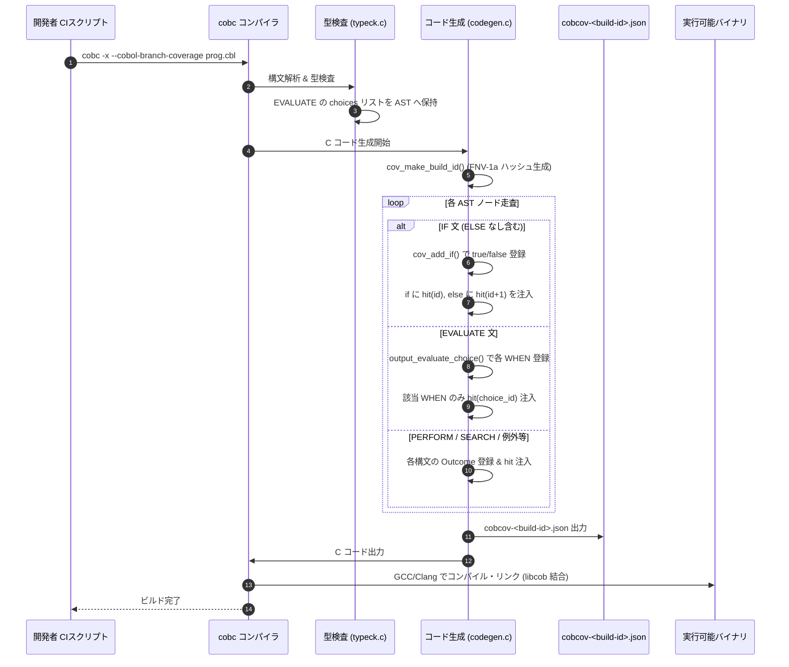
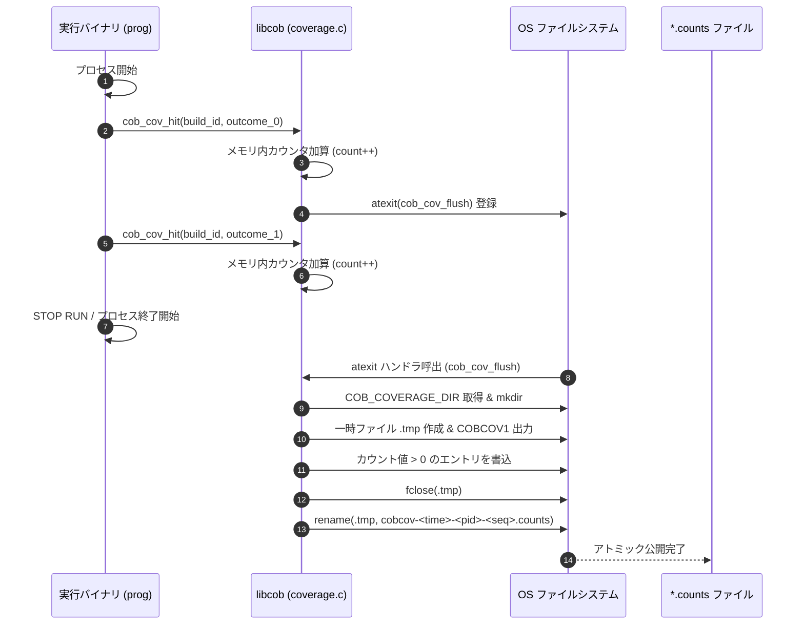
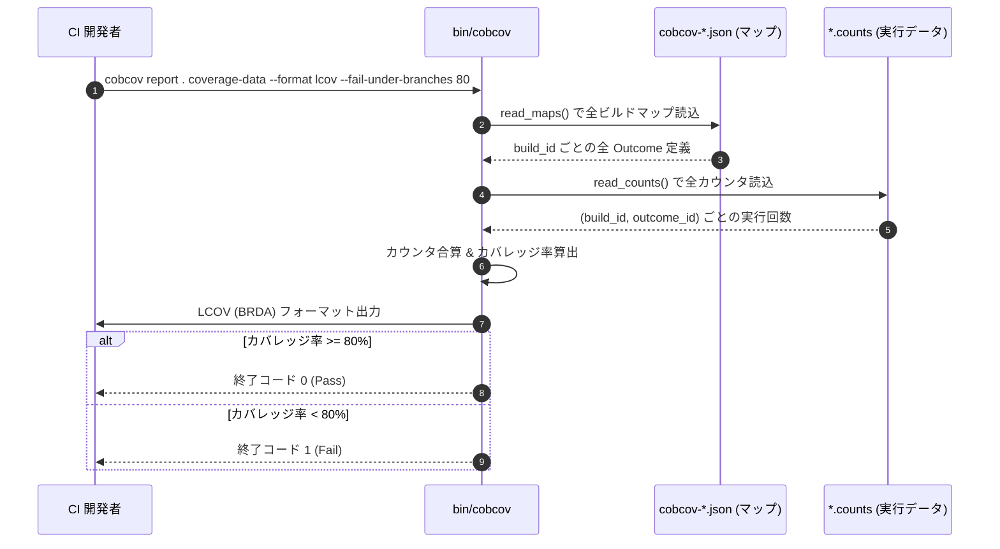

# COBOL 分岐カバレッジ機能 実装詳細解説: コンパイル・実行・集計シーケンス

本ドキュメントでは、本リポジトリにおける **COBOL 分岐カバレッジ機能（`--cobol-branch-coverage` および `bin/cobcov`）** について、コンパイル時のソースAST計装・静的マップ生成、実行時のインメモリ計測・アトミックフラッシュ、および集計ツールの内部シーケンスを含めて詳細に解説します。

---

## 1. COBOL分岐カバレッジのアーキテクチャ概要

### 1.1 目的と従来の C カバレッジ（gcov）との根本的差異
GnuCOBOL は COBOL ソースコードを C 言語へトランスパイルしてビルドします。従来提供されていた `--coverage` オプションは、生成された C 言語コードに対して GCC の `gcov` カバレッジを適用するものでした。
しかし、この方法には以下の重大な課題がありました:

1. **生成 C コードの分岐数の爆発**:
   COBOL の単一の文（例: `EVALUATE`, `PERFORM UNTIL`, `SEARCH`, ファイルI/O）は、C 言語上では多数の `if`、`switch`、ポインタ検証、内部エラーチェックに展開されます。C レベルの分岐を計測しても、COBOL ソース上の「ビジネスロジックの網羅率」を測定できません。
2. **暗黙の分岐（`ELSE` のない `IF` 等）の不可視性**:
   COBOL で `IF X = 1 DISPLAY 'OK' END-IF.` と書かれた場合、偽（false）ルートの記述がなくても、テストとしては「真」と「偽」の双方が評価されたかを測定する必要があります。

本リポジトリで新規実装された **`--cobol-branch-coverage`** は、**「COBOL ソースコードの論理的分岐結果（Outcome）」を直接計測する**ための独立したサブシステムです。

### 1.2 全体アーキテクチャ構成図

```
+--------------------------------------------------------------------------+
|                        COBOL ソースコード (.cbl)                          |
|  - IF X = 0 DISPLAY 'TRUE' END-IF. (ELSE なし)                            |
|  - EVALUATE ... WHEN ... WHEN OTHER                                      |
|  - PERFORM ... UNTIL ... / PERFORM ... TIMES                             |
|  - SEARCH / GO TO DEPENDING / ON SIZE ERROR / ファイル例外                |
+--------------------------------------------------------------------------+
                                     |
                                     v  [cobc --cobol-branch-coverage]
+--------------------------------------------------------------------------+
| 1. コンパイル層: cobc (typeck.c, codegen.c)                              |
|   - FNV-1a 64bit ハッシュによる決定論的 build_id 算出                    |
|   - COBOL AST の走査 & 分岐判断 (Decision) と結果 (Outcome) の同定        |
|   - 静的カバレッジマップ出力: cobcov-<build-id>.json                     |
|   - 生成 C コードに cob_cov_hit("<build_id>", outcome_id) を計装注入     |
|     (※ ELSE のない IF にも暗黙の else { cob_cov_hit(...); } を合成生成)   |
+--------------------------------------------------------------------------+
          |                                              |
          v                                              v
+-----------------------------+        +-----------------------------------+
| 静的マップファイル           |        | 計装済み実行バイナリ              |
| cobcov-<build-id>.json      |        | (GCC/Clang + libcob)              |
|  - 各 Outcome の位置        |        +-----------------------------------+
|    (file, line, col, kind)  |                          |
|  - 期待結果 (true/false 等) |                          v  [実行: ./app]
+-----------------------------+        +-----------------------------------+
          |                            | 2. 実行時ランタイム: libcob       |
          |                            |    (coverage.c)                   |
          |                            |   - cob_cov_hit で 64bit 加算     |
          |                            |   - atexit(cob_cov_flush) 自動登録|
          |                            |   - 一時ファイル経由のアトミック  |
          |                            |     ファイル出力                  |
          |                            +-----------------------------------+
          |                                              |
          |                                              v
          |                            +-----------------------------------+
          |                            | カウンタファイル (複数実行蓄積)   |
          |                            | cobcov-<time>-<pid>-<seq>.counts  |
          |                            | (COB_COVERAGE_DIR 配下)           |
          |                            +-----------------------------------+
          |                                              |
          +----------------------+-----------------------+
                                 |
                                 v
+--------------------------------------------------------------------------+
| 3. 集計・レポーティング層: bin/cobcov (Python 3)                          |
|   - マップと各カウンタファイルの build_id 整合性検証                     |
|   - 複数プロセス・複数回実行のカウンタ合算                               |
|   - カバレッジ率算出 (通過数 > 0 の Outcome / 全 Outcome)                |
|   - 出力形式: テキスト / JSON / LCOV (BRDA)                              |
|   - CI ゲート判定: --fail-under-branches による閾値検査                  |
+--------------------------------------------------------------------------+
```

---

## 2. コンパイルフェーズの実装詳細

コンパイラフロントエンドの実装は `cobc/typeck.c` および `cobc/codegen.c` にあります。

### 2.1 決定論的ビルド ID の算出 (`cov_make_build_id`)

コンパイルごとに、ソースコードとビルド条件から 16 進 16 文字の FNV-1a 64bit ハッシュ値 `build_id` を生成します。

```c
/* cobc/codegen.c より抜粋 */
static void cov_make_build_id (const char *source)
{
    unsigned long long hash = 14695981039346656037ULL;
    // 1. GnuCOBOL バージョン文字列をハッシュ
    // 2. コンパイラ引数 (argv) をすべてハッシュ
    // 3. 前処理済み COBOL ソースコード (source) の全バイトをハッシュ
    snprintf (cov_build_id, sizeof (cov_build_id), "%016llx", hash);
}
```
この `build_id` により、実行時カウンタと静的マップの完全な 1 対 1 対応が保証され、異なるリビジョンの実行結果が誤って混入することを防止します。

### 2.2 静的分岐マップの生成 (`cov_write_map`)

コンパイル完了時、作業ディレクトリに `cobcov-<build-id>.json` が出力されます。

```json
{
  "version": 1,
  "build_id": "a1b2c3d4e5f60718",
  "scope": "if,evaluate,perform,search,goto-depending,size-error,overflow,call-exception,file-handler,display-exception,accept-exception,xml-exception,json-exception",
  "outcomes": [
    {
      "id": 0,
      "file": "sample.cbl",
      "program": "SAMPLE",
      "line": 16,
      "column": 13,
      "decision": 0,
      "kind": "IF",
      "result": "true"
    },
    {
      "id": 1,
      "file": "sample.cbl",
      "program": "SAMPLE",
      "line": 16,
      "column": 13,
      "decision": 0,
      "kind": "IF",
      "result": "false"
    }
  ]
}
```

### 2.3 COBOL構文別の計装コード注入メカニズム

#### (1) `IF` 文 (`output_if` in `codegen.c`)
- 真の結果（`cov_id`）と偽の結果（`cov_id + 1`）を割り当てます。
- **暗黙の偽ブロックの自動合成**:
  ソースコード上に `ELSE` が書かれていない場合でも、コンパイラは自動的に `else` ブロックを生成し、偽ルートの通過を計測します。

```c
// 生成される C コードのイメージ
if (/* 条件式 */) {
    cob_cov_hit ("a1b2c3d4e5f60718", 0); /* true */
    /* THEN 本文 */
} else {
    cob_cov_hit ("a1b2c3d4e5f60718", 1); /* false (ELSE がなくても生成) */
}
```

#### (2) `EVALUATE` 文 (`typeck.c` & `output_evaluate_choice` in `codegen.c`)
- `typeck.c` の型検査段階で、複数の `WHEN` や `ALSO`、`THRU` が論理和に畳み込まれる前に、元の選択肢リスト `cov_choices` を AST（`struct cb_if`）に保持します。
- `output_evaluate_choice` は以下の構造を持つ C コードを出力します:

```c
// 生成される C コードのイメージ
{
    int cob_cov_choice_0 = -1;
    if (/* WHEN 1 の条件 */) {
        cob_cov_choice_0 = 2; // WHEN 1 の Outcome ID
    } else if (/* WHEN 2 の条件 */) {
        cob_cov_choice_0 = 3; // WHEN 2 の Outcome ID
    } else if (/* WHEN OTHER または暗黙の不一致 */) {
        cob_cov_choice_0 = 4; // unmatched の Outcome ID
    }
    
    if (cob_cov_choice_0 >= 0) {
        cob_cov_hit ("a1b2c3d4e5f60718", cob_cov_choice_0);
        /* 文群の実行 */
    }
}
```
これにより、文群を共有する複数の `WHEN` であっても、**「最初に条件を満たした1つの WHEN のみ」** を正確にカウントします。

#### (3) その他の対象構文
- **`PERFORM ... UNTIL` / `VARYING`**: `continue`（ループ継続）と `exit`（ループ終了）。
- **`PERFORM ... TIMES`**: `0 times`（1度も実行せず通過）と `1+ times`（1回以上実行）。
- **`SEARCH` / `SEARCH ALL`**: 各 `WHEN` の合致、および `AT END`（または未検出 `unmatched`）。
- **`GO TO ... DEPENDING ON`**: 各転送先ラベル分岐、および `out of range`（範囲外での次文通過）。
- **例外・エラーハンドラ**:
  - `ON SIZE ERROR` / `ON OVERFLOW`: `normal` / `handler`
  - `CALL ... ON EXCEPTION`: `normal` / `handler`
  - ファイル操作 (`READ`, `WRITE` 等): `AT END`, `INVALID KEY`, `AT EOP`
  - `DISPLAY`, `ACCEPT`, `XML GENERATE/PARSE`, `JSON GENERATE/PARSE` の `ON EXCEPTION`

---

## 3. 実行フェーズの実装詳細

実行時ランタイムは `libcob/coverage.c` に軽量かつ高信頼に実装されています。

### 3.1 インメモリ計装 (`cob_cov_hit`)

```c
struct cob_cov_counter {
    struct cob_cov_counter *next;
    char build_id[17];
    unsigned int outcome_id;
    unsigned long long count;
};
```
- 各計装ポイントから呼び出され、該当する `(build_id, outcome_id)` のカウンタを探索（なければ線形アロケート）してインクリメントします。
- カウンタは `unsigned long long`（64bit）で保持され、オーバーフローを防止（`~0ULL` で飽和）。
- 初回呼び出し時に `atexit(cob_cov_flush)` を自動登録し、通常終了時に確実にディスク書き出しが行われるようにします。

### 3.2 アトミックフラッシュ機構 (`cob_cov_flush`)

並列テスト実行や突然のプロセス終了によるデータ破損を防ぐため、以下の手順でアトミックに書き出します:

1. **出力ディレクトリの解決**:
   環境変数 `COB_COVERAGE_DIR`（未指定時は `./cobol-coverage`）を取得し、ディレクトリがなければ自動作成（`mkdir` / `_mkdir`）。
2. **ユニークファイル名の生成**:
   同一ディレクトリへ複数プロセス・スレッドが書き込んでも衝突しないよう、以下の形式を採用:
   `cobcov-<UNIX時間>-<PID>-<連番>.counts`
3. **アトミックリネーム**:
   - まず一時ファイル `cobcov-...counts.tmp` に書き込み。
   - 先頭行にマジックヘッダ `COBCOV1\n` を出力。
   - カウントが 1 以上のエントリのみをタブ区切りで出力:
     `<build_id>\t<outcome_id>\t<count>\n`
   - `fclose` 完了後、OS のアトミック操作 `rename(temporary, path)` により一瞬で公開。
   - これにより、集計ツール側が書き込み途中の不完全なファイルを読み取ってしまうレースコンディションを完全に排除します。

---

## 4. 集計・レポーティングフェーズの実装詳細

集計ツールは Python 3 標準ライブラリのみで動作するスクリプト `bin/cobcov` です。

### 4.1 集計ロジック (`read_maps` と `read_counts`)

1. **マップの走査**:
   指定されたディレクトリまたはファイルからすべての `cobcov-*.json` を読み込み、`build_id` をキーにしてインデックス化。
2. **カウンタの走査・合算**:
   指定されたディレクトリ配下のすべての `*.counts` ファイルを読み込み、同じ `(build_id, outcome_id)` のカウント値を加算。
   - マップに存在しない `build_id` や未知の `outcome_id` が含まれている場合はエラーを発生させ、古い成果物との不整合を検知。
3. **カバレッジ率の算出**:
   $$\text{カバレッジ率} = \frac{\text{通過回数 } > 0 \text{ である Outcome 数}}{\text{マップ内の全 Outcome 総数}} \times 100\%$$
   ※単に実行回数を足し合わせるのではなく、「少なくとも1回以上通過したか」を評価します。

### 4.2 出力フォーマット

#### (1) テキスト形式（デフォルト / 人間向け）
```text
COBOL IF, EVALUATE branches: 5/6 (83.3%), 2 counter file(s)
sample.cbl:16:13 SAMPLE IF #0 true: 1
sample.cbl:16:13 SAMPLE IF #0 false: 0
sample.cbl:17:13 SAMPLE IF #1 true: 0
sample.cbl:17:13 SAMPLE IF #1 false: 2
sample.cbl:30:13 SAMPLE EVALUATE #2 WHEN 1: 1
sample.cbl:32:13 SAMPLE EVALUATE #2 WHEN OTHER: 1
```

#### (2) JSON 形式 (`--format json` / 機械可読)
CI やテスト管理ダッシュボードへの取り込み用として、`total`, `covered`, `percent`, および各 Outcome の全プロパティを出力。

#### (3) LCOV 形式 (`--format lcov` / カバレッジ可視化連携)
既存の LCOV / genhtml / SonarQube / Codecov と連携可能な標準フォーマットを出力:
- `SF:<COBOLファイルパス>`
- `BRDA:<行番号>,<ブロック番号>,<ブランチ番号>,<実行回数>`
- `BRF:<総ブランチ数>` / `BRH:<通過ブランチ数>`

#### (4) CI ゲート閾値判定 (`--fail-under-branches <N>`)
カバレッジ率が指定された閾値（例: 80.0%）未満の場合、終了コード `1` を返却して CI ジョブを失敗させます。

---

## 5. 詳細シーケンス図

### 5.1 コンパイル・マップ生成シーケンス



### 5.2 実行時カウンタ収集・アトミックフラッシュシーケンス



### 5.3 集計・レポーティングシーケンス



---

## 6. まとめと技術的特徴

1. **COBOL セマンティクスに完全準拠した分母**:
   生成 C の低水準な分岐数ではなく、COBOL ソースコードに記述された論理的分岐（`IF`、`EVALUATE`、`PERFORM`、`SEARCH`、例外ハンドラ等）のみを分母として抽出します。
2. **決定論的ビルド ID による不整合防止**:
   ソースとビルド環境から算出される `build_id` により、古いビルドや別モジュールの実行データが混入することを防ぎます。
3. **ゼロオーバーヘッドに近い実行時設計**:
   メモリ上の単純な 64bit 加算のみで動作し、ファイル書き込みはプロセス終了時の `atexit` 1回のみ。アトミックな一時ファイルリネームにより並列実行時も安全です。
4. **標準フォーマット（LCOV / JSON）と CI 連携**:
   LCOV 形式の `BRDA` 出力により、SonarQube や VS Code、Codecov などのモダンな開発環境へそのままカバレッジ結果を可視化できます。
