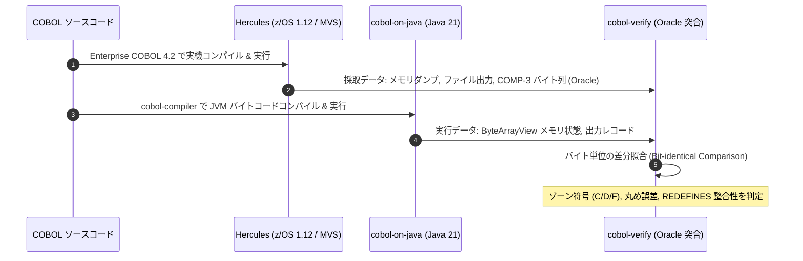

# cobol-on-java における COBOL カバレッジ・単体テスト検証アーキテクチャ詳細解説

本ドキュメントでは、**cobol-on-java（Java 21 / JVM バイトコード直接生成方式）** における **COBOL カバレッジ計測・単体テスト検証サブシステム（`cobol-junit` / `cobol-verify`）** について、JVM バイトコード（ASM）へのデバッグ情報埋め込みと JaCoCo 連携、JUnit 5 統合とプログラム／SECTION 単位の Mock・Spy 機構、および実機（z/OS 実機 / Hercules）Oracle による三層テスト検証基盤のアーキテクチャを詳細に解説します。

---

## 1. カバレッジ・検証基盤のアーキテクチャ概要

### 1.1 目的と JVM バイトコード生成方式の優位性
`cobol-on-java` は、COBOL、PL/I、および HLASM のソースコードを Java 言語や C 言語にトランスパイルすることなく、Java 21 上のバイトコード操作ライブラリ（ASM）を用いて **直接 JVM バイトコード（`.class` ファイル）へコンパイル** します。

このアプローチにより、カバレッジ計測およびテスト自動化において以下の強力な利点が得られます:

1. **エコシステム標準カバレッジツール（JaCoCo 等）との完全透過連携**:
   - コンパイラ（`cobol-compiler`）が生成するクラスファイルに、COBOL ソースの行番号（`LineNumberTable`）および変数情報（`LocalVariableTable`）を埋め込むことで、Java エコシステムの業界標準ツール（JaCoCo、SonarQube、IntelliJ IDEA カバレッジ、Maven JaCoCo Plugin）が **COBOL ソース行および分岐カバレッジをそのまま計測** できます。
2. **JUnit 5 によるファーストクラス単体テスト（`cobol-junit`）**:
   - Java 開発者が使い慣れた JUnit 5（Jupiter）のテストケース内から COBOL プログラムを直接起動。外部サブルーチン（`CALL`）の Stub/Mock/Spy や、特定 `SECTION` の直接起動・局所 Mock が可能です。
3. **Hercules / z/OS 実機オラクルによる三層検証基盤（`cobol-verify`）**:
   - 「メインフレームと同一動作を証明する」ため、同一の COBOL ソースを IBM 実機または Hercules エミュレータ上で実行してバイト単位の期待値（Oracle）を採取し、JVM 上の実行結果と全自動で突き合わせる品質保証パイプラインを確立しています。

### 1.2 全体アーキテクチャ構成図

```text
+--------------------------------------------------------------------------+
|                  COBOL ソースコード (.cbl / .cob)                         |
|  - IF CUST-BAL < 0 ... ELSE ... END-IF                                   |
|  - PERFORM 2000-PROCESS-RECORD-SEC                                       |
|  - CALL 'SUBPROG' USING BY REFERENCE LINK-DATA                           |
+--------------------------------------------------------------------------+
                                     │
                                     ▼  [cobol-compiler (ASM)]
+--------------------------------------------------------------------------+
| 1. コンパイル層: ASM バイトコード & デバッグ情報生成                      |
|   - COBOL AST の走査 & 手続きハッシュ (SHA-256 procedureHash) 算出         |
|   - JVM 命令列生成 (MethodVisitor)                                       |
|   - LineNumberTable: COBOL ソースの元行番号をバイトコードラベルにマッピング  |
|   - LocalVariableTable: WORKING-STORAGE / LINKAGE 項目の可視化            |
|   - 単体テスト用シーム注入 (SECTION 境界マニフェスト / CALL 委託インターフェース)|
+--------------------------------------------------------------------------+
                                     │
                                     ▼  [.class 生成]
+--------------------------------------------------------------------------+
| 2. 実行・単体テスト層: cobol-junit (JUnit 5 統合)                          |
|   - CobolExtension / CobolTestContext によるテストセッション分離         |
|   - CobolProgramFixture:                                                 |
|     * call / runMain (プログラム全起動)                                   |
|     * invokeSection (適格な通常 SECTION の直接単独実行)                   |
|     * stubProgram / expectProgram (外部サブルーチンの引数スナップショット検証)|
|     * mockSection / spySection (明示的 PERFORM SECTION の差し替え)        |
+--------------------------------------------------------------------------+
                                     │
                                     ▼  [Java Agent 経由の計測]
+------------------------------------+-------------------------------------+
| 3. カバレッジ計測層: JaCoCo Agent    | 4. 三層検証層: cobol-verify          |
|   - バイトコード実行追跡           |   - 層 1: CCVS85 適合性テスト       |
|   - 行カバレッジ (Instruction/Line)|   - 層 2: Hercules / z/OS Oracle 突合|
|   - 分岐カバレッジ (Branch: IF/EVAL)|   - 層 3: 端数処理・EBCDIC メモリ整合 |
|   - HTML / XML / Sonar レポート出力|   - 回帰テスト自動差分検知 (L3 保証)|
+------------------------------------+-------------------------------------+
```

---

## 2. ASM によるデバッグ情報の埋め込みと JaCoCo 連携

### 2.1 `LineNumberTable` と `SourceFile` 属性の生成
`cobol-compiler` のバイトコード生成器は、COBOL の文（Statement）をコンパイルする際、対応する COBOL ソースの行番号を Java クラスファイルの属性として出力します:

```java
// MethodVisitor に対する行番号の記録例
Label lineLabel = new Label();
mv.visitLabel(lineLabel);
mv.visitLineNumber(statement.getSourceLine(), lineLabel);
// 続く COBOL 文のバイトコード命令列を出力
mv.visitVarInsn(ALOAD, 1);
...
```

これにより、JaCoCo などの Java カバレッジエージェントは、生成されたクラスが Java ソースからではなく COBOL ソースから作られたものであるにもかかわらず、**「どの行が何回通過したか」「`IF` や `EVALUATE` の条件分岐の双方が網羅されたか」** を 1 行単位・1 分岐単位で正確に追跡します。

### 2.2 レポーティングと CI/CD パイプライン統合
Java 標準のビルドツール（Maven / Gradle）のプラグインをそのまま利用可能です:

```xml
<!-- pom.xml での JaCoCo 設定 -->
<plugin>
    <groupId>org.jacoco</groupId>
    <artifactId>jacoco-maven-plugin</artifactId>
    <version>0.8.12</version>
    <executions>
        <execution>
            <goals>
                <goal>prepare-agent</goal>
                <goal>report</goal>
            </goals>
        </execution>
    </executions>
</plugin>
```

ビルド実行（`mvn test`）を行うだけで、`target/site/jacoco/index.html` に COBOL ソースの美しいカバレッジレポート（緑: カバー、赤: 未カバー、黄: 部分分岐カバー）が自動生成されます。

---

## 3. `cobol-junit` によるテスト駆動開発とモック機能

`cobol-junit`（`docs/design/76-junit-testing.md`）は、COBOL のプログラムおよびロジックの最小単位に対する詳細な単体テストを実現します。

### 3.1 テスト境界の 3 段階

| 段階 | 起動 API | 主なテスト対象 | 差し替え可能な依存 |
| :--- | :--- | :--- | :--- |
| **プログラム** | `CobolSession.call` / `runMain` | 公開された COBOL 入出力契約 | 外部 `CALL`、明示的 `PERFORM SECTION` |
| **SECTION** | `fixture.invokeSection` | 計算・編集等の局所ロジック | 外部 `CALL`、下位 SECTION の明示的 `PERFORM` |
| **シナリオ** | 同一セッションでの複数実行 | 状態保持、`CANCEL`、ファイル、ジョブ境界 | 外部データベース、メッセージキュー等 |

### 3.2 外部サブルーチンのモック (`stubProgram` / `expectProgram`)
メインフレームの COBOL では、外部プログラムを `CALL 'SUBPROG' USING ...` で呼び出します。テスト実行時、実物の `SUBPROG` を起動する代わりに Java 側でスタブやモックを登録できます:

```java
@Test
void testCustomerUpdateWithMockSubroutine(CobolProgramFixture fixture) {
    // 外部サブルーチン 'CRDVAL' (クレジットカード有効性検証) をモック
    fixture.expectProgram("CRDVAL")
        .times(1)
        .withArgs(args -> {
            // 入力時の引数バイト列を検証
            assertThat(args.get(0).readString(16)).isEqualTo("4000123456789010");
        })
        .willAnswer(args -> {
            // 出力引数 (復帰フラグ) を書き換えて返却
            args.get(1).writeString("00"); // 正常終了
            return 0; // RETURN-CODE
        });

    // 主プログラムを実行
    CobolTestResult result = fixture.call("CBACT01C", accountDataView);
    assertThat(result.returnCode()).isEqualTo(0);
}
```

### 3.3 SECTION の直接実行と局所モック (`mockSection` / `spySection`)
巨大なモノリシック COBOL プログラム（数万行）において、全体を起動することなく特定の計算 SECTION（例: 利息計算 `2000-CALC-INTEREST-SEC`）のみを単独実行してピンポイントで分岐をテストできます:

- `fixture.invokeSection("2000-CALC-INTEREST-SEC")`:
  作業場所（`WORKING-STORAGE`）および `LINKAGE` を設定した上で、該当 SECTION の先頭から末尾までを実行。
- `fixture.mockSection("9000-LOG-AUDIT-SEC")`:
  本流の計算をテストする際、途中で呼び出される監査ログ出力 SECTION などを空実装やアサーションに差し替え。

---

## 4. 三層検証基盤（`cobol-verify`）とオラクル突合

`cobol-on-java` では、単にテストが通るだけでなく、**「z/OS 実機とバイト単位で同じ動作をすること」** を検証するため、三層の検証基盤を構築しています:



1. **第 1 層: CCVS85 適合性テスト**:
   ANSI/NIST CCVS85 スイートの全プログラムを流し、COBOL 85 基本仕様への適合性を確認。
2. **第 2 層: Hercules / 実機 z/OS オラクル検証**:
   - AWS CardDemo、CICS GenApp、Bank of Z の実コードを実行。
   - `COMP-3`（パック10進数）の符号ニブル（正: `0xC`、負: `0xD`、無符号: `0xF`）の扱いが実機コンパイラオプション（`NUMPROC(NOPFD)` / `TRUNC(STD)` 等）と完全一致することをバイトレベルで保証。
3. **第 3 層: 端数処理・オーバーフロー検証**:
   - `ON SIZE ERROR`、除算の丸め（`ROUNDED`）、中間結果の精度桁数（31桁拡張）が実機と一致することを検証。

---

## 5. 他処理系との比較

| 比較項目 | cobol-on-java (`cobol-junit` / ASM) | Zeus (`zcov`) | GnuCOBOL (`cobcov`) |
| :--- | :--- | :--- | :--- |
| **カバレッジ計測** | **JaCoCo 等の標準 Java ツールと完全連携** | インタプリタ内蔵カウンタ (`zcov`) | C トランスパイル時のソース計装 |
| **単体テスト** | **JUnit 5 ファーストクラス統合** | CLI 経由のジョブ・プログラム実行 | シェルスクリプト / Autotest |
| **Mock / Spy** | **外部 CALL / SECTION 単位の Mock 可能** | 未対応（環境全体を実行） | 未対応 |
| **部分実行** | **特定 SECTION の単独直接起動が可能** | プログラム単位でのみ起動 | プログラム単位でのみ起動 |
| **オラクル検証** | **Hercules / z/OS 実機とのバイト突合基盤** | Hercules 差分ツール (`zeus-hercdiff`)| 出力テキスト比較 |
| **CI/CD 親和性** | **Maven / Gradle / SonarQube / GitHub Actions** | 専用 CLI ツール | GCC / Python スクリプト |
