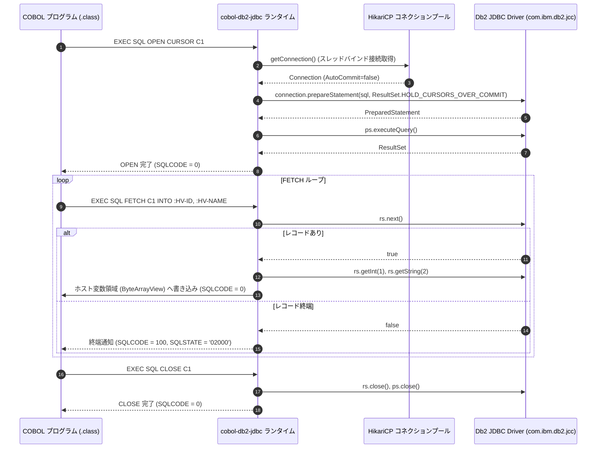

# cobol-on-java における Db2 統合アーキテクチャと Spring Framework トランザクション連携詳細解説

本ドキュメントでは、**cobol-on-java（Java 21 / JVM バイトコード直接生成方式）** における **IBM Db2 統合サブシステム（`cobol-db2` / `cobol-db2-jdbc`）** について、SQL プリコンパイルと JDBC コード生成、Spring Boot 4.1 / Spring Framework 7.0 のトランザクション管理連携、EBCDIC 生バイトと JDBC SQL 型の双方向変換、および `WITH HOLD` カーソルとドライバ管理 UOW（作業単位）の内部アーキテクチャを詳細に解説します。

---

## 1. Db2 統合のアーキテクチャ概要

### 1.1 目的とエンタープライズ Java 統合の思想
メインフレーム（z/OS）上の基幹業務システム（AWS CardDemo, CICS GenApp, Bank of Z 等）における Db2 データベースアクセス（`EXEC SQL ... END-EXEC`）を、オープンな JVM 環境上で**原本無修正**のまま稼働させます。

`cobol-on-java` の最大の特徴は、**「エンタープライズ Java（Spring Boot 4.x / Spring Data / JDBC）の確立された資産・運用基盤と完全に調和する」** 点にあります。独自の DB クライアントやネイティブライブラリを抱えるのではなく、Java 業界の標準である JDBC（Java Database Connectivity）および Spring のトランザクション境界管理（`PlatformTransactionManager`）に統合されています。

### 1.2 全体アーキテクチャ構成図

```text
+--------------------------------------------------------------------------+
|                  COBOL ソースコード (.cbl / .cob)                         |
|  EXEC SQL                                                                |
|      SELECT CUST_NAME, CUST_BAL INTO :HV-NAME, :HV-BAL                   |
|      FROM CUSTOMER WHERE CUST_ID = :HV-ID                                |
|  END-EXEC                                                                |
+--------------------------------------------------------------------------+
                                     │
                                     ▼  [cobol-compiler / cobol-db2]
+--------------------------------------------------------------------------+
| 1. コンパイル層: SQL 解析 & バイトコード直接生成                         |
|   - EXEC SQL 構文解析 & パラメータ置換 (? プレースホルダー化)             |
|   - SQLCA (SQLCODE, SQLSTATE) 自動メモリ配置                             |
|   - 型安全な JDBC 呼び出し命令列への JVM バイトコード展開                 |
|     (PreparedStatement, ResultSet, ParameterSetter, ColumnGetter)       |
+--------------------------------------------------------------------------+
                                     │
                                     ▼  [実行時: cobol-db2-jdbc]
+------------------------------------+-------------------------------------+
| 2. トランザクション・UOW 制御層 (docs/design/77, ADR-0012)                 |
|   - プロファイル A: SPRING_MANAGED (標準)                                 |
|     * Spring PlatformTransactionManager / @Transactional 連携            |
|     * DataSourceUtils.getConnection によるスレッドバインド接続           |
|     * CICS EXEC CICS SYNCPOINT ⇄ Spring TransactionStatus コミット       |
|   - プロファイル B: DRIVER_MANAGED (WITH HOLD カーソル必須タスク専用)     |
|     * Db2 JDBC Driver の物理 Connection をタスク全体で直接保持           |
|     * 複数 commit 間にまたがる ResultSet / カーソル開放を防止             |
+------------------------------------+-------------------------------------+
                                     │
                                     ▼  [データ変換: ByteArrayView]
+--------------------------------------------------------------------------+
| 3. 型変換層: EBCDIC 生バイト ⇄ JDBC SQL 型マッピング                      |
|   - 文字列 (CHAR/VARCHAR): EBCDIC 037 ⇄ Java String / UTF-8              |
|   - 10進数 (COMP-3 / PACKED-DECIMAL): EBCDIC ニブル ⇄ java.math.BigDecimal|
|   - 整数 (COMP / COMP-5): ビッグエンディアンバイト列 ⇄ short / int / long |
|   - NULL 指示子 (INDICATOR): 短精度整数 ⇄ PreparedStatement.setNull      |
+--------------------------------------------------------------------------+
                                     │
                                     ▼  [標準 JDBC 通信]
+--------------------------------------------------------------------------+
| 4. 接続プール & JDBC ドライバ (HikariCP / IBM Db2 JDBC Driver)            |
|   - コネクションプール管理 (com.zaxxer.hikari.HikariDataSource)          |
|   - IBM Data Server Driver for JDBC (com.ibm.db2.jcc.DB2Driver)          |
|   - または PostgreSQL JDBC ドライバ (org.postgresql.Driver)              |
+--------------------------------------------------------------------------+
                                     │ TCP/IP 通信
                                     ▼
+--------------------------------------------------------------------------+
| 5. データベースサーバー (IBM Db2 Community Edition / z/OS Db2)            |
+--------------------------------------------------------------------------+
```

---

## 2. トランザクション管理プロファイル（`SPRING_MANAGED` vs `DRIVER_MANAGED`）

`cobol-on-java` は、メインフレーム特有の SQL 制御要件（`WITH HOLD` カーソル）と Spring の標準トランザクションモデルのギャップを解決するため、2 つの実行プロファイルを提供します（`ADR-0012`）。

### 2.1 標準プロファイル: `SPRING_MANAGED`
大部分のトランザクションおよびバッチステップで利用される標準モードです。
- **Spring 統合**:
  `PlatformTransactionManager`（`DataSourceTransactionManager`）がトランザクション境界を管理。
- **接続共有**:
  Java のサービスクラスやリポジトリ（Spring Data JPA, MyBatis 等）と、翻訳された COBOL プログラムが、同一スレッド・同一コネクション・同一トランザクションをシームレスに共有。
- **同期点連携**:
  `EXEC CICS SYNCPOINT` は `TransactionManager.commit()` を呼び出し、`EXEC CICS SYNCPOINT ROLLBACK` は `rollback()` をトリガーします。

### 2.2 特殊プロファイル: `DRIVER_MANAGED`（`WITH HOLD` カーソル対応）
メインフレームの COBOL では、大量更新バッチなどで以下のパターンが頻出します:

```cobol
EXEC SQL DECLARE C1 CURSOR WITH HOLD FOR
    SELECT CUST_ID, BAL FROM CUSTOMER FOR UPDATE
END-EXEC.
EXEC SQL OPEN C1 END-EXEC.
PERFORM UNTIL ...
    EXEC SQL FETCH C1 INTO :HV-ID, :HV-BAL END-EXEC
    -- 更新処理
    EXEC SQL UPDATE CUSTOMER SET BAL = ... WHERE CURRENT OF C1 END-EXEC
    -- 一定件数ごとに中間コミット (カーソルは維持)
    EXEC SQL COMMIT END-EXEC
END-PERFORM.
EXEC SQL CLOSE C1 END-EXEC.
```

**課題**:
一般的な Spring の `DataSourceTransactionManager` では、`commit()` を発行するとコネクションがプールに返却（クローズ）され、オープン中のカーソルや `ResultSet` が破棄されます。

**解決策 (`ADR-0012`)**:
`DRIVER_MANAGED` プロファイルでは、Spring のトランザクション同期から意図的に切り離し、Db2 公式 JDBC ドライバ（IBM JCC）の物理コネクションを直接タスクスコープで保持します。ドライバ本来の `Connection.commit()` を呼び出すことで、`WITH HOLD` でオープンされた `ResultSet` を破棄することなく中間コミットを成立させます。

---

## 3. ホスト変数と EBCDIC / SQL 型変換エンジン

COBOL プログラムの作業場所（`WORKING-STORAGE`）や `LINKAGE` に配置された生バイト列と、JDBC の Java 型との変換は、`ByteArrayView` を通じて厳密に行われます。

### 3.1 主要な型マッピング仕様

| COBOL データ項目定義 | 内部メモリ表現 | JDBC メソッド | 変換仕様 |
| :--- | :--- | :--- | :--- |
| **`PIC X(n)`** | EBCDIC 037 固定長バイト列 | `setString` / `getString` | 指定 CCSID（IBM-037）による双方向文字変換。末尾空白パディング。 |
| **49 レベル VARCHAR**<br>`49 LEN PIC S9(4) COMP.`<br>`49 TEXT PIC X(n).` | 2バイト長接頭部 + EBCDIC 文字列 | `setString` / `getString` | 先頭 2 バイトの長さを読み取り、有効長のみを変換。 |
| **`PIC S9(p)V9(q) COMP-3`** | パック10進数（Packed Decimal） | `setBigDecimal` / `getBigDecimal` | 符号ニブル（`C`/`D`/`F`）と 10 進数を抽出し、桁数精度の完全な `BigDecimal` を構築。丸め誤差ゼロ。 |
| **`PIC S9(4) COMP`** | 2バイト 2の補数（Big-Endian） | `setShort` / `getShort` | 16bit 符号付き整数として直接変換。 |
| **`PIC S9(9) COMP`** | 4バイト 2の補数（Big-Endian） | `setInt` / `getInt` | 32bit 符号付き整数として直接変換。 |
| **`INDICATOR` 句**<br>`:HV-VAL :HV-IND` | 2バイト COMP (`-1` = NULL) | `setNull` / `wasNull` | `:HV-IND < 0` の場合、SQL NULL を送信。取得値が NULL の場合、`:HV-IND` に `-1` を代入。 |

---

## 4. 実行シーケンス: カーソル操作とエラーハンドリング



### 4.1 SQLCA とエラーマッピング
- SQL 実行直後、返却された `SQLException` のエラーコードおよび SQLSTATE は、COBOL プログラムの `SQLCA` 領域（`SQLCODE`, `SQLSTATE`, `SQLERRM`）へ即座に転送されます。
- 例:
  - 成功: `SQLCODE = 0`, `SQLSTATE = '00000'`
  - 終端（NOT FOUND）: `SQLCODE = +100`, `SQLSTATE = '02000'`
  - 重複キー違反: `SQLCODE = -803`, `SQLSTATE = '23505'`
  - デッドロック / ロックタイムアウト: `SQLCODE = -911`, `SQLSTATE = '40001'`

---

## 5. 他処理系との比較

| 比較項目 | cobol-on-java (`cobol-db2-jdbc`) | Zeus (`zeus-drda`) | GnuCOBOL (`extras/db2sql`) |
| :--- | :--- | :--- | :--- |
| **通信アーキテクチャ** | **標準 JDBC / DataSource 統合** | Pure Rust による DRDA 直接実装 | IBM CLI / ODBC 動的リンク |
| **フレームワーク統合**| **Spring Boot 4 / PlatformTransactionManager**| CICS / JCL 内部トランザクション | C 言語 / トランザクション手動管理 |
| **WITH HOLD カーソル** | `DRIVER_MANAGED` プロファイルで対応 | DRDA パケット制御で対応 | ODBC `SQL_ATTR_CURSOR_HOLD` |
| **接続プール** | **HikariCP (世界標準の高性能プール)** | 自前コネクション管理 | 外部 ODBC プールまたは単一接続 |
| **可観測性・APM** | **OpenTelemetry, Micrometer, Dynatrace 等と完全透過**| 内部ログ / メトリクス | OS プロファイラ (perf, valgrind) |
