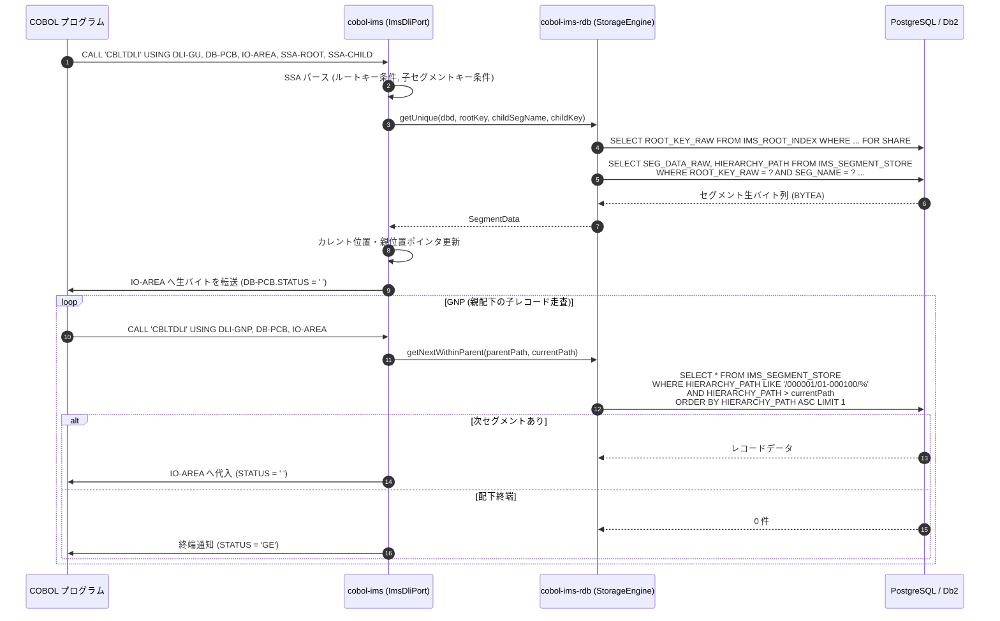

# cobol-on-java における IMS DB / TM 統合アーキテクチャと非正規化生バイト格納モデル詳細解説

本ドキュメントでは、**cobol-on-java（Java 21 / JVM バイトコード直接生成方式）** における **IMS サブシステム（`cobol-ims` / `cobol-ims-rdb` / `cobol-ims-jms`）** について、RDB を階層ストレージとして利用する「非正規化・生バイト格納モデル（Denormalized Raw Storage Engine）」、`HIERARCHY_PATH` による深さ優先走査順序の保証、ルートアンカーロックと競合リトライ、DL/I 呼び出しインターフェース（`CBLTDLI` / `AIBTDLI`）、および RabbitMQ / JMS を用いた IMS TM メッセージ連携の内部アーキテクチャを詳細に解説します。

---

## 1. IMS サブシステムのアーキテクチャ概要

### 1.1 目的と「非正規化・生バイト格納モデル」の設計判断
メインフレームにおける階層型データベース（IMS DB）をオープン環境（Java/JVM）へ移行する際、従来のマイグレーション手法では「IMS の DBD を解析し、各セグメントを RDB の正規化されたテーブル群へマッピング・分解する」アプローチが取られるのが一般的でした。

しかし、`cobol-on-java` では以下の技術的課題を解決するため、**「RDB を業務テーブルとしてではなく、トランザクション対応の階層ストレージエンジンとして利用する非正規化・生バイト格納モデル（ADR-0013）」** を採用しています:

1. **COBOL データ表現の非可逆分解の防止**:
   セグメント内には `COMP-3`（パック10進数）、2進整数、`OCCURS DEPENDING ON`（可変長配列）、同一領域の多重 `REDEFINES`、さらに DBD には定義されていない業務フィールドが含まれます。これを SQL のリレーショナル列へ分解すると、文字コード変換や端数処理でデータ破損が発生します。
2. **階層走査順序（Hierarchical Sequence）の維持**:
   DL/I の `GN`（次走査）や `GNP`（親配下走査）は、深さ優先・先行順（Pre-order Traversal）で走査されます。正規化テーブルの多数の外部キー結合や UNION でこの順序を毎度エミュレートするのは性能的・論理的に破綻します。
3. **スキーマフリーな移行**:
   DBD に新しいセグメントやフィールドが追加・変更されても、RDB 側の DDL マイグレーションが一切不要です。

### 1.2 全体アーキテクチャ構成図

```text
+--------------------------------------------------------------------------+
|                  COBOL アプリケーション (.cbl / .class)                   |
|  - CALL 'CBLTDLI' USING DLI-GU, DB-PCB, IO-AREA, SSA-1...                |
|  - CALL 'AIBTDLI' USING AIB-MASK, IO-AREA, SSA-1...                      |
+--------------------------------------------------------------------------+
                                     │
                                     ▼  [中立フレームワークポート: cobol-ims]
+--------------------------------------------------------------------------+
| 1. DL/I インターフェース層 (ImsDliPort, DbdParser, PsbParser)             |
|   - CBLTDLI / AIBTDLI 呼び出しのディスパッチ                             |
|   - PCB / AIB マスクの状態コード (STATUS, DIBSTAT) 設定                   |
|   - カレント位置ポインタ (Current Position, Parent Position) の維持     |
|   - SSA (Segment Search Argument) 構文解析 & コマンドコード処理           |
+--------------------------------------------------------------------------+
                                     │
                                     ▼  [階層ストレージ操作: cobol-ims-rdb]
+--------------------------------------------------------------------------+
| 2. 非正規化ストレージエンジン層 (ADR-0013, ADR-0015)                      |
|   - HIERARCHY_PATH 採番 & 階層走査 (Pre-order Traversal) 順序保証        |
|   - ルートアンカーロック (IMS_ROOT_INDEX 行ロック) & デッドロック回避     |
|   - 楽観的並行制御 & 競合リトライ機構                                    |
|   - ブロックプリフェッチ (大量 GN 走査のクエリ往復削減)                  |
+--------------------------------------------------------------------------+
                                     │
                                     ▼  [JDBC / DataSource]
+------------------------------------+-------------------------------------+
| 3. バックエンド RDB (PostgreSQL / IBM Db2 / MySQL)                        |
|   - IMS_SEGMENT_STORE: セグメント生データを BLOB / BYTEA で保持          |
|   - IMS_ROOT_INDEX: ルートキー索引 & 排他制御アンカー                    |
+------------------------------------+-------------------------------------+
                                     │
                                     ▼  [メッセージ連携: cobol-ims-jms]
+--------------------------------------------------------------------------+
| 4. IMS TM メッセージング層 (ADR-0014)                                     |
|   - RabbitMQ / JMS ニュートラルキューによるメッセージ処理                |
|   - I/O PCB 経由のトランザクション送受信 (GU / ISRT / PURG)              |
+--------------------------------------------------------------------------+
```

---

## 2. 汎用 RDB スキーマ設計と `HIERARCHY_PATH`

### 2.1 テーブル定義
バックエンド RDB（PostgreSQL または Db2）上に、全 DBD で共有される以下の 2 つの共通テーブルを作成します:

```sql
-- 1. ルートキー索引および排他アンカーテーブル
CREATE TABLE IMS_ROOT_INDEX (
    DBD_NAME       VARCHAR(8)   NOT NULL,
    ROOT_KEY_RAW   BYTEA        NOT NULL,  -- EBCDIC 生バイト列
    CREATED_AT     TIMESTAMP    NOT NULL DEFAULT CURRENT_TIMESTAMP,
    PRIMARY KEY (DBD_NAME, ROOT_KEY_RAW)
);

-- 2. 階層セグメント格納テーブル (非正規化ストレージ)
CREATE TABLE IMS_SEGMENT_STORE (
    DBD_NAME       VARCHAR(8)   NOT NULL,
    ROOT_KEY_RAW   BYTEA        NOT NULL,
    HIERARCHY_PATH VARCHAR(256) NOT NULL,  -- 階層位置を示す文字列
    SEG_NAME       VARCHAR(8)   NOT NULL,  -- セグメント名
    SEQ_KEY_RAW    BYTEA,                  -- セグメントキー生バイト
    SEG_DATA_RAW   BYTEA        NOT NULL,  -- 業務データ本体 (EBCDIC 生バイト)
    PRIMARY KEY (DBD_NAME, ROOT_KEY_RAW, HIERARCHY_PATH)
);

-- 階層順序走査のための必須インデックス (照合順序 COLLATE "C")
CREATE INDEX IDX_IMS_SEG_SCAN ON IMS_SEGMENT_STORE (
    DBD_NAME, ROOT_KEY_RAW, HIERARCHY_PATH COLLATE "C"
);
```

### 2.2 `HIERARCHY_PATH` による先行順（Pre-order Traversal）保証
階層型データベースの「親 → 第1子 → 孫 → 次の双子子 → 次の親」という順序を、リレーショナル DB の `ORDER BY HIERARCHY_PATH` だけで完全に一致させるため、以下の厳格な採番規則（`ADR-0013`）を設けています:

1. **固定幅・固定文字集合**:
   - `/000001/01-000100/02-000100` のように、各階層レベルを固定桁数の数字とハイフン `-` だけで採番。
2. **小数点採番の禁止**:
   - ASCII において `.` (`0x2E`) は `/` (`0x2F`) より小さいため、小数点を混ぜると「自分の子セグメントよりも兄弟セグメントが先にソートされる」という順序崩壊が発生します。そのためスラッシュと数字のみを使用します。
3. **`COLLATE "C"` の明記**:
   - データベースのロケール設定に依存せず、常に厳格な ASCII バイト値順でソートされるようにインデックス列に `COLLATE "C"` を強制します。

---

## 3. 並行制御とロックアーキテクチャ (`ADR-0015`)

### 3.1 ルートアンカーロック（Root Anchor Locking）
IMS DB では、あるセグメント（子や孫）を更新・挿入・削除する際、ツリー全体の一貫性を保つ必要があります。
- **課題**:
  配下のセグメント行（`IMS_SEGMENT_STORE`）を個別にロックすると、階層ツリーの再採番や並行挿入時にデッドロック（Deadlock）が頻発します。
- **解決策**:
  更新を伴うすべての操作（`ISRT`, `DLET`, `REPL`, `GHU`, `GHN`）は、**「まず対象ツリーのルートキーを `IMS_ROOT_INDEX` 上で `SELECT ... FOR UPDATE` してアンカーロックを獲得する」** 方式を採用しています。
  これにより、同一ルート配下のツリー更新は必ずルート単位で直列化され、デッドロックが原理的に防止されます。

### 3.2 競合リトライ機構
別々のトランザクションが異なる順序でロックを試みた場合や、ロックタイムアウトが発生した場合は、`cobol-ims-rdb` のランタイムが自動的に指数バックオフ付きリトライを実行し、業務プログラムにはエラーを見せずに透過的に処理を完遂させます。

---

## 4. DL/I 呼び出しと SSA 処理シーケンス



---

## 5. IMS TM (Transaction Manager) と RabbitMQ / JMS 連携

`ADR-0014` により、オンラインメッセージ処理（IMS TM）はモダンなメッセージ指向ミドルウェア（MOM）と統合されています:

1. **JMS ニュートラルキュー**:
   - `cobol-ims-jms` は、トランザクションキューとして **RabbitMQ（AMQP / JMS）** または **Apache ActiveMQ** を利用。
2. **I/O PCB のメッセージ対話**:
   - `CALL 'CBLTDLI' USING DLI-GU, IO-PCB, MSG-AREA`:
     トランザクションキューから次のメッセージを受信。
   - `CALL 'CBLTDLI' USING DLI-ISRT, IO-PCB, RESP-AREA`:
     応答メッセージをキューへ格納。
3. **分散トランザクション整合性**:
   - メッセージの消費、DB の更新、応答メッセージの投入が、単一の作業単位（UOW）として原子的にコミットされます。

---

## 6. 他処理系との比較

| 比較項目 | cobol-on-java (`cobol-ims-rdb`) | Zeus (`zeus-ims`) | GnuCOBOL (`extras/imsdb`) |
| :--- | :--- | :--- | :--- |
| **ストレージエンジン** | **汎用 RDB (PostgreSQL/Db2) 上の非正規化 BLOB**| 独自 B 木索引 ＋ チェックサム付き WAL | 独自 B 木索引 ＋ WAL (Rust) |
| **データ永続化** | RDB の ACID トランザクション・レプリケーション | 単一ローカルファイル (`ims.wal`) | 単一ローカルファイル |
| **走査順序保証** | `HIERARCHY_PATH` + `COLLATE "C"` インデックス | B 木メモリツリー・先行順ポインタ | B 木メモリツリー・先行順ポインタ |
| **並行制御** | **ルートアンカー行ロック + 自動リトライ** | プロセス間ファイルロック (排他) | 単一プロセス / C ABI スレッドセーフ |
| **IMS TM 連携** | **RabbitMQ / JMS によるエンタープライズ統合** | ローカルキューファイル (`ims/tmq`) | ローカルキュー |
| **運用性・BCP** | **RDB 標準のバックアップ・高可用性・クラウド連携**| WAL ファイルバックアップ | WAL ファイルバックアップ |
