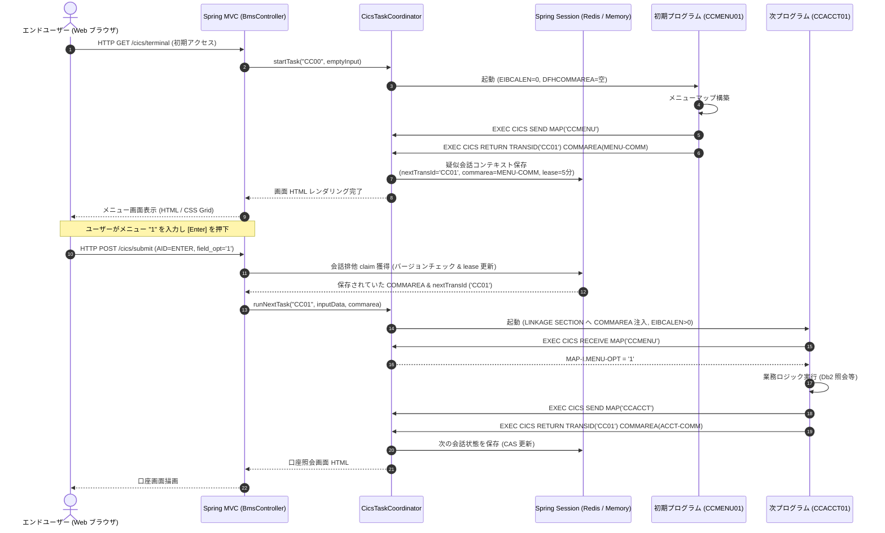

# cobol-on-java における CICS / BMS Web 画面レンダリングおよびトランザクションシーケンス詳細ガイド

本ドキュメントでは、**cobol-on-java（Java 21 / JVM バイトコード直接生成方式）** における **CICS オンライン処理エンジン（`cobol-cics`）** および **BMS Web レンダラー（`cobol-spring-boot-4-bms-thymeleaf`）** について、BMS マクロから HTML5 / CSS Grid / Thymeleaf テンプレートへの自動変換、ブラウザネイティブな「エミュレータレス」3270 画面再現、Spring MVC / Spring Session による疑似会話型（Pseudo-Conversational）トランザクション制御、排他 claim / lease 機構、および HTTP シーケンスを詳細に解説します。

---

## 1. CICS / BMS サブシステムのアーキテクチャ概要

### 1.1 目的と「エミュレータレス Web UI」の設計思想
メインフレームのオンライントランザクション業務（CardDemo, GenApp, Bank of Z 等）は、CICS 上で稼働し、IBM 3270 端末画面（BMS マクロ定義）を通じてエンドユーザーに操作画面を提供します。

GnuCOBOL や Zeus が「端末エミュレータ（TN3270 クライアント）を接続するための Telnet サーバーを提供する」アプローチをとるのに対し、`cobol-on-java` では **「専用エミュレータソフトウェアを完全に廃止し、モダンな Web ブラウザ（Chrome / Edge 等）上で 3270 画面の操作性と配置をそのままネイティブ再現する（エミュレータレス Web UI）」** という革新的なアプローチを採用しています。

主な技術的特徴:
1. **BMS マクロから HTML5 / CSS Grid への自動変換**:
   - `BmsParser` がアセンブラの BMS マクロ（`DFHMSD`, `DFHMDI`, `DFHMDF`）を解析し、24行×80桁の端末グリッドを CSS Grid テンプレートへ自動マッピング。
2. **キーボード操作意味論の完全再現**:
   - エンターキー（`Enter`）、ファンクションキー（`F1`〜`F12`）、クリアキー（`Clear`）、タブキーによる入力フィールド間移動、MDT（改変データタグ）による差分送信を JavaScript で忠実にエミュレート。
3. **Spring Session による疑似会話（Pseudo-Conversational）の実現**:
   - HTTP のステートレスなリクエスト/レスポンスの上に、CICS 特有の `RETURN TRANSID(...) COMMAREA(...)` の状態遷移を Spring Session を介してマッピング。複数ノード環境でも分散セッション（Redis 等）で安全に水平スケール可能。

### 1.2 全体アーキテクチャ構成図

```text
+--------------------------------------------------------------------------+
|                  モダン Web ブラウザ (Google Chrome, Edge, Safari 等)      |
|  - HTML5 / CSS Grid レンダリング (24行 x 80桁の等幅端末フォント画面)      |
|  - JavaScript 端末コントローラ: F1〜F12 キーハンドリング, MDT 収集         |
+--------------------------------------------------------------------------+
                                     │ HTTPS / POST (JSON または Form データ)
                                     ▼
+--------------------------------------------------------------------------+
| 1. Spring MVC コントローラ層 (cobol-spring-boot-4-bms-thymeleaf)          |
|   - HTTP リクエスト受信 & AID キー (Enter / PF1 等) / カーソル位置抽出     |
|   - Spring Session から端末コンテキスト (TerminalContext) を解決          |
+--------------------------------------------------------------------------+
                                     │ 会話 claim (排他ロック)
                                     ▼
+--------------------------------------------------------------------------+
| 2. CICS タスク制御層 (cobol-cics: CicsTaskCoordinator, CicsGateway)       |
|   - 疑似会話エンベロープ (ConversationEnvelope) の排他 claim & lease 獲得  |
|   - 許可リスト型 CicsTransactionRegistry による TRANSID 照合              |
|   - CicsTaskBoundary: 業務 UOW (Spring トランザクション) の開始           |
|   - 実行制御: LINK, XCTL, RETURN, SYNCPOINT, ABEND のディスパッチ          |
+--------------------------------------------------------------------------+
                                     │
                                     ▼  [BmsInputDecoder: MDT データ復元]
+--------------------------------------------------------------------------+
| 3. BMS 入出力変換層 (cobol-cics: BmsModel, BmsInputDecoder)                |
|   - ブラウザから送信された改変フィールド値をシンボリックマップ (MAP-I) へ格納|
|   - 属性バイト (プロテクト, 輝度, カーソル位置) の評価                    |
+--------------------------------------------------------------------------+
                                     │ CobolSession 経由の直接メソッド呼出し
                                     ▼
+--------------------------------------------------------------------------+
| 4. COBOL アプリケーション (例: CardDemo CCMENU01C 等)                     |
|   - EXEC CICS RECEIVE MAP(...) INTO(...)                                 |
|   - 業務ロジック実行                                                     |
|   - EXEC CICS SEND MAP(...) FROM(...)                                    |
|   - EXEC CICS RETURN TRANSID('CC01') COMMAREA(...)                       |
+--------------------------------------------------------------------------+
                                     │ レンダリング要求
                                     ▼
+--------------------------------------------------------------------------+
| 5. Thymeleaf Web レンダラー (BmsThymeleafRenderer)                        |
|   - 出力シンボリックマップ (MAP-O) の値を HTML テンプレートへ注入         |
|   - CSS クラス (3270-green, 3270-bright, 3270-protect, 3270-unprotect)  |
|   - レンダリング済み HTML をブラウザへ返却 (または SSE / WebSocket 更新)  |
+--------------------------------------------------------------------------+
```

---

## 2. BMS マクロの Web レンダリング変換（HTML5 / CSS Grid）

### 2.1 BMS マクロからグリッドへの変換原則
アセンブラの BMS ソース（`DFHMDF POS=(row, col), LENGTH=len`）は、24 行 × 80 列の固定セルグリッドとして解釈されます:

```css
/* 3270 画面コンテナの CSS Grid 定義 */
.cics-terminal-grid {
    display: grid;
    grid-template-rows: repeat(24, 1.25rem);
    grid-template-columns: repeat(80, 0.65rem);
    background-color: #000000;
    color: #00ff00; /* IBM 3270 伝統のグリーン管表示 */
    font-family: "IBM Plex Mono", "Courier New", monospace;
}

/* 各フィールドの配置スタイル */
.cics-field {
    grid-row-start: var(--row);
    grid-column-start: var(--col);
    grid-column-end: span var(--len);
}
.cics-protected   { pointer-events: none; }
.cics-unprotected { background-color: #111111; border-bottom: 1px solid #555555; }
.cics-bright      { color: #ffffff; font-weight: bold; }
.cics-dark        { display: none; } /* パスワード入力フィールド等 */
```

### 2.2 ブラウザ側 JavaScript による 3270 操作のエミュレーション
- **ファンクションキー (`F1`〜`F12`)**:
  ブラウザの既定の動作（ヘルプ表示等）を `e.preventDefault()` で抑制し、該当する CICS AID コード（`0x31`〜`0x3C`）としてサーバーへ送信。
- **改変データタグ（MDT）の収集**:
  ユーザーがキー入力を行った `<input>` 要素に `data-mdt="true"` フラグを付与。フォーム送信時は、**変更されたフィールドの値とカーソル位置のみ** をペイロードとして送信（3270 データストリームの帯域最適化を Web 上で再現）。

---

## 3. 疑似会話型（Pseudo-Conversational）トランザクション処理シーケンス



---

## 4. 排他 claim と lease 機構による並行性制御

Web ブラウザ環境特有の課題として、**「ユーザーがブラウザの戻るボタンを押す」「タブを複製して並行操作する」「二重クリックする」** といった動作があります。

`cobol-cics` の `CicsTaskCoordinator`（`docs/design/77-spring-cics-db2.md`）は、以下の堅牢な排他制御を備えています:

1. **排他 claim（CAS: Compare-And-Swap）**:
   - 会話エンベロープ（`ConversationEnvelope`）はバージョン番号を保持。
   - リクエスト到着時、セッション内のバージョンと一致する場合のみ排他ロック（claim）を獲得し、バージョンをインクリメント。並行する重複リクエストは直ちに拒否されます。
2. **有効期限付き lease**:
   - 会話コンテキストには期限（例: 5分）が設定され、タイムアウトした会話は安全に解放されます。
3. **トランザクション確定の順序性**:
   - 業務 UOW（Spring トランザクション / Db2 コミット）が成功した場合にのみ、会話エンベロープの変更がセッションへ恒久反映されます。コミット失敗時は安全にロールバックされます。

---

## 5. 他処理系との比較

| 比較項目 | cobol-on-java (`cobol-cics` / Thymeleaf) | Zeus (`zcics`) | GnuCOBOL (`cobcics`) |
| :--- | :--- | :--- | :--- |
| **画面クライアント** | **モダン Web ブラウザ (Chrome/Edge/Safari)**| 3270 専用エミュレータ (x3270 等)| 3270 専用エミュレータ |
| **画面プロトコル** | **HTTPS / HTML5 / CSS Grid / JSON** | Telnet / TN3270(E) プロトコル | Telnet / TN3270 プロトコル |
| **エミュレータ導入** | **不要（ゼロインストール）** | 端末ソフトの導入が必要 | 端末ソフトの導入が必要 |
| **セッション管理** | **Spring Session (Redis 等で分散水平スケール可能)**| プロセス内インメモリ保持 | プロセス内インメモリ |
| **セキュリティ・認証**| **Spring Security, OAuth2, SAML, WebAuthn**| CICS 内部認証 / 独自実装 | 簡易認証 |
| **トランザクション統合**| **Spring Framework @Transactional / DataSource**| 内部 UOW コントローラ | 手動コミット制御 |
