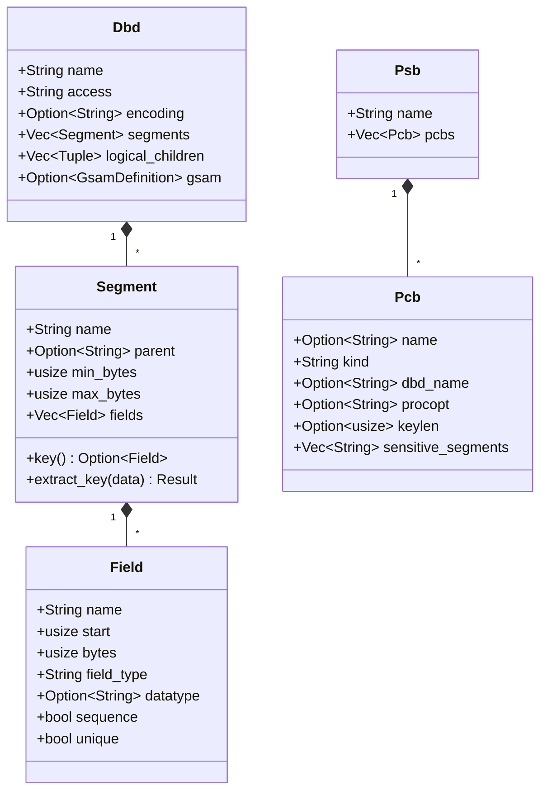
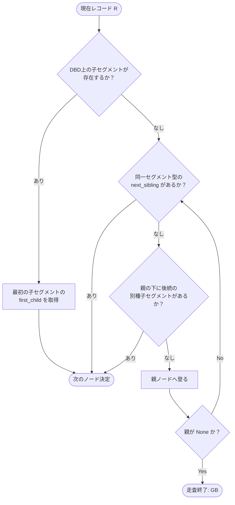

# GnuCOBOL extras/imsdb: RustによるIMS DB互換実装のデータ構造調査報告書

## 1. 調査概要

### 1.1 背景と目的
IBMメインフレーム環境の階層型データベース「IMS DB（Information Management System Database）」およびそのアクセス言語「DL/I（Data Language/I）」を用いた既存資産（Bank of Z、AWS CardDemo等）を、GnuCOBOLやPL/I、`jclsh`（JCLシェル）からソースコード変更なしに実行可能とするため、`gnucobol/extras/imsdb/` にてRustによる互換データベースエンジンが実装されています。

本報告書では、特に**IMS DBのデータ構造がRust上でどのように表現・設計されているか**に焦点を当てて調査・整理しました。

### 1.2 ソースコード構成
`gnucobol/extras/imsdb/` の構成は以下の通りです。外部クレート依存（`dependencies`）を持たず、Rust標準ライブラリ（`std`）のみで完結して実装されています。

| ファイル | 役割 |
| :--- | :--- |
| `src/catalog.rs` | DBD（データベース定義）およびPSB（プログラム仕様ブロック）のパースとスキーマメタデータ表現 |
| `src/store.rs` | セグメントレコード、B-Tree階層索引、WAL永続化、トランザクションステージング、ロック機構 |
| `src/dli.rs` | DL/I呼び出し（GU, GN, GNP, ISRT, REPL, DLET等）、SSAパース、階層順巡回（Pre-order Traversal）、PCB位置情報保持 |
| `src/call_adapter.rs`| COBOL/PL/I用のPCBマスク（36バイトヘッダ＋連結キー）、EBCDIC/ASCII制御文字変換、COMP-5数値表現 |
| `src/ffi.rs` / `imsdb.h` | C言語ABIインターフェース（`cbltdli.c` から呼び出される共有ライブラリ境界） |
| `src/gsam.rs` | GSAM（順次アクセス方式）セッション、固定長レコード処理、RSA（レコード探索アドレス）表現 |
| `src/csv_load.rs` | サンプルデータ（CSV）からEBCDIC/バイナリ/パック10進への変換・投入ユーティリティ |
| `src/main.rs` | CLIツール `imsdbctl`（定義検証、インポート/エクスポート等） |

---

## 2. メタデータ（DBD / PSB）のデータ構造表現

IMS DBの定義情報（DBD macro, PSB macro）は、固定桁アセンブラ形式から構文解析され、`src/catalog.rs` の構造体にマッピングされます。



### 2.1 セグメントとフィールド定義 (`Segment`, `Field`)
- **`Field`**:
  ```rust
  pub struct Field {
      pub name: String,
      pub start: usize,          // 1-indexed (DBD仕様に準拠)
      pub bytes: usize,          // バイト長
      pub field_type: String,    // "C"(文字), "P"(パック10進), "X"(16進) 等
      pub datatype: Option<String>,
      pub sequence: bool,        // SEQフラグ (キー項目であるか)
      pub unique: bool,          // Uフラグ (一意キーか否か)
  }
  ```
- **`Segment`**:
  ```rust
  pub struct Segment {
      pub name: String,
      pub parent: Option<String>, // 親セグメント名 (ルートの場合は None)
      pub min_bytes: usize,
      pub max_bytes: usize,
      pub fields: Vec<Field>,
  }
  ```
  - `key()`: `fields` の中から `sequence == true` のフィールドを取得。
  - `extract_key(&self, data: &[u8])`: 生データスライス `data` から `start - 1 .. start - 1 + bytes` の範囲をキーバイト列として安全にスライス抽出。

### 2.2 データベース定義とプログラムビュー (`Dbd`, `Psb`, `Pcb`)
- **`Dbd`**: 対象DB全体の構成（アクセス方式: HDAM, HIDAM, GSAM等、セグメント階層一覧、論理子宣言）。
- **`Pcb`**: COBOLプログラム側から参照するPCBビュー（アクセス種別 "DB" / "GSAM"、処理オプション `PROCOPT`（"G", "I", "R", "D", "A" 等）、感度セグメント一覧 `sensitive_segments`、最大連結キー長 `KEYLEN`）。

---

## 3. レコードインスタンスと階層インデックスのデータ構造表現

IMS DBの中核となるデータ構造は `src/store.rs` に実装されています。

### 3.1 レコードインスタンス (`Record`)
データベース内のセグメント1件は、`Record` 構造体として表現されます。

```rust
#[derive(Clone, Debug, PartialEq, Eq)]
pub struct Record {
    pub id: u64,
    pub dbd: String,
    pub segment: String,
    pub parent: Option<u64>,
    pub root_key: Vec<u8>,
    pub key: Vec<u8>,
    pub data: Vec<u8>,
}
```

各フィールドの役割と設計意図：
1. **`id: u64`**:
   セグメントインスタンスの一意な識別子（1から自動インクリメント）。親・子の参照関係やB-Treeでの同一キーセグメントの区別に使われます。
2. **`parent: Option<u64>`**:
   親セグメントの `Record.id`。ルートセグメントの場合は `None`、子セグメントの場合は親のIDを保持することで、**木構造のポインタ（上向き参照）**を形成します。
3. **`root_key: Vec<u8>`**:
   そのセグメントが属する木全体のルートセグメントのシーケンスキー。
   - ルート自身の場合は `key == root_key`。
   - 子孫セグメントもすべて `root_key` を保持することで、**ルート単位の排他ロック判定を $O(1)$ で実行可能**にしています。
4. **`key: Vec<u8>`**:
   DBDの `FIELD` 定義に基づき抽出された、自身のシーケンスキーの生バイト列。
5. **`data: Vec<u8>`**:
   セグメントレコード本文の**生バイト列（Raw bytes）**。
   - **文字コード・数値型の無変換保持**: CP1047 / IBM-037等のEBCDIC文字列、パック10進数（COMP-3）、2の補数バイナリ（COMP / COMP-5）をUTF-8等にデコードせず、バイト列のまま格納します。これにより、浮動小数点やパック10進数の丸め誤差・変換破壊を完全に排除しています。

---

### 3.2 階層関係とインデックス表現 (`IndexKey` と `State`)

IMS DBの階層関係および順序付けは、`BTreeMap` を用いた複合タプルキーによって実現されています。

```rust
type IndexKey = (String, Option<u64>, String, Vec<u8>, u64);
//                │       │            │       │        └─ (5) record_id (u64)
//                │       │            │       └────────── (4) sequence_key (Vec<u8>)
//                │       │            └────────────────── (3) segment_name (String)
//                │       └─────────────────────────────── (2) parent_id (Option<u64>)
//                └─────────────────────────────────────── (1) dbd_name (String)

#[derive(Default)]
struct State {
    records: BTreeMap<u64, Record>,
    index: BTreeMap<IndexKey, ()>,
    next_id: u64,
}
```

#### このタプル構造による巧妙な走査メカニズム：

1. **ルートセグメントのキー順走査**:
   - ルートセグメントは `parent_id = None` です。
   - インデックス上では `(dbd, None, "ROOT", root_key, id)` として格納されます。
   - `index.range((dbd, None, "ROOT", target_key, 0)..)` により、指定したキー以降のルートを辞書順（ビッグエンディアン／バイト値順）で高速に二分探索・レンジスキャンできます。
2. **同一親の下にある子セグメント群の取得 (`children`)**:
   - 親ID `P` を持つセグメント `CHILD` の一覧を取得する場合：
     ```rust
     let prefix = (dbd.to_string(), Some(P), "CHILD".to_string(), Vec::new(), 0);
     self.index.range(prefix..)
         .take_while(|((d, p, s, _, _), _)| d == dbd && *p == Some(P) && s == "CHILD")
     ```
   - これにより、親ノード `P` に紐づく `CHILD` セグメントだけをキー順に一括走査できます。
3. **次の兄弟セグメントの取得 (`next_sibling`)**:
   - カレントレコード `(dbd, parent, segment, key, id)` に対し：
     ```rust
     let start = (dbd, parent, segment, key, id + 1);
     let next = self.index.range(start..).next();
     ```
   - 同一親・同一セグメント種別の中で、現在のキー（または同一キーの次レコード）以降を即座に特定できます。
4. **非一意シーケンスフィールド（Non-Unique Key）のサポート**:
   - IMS DBでは重複キー（`FIELD ...,SEQ` で `U` フラグなし）が許容されます。
   - インデックス末尾に `record_id: u64`（一意）を含めているため、キー値が重複していてもBTree上でキーが上書きされず、ID順（挿入順）に自然に並びます。

---

## 4. トランザクションとWAL（Write-Ahead Logging）のデータ構造

### 4.1 トランザクション内のステージング (`Change` と `Transaction`)
コミット前の変更はデータベース本体（`State`）を直接変更せず、`Transaction` 構造体内にステージングされます。

```rust
enum Change {
    Insert(Record),
    Replace { record: Record, old_data: Vec<u8> },
    Delete { record: Record },
}

pub struct Transaction {
    database: Database,
    id: u64,
    changes: Vec<Change>,             // 未コミットの変更一覧
    locks: Vec<(String, Vec<u8>)>,    // 獲得したルートロック一覧
}
```

- **Read-Your-Own-Writes（自己更新の即時可視性）**:
  `Transaction::get` や `children` を呼んだ場合、永続化済みの `database` の内容とローカルの `changes` を動的にマージし、トランザクション内で自分が行った変更（ISRT/REPL/DLET）が即座に反映された状態で走査します。
- **ロールバック**:
  `Transaction::rollback()` は単に `changes` を破棄しロックを解放するだけなので、$O(1)$ かつ安全です。

### 4.2 ルート単位の排他ロック構造
```rust
locks: Mutex<HashMap<(String, Vec<u8>), u64>>, // (dbd, root_key) -> tx_id
lock_changed: Condvar,
```
- **デッドロック防止（Total Key Order）**:
  複数トランザクション間のデッドロックを防ぐため、ロック獲得時にキーの昇順（トータルオーダー）を強制しています。
  ```rust
  if self.locks.last().is_some_and(|last| last > &key) {
      return Err(StoreError::Conflict(
          "root locks must be acquired in ascending key order".into(),
      ));
  }
  ```
  降順でのロック要求は即座にエラーとし、未然にデッドロックを防止します。

### 4.3 WAL（先行書き込みログ）のバイナリフォーマット
永続化はコミットログ形式のファイル（WAL）を用いて行われます。コミット時、以下のフォーマットで1フレームとして末尾に追加（`sync_data()`）されます。

```text
+-------------------+--------------------+----------------------+------------------------+
| Magic (4 bytes)   | Payload Length     | Checksum (4 bytes)   | Payload (N bytes)      |
| "IMS1"            | u32 (Little-Endian)| FNV-1a (Little-Endian| Changes serialized     |
+-------------------+--------------------+----------------------+------------------------+
```

- **ペイロード内のシリアライズ構造**:
  - `changes.len(): u32`
  - 各変更レコード:
    - 操作コード: `1` (Insert), `2` (Replace), `3` (Delete)
    - レコード本文:
      `id (u64)` + `dbd (len+str)` + `segment (len+str)` + `parent (u64)` + `root_key (len+bytes)` + `key (len+bytes)` + `data (len+bytes)`
- **原子性保証（Undoメカニズム）**:
  コミット処理では、メモリ状態を更新する前に各変更に対する逆操作（`inverse`）のリストを作成します。WALの書き込みやディスク同期（fsync）に失敗した場合は、直ちに `undo` を適用してインメモリ状態を巻き戻します。
- **クラッシュリカバリ**:
  起動時（`Database::open`）に先頭からフレームを順次読み込み、チェックサム検証が成功した完全なフレームのみをリプレイします。クラッシュ等により末尾に書きかけの不完全フレームが存在した場合は、自動的に切り詰めて（`wal.set_len(valid_end)`）正常復帰します。

---

## 5. DL/Iセッションと階層走査のデータ構造

`src/dli.rs` は、DL/I呼び出し（GU, GN, GNP等）に応じた階層走査を制御します。

### 5.1 PCBカレント位置情報 (`Position` と `Session`)

```rust
#[derive(Default)]
struct Position {
    current: Option<u64>,       // 現在位置のレコードID
    parent: Option<u64>,        // GNP用の親位置レコードID
    exhausted: bool,            // 終端到達フラグ (GBステータス用)
    held: Option<u64>,          // GHU/GHN/GHNP でロック保持したレコードID
    last_deleted: Option<Record>, // 直前にDLETされたレコード (GNの継続用)
}

pub struct Session {
    database: Database,
    psb: Psb,
    positions: Vec<Position>,   // PCBインデックスごとのカレント位置
    transaction: Transaction,
    lock_timeout: Duration,
}
```

- IMS DBではプログラム内のPCBごとに独立したカレント位置を持ちます。`positions: Vec<Position>` でこれを管理します。
- `held`: Hold系呼び出し（`GHU` 等）で取得したレコードIDを記憶し、後続の `REPL` や `DLET` が同一レコードに対して行われているかを検証（不一致なら `DJ` ステータス）。

### 5.2 SSA（Segment Search Argument）の表現
```rust
struct Ssa {
    segment: String,
    condition: Option<(String, Vec<u8>)>, // (field_name, expected_raw_bytes)
}
```
- 修飾SSA（`SEGNAME(FIELD = VALUE)`）からセグメント名、フィールド名、比較値のバイト列を抽出。
- 一致判定（`matches`）は、DBDに定義された `start` と `bytes` の生バイト列比較によって行われます。

### 5.3 階層先行順巡回（Pre-order Traversal）アルゴリズム
IMS DBの `GN`（Get Next）は、ツリー構造を深さ優先・先行順（親 → 最初の子 → その子 → 次の兄弟 → 親の次の兄弟）で巡回します。`next_after` 関数がこれをインデックス走査で実現しています。



---

## 6. COBOL / C ABI 連携境界のデータ構造

COBOL側の `CALL "CBLTDLI"` とのデータ受け渡しは `src/call_adapter.rs` および `cbltdli.c` で処理されます。

### 6.1 COBOL DB PCB マスク (`PcbMask`)
COBOL側で定義される9フィールドのDB PCBマスク（36バイト固定ヘッダ + 連結キーフィードバック領域）を、バイトバッファスライスとして直接読み書きします。

| オフセット | バイト長 | 項目名 | 内容 / フォーマット |
| :---: | :---: | :--- | :--- |
| `0..8` | 8 | DBD名 | 英数字（空白埋め、ASCIIまたはCP1047） |
| `8..10` | 2 | セグメントレベル番号 | 2桁の10進文字列（例: `"01"`, `"02"`） |
| `10..12` | 2 | ステータスコード | 正常時 `"  "`、未発見 `"GE"`、終端 `"GB"`、重複 `"II"` 等 |
| `12..16` | 4 | 処理オプション | PROCOPT（例: `"A   "`, `"GO  "`） |
| `16..20` | 4 | 予備領域 | JSP予約領域（0クリア） |
| `20..28` | 8 | セグメント名 | 直前にアクセスしたセグメント名（空白埋め） |
| `28..32` | 4 | キーフィードバック長 | ビッグエンディアン 32bit 整数 |
| `32..36` | 4 | 機微セグメント数 | ビッグエンディアン 32bit 整数 |
| `36..` | KEYLEN | 連結キーフィードバック | ルートからカレントまでの連結キー（生バイト列） |

### 6.2 C FFI 型定義 (`imsdb.h` / `src/ffi.rs`)
```c
typedef struct ImsHandle ImsHandle;

typedef struct {
    uint8_t *data; // SSAバッファ または GSAM RSAバッファ
    size_t len;
} ImsSpan;
```
- `imsdb_open`: WALパス、DBDディレクトリ、PSBパス、エンコーディングフラグ（EBCDIC制御文字 / COMP-5 リトルエンディアン等）を受け取り、ハンドルを生成。
- `imsdb_call`: PCBインデックス、DL/I関数名（`"GU  "`等）、PCBバッファ、I/O領域、SSA配列を受け取り実行。

---

## 7. 特徴的な設計と考察

### 7.1 生バイト列（Raw Bytes）保存の徹底
メインフレーム上のIMS DBは、テキスト（EBCDIC）、COMP-3（パック10進数）、COMP（ビッグエンディアン2進数）が同一レコード内に混在します。
本Rust実装では、レコード本文（`data`）およびキー（`key`）をすべて `Vec<u8>` の生バイト列として扱い、文字エンコーディング変換を行いません。文字比較が必要なSSAの判定やPCBマスクの制御バイトのみを局所的に変換するため、データの破壊や精度の欠落が一切生じない堅牢な構造となっています。

### 7.2 B-Treeタプルキーによる階層モデルの平坦化（Flattening）
木構造データベースをリレーショナルDBMSやグラフ構造で実装する場合、親から子へのポインタ追跡にオーバーヘッドがかかりがちですが、本実装では：
`IndexKey = (dbd, parent_id, segment_name, sequence_key, record_id)`
というタプルを定義し、Rust標準の `BTreeMap` に格納することで、**階層構造の探索と走査（親子・兄弟・深さ優先走査）を単一のB-Treeのレンジスキャンへと見事に還元**しています。

### 7.3 単一ノード・高信頼性を志向した軽量WAL設計
外部DBエンジン（SQLite, RocksDB, redb等）に依存せず、専用のフレーム化WALログ（マジックヘッダ、フレーム長、FNV-1aチェックサム、Undoセット）を自前で実装することにより、GnuCOBOL等のバッチ実行時における高速なコミット／ロールバックと完全な原子性を両立しています。
