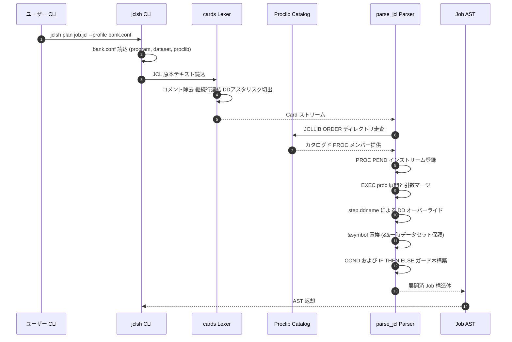
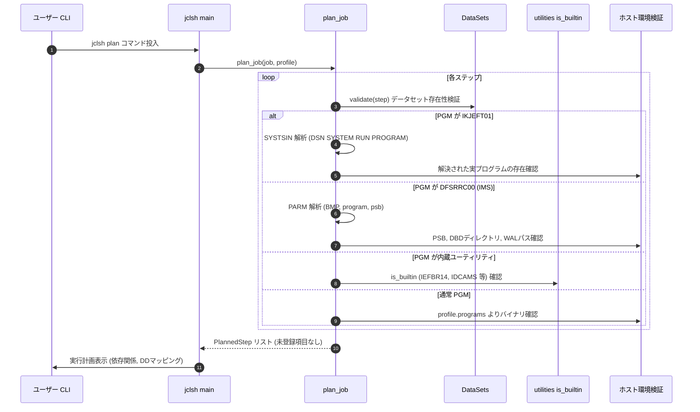
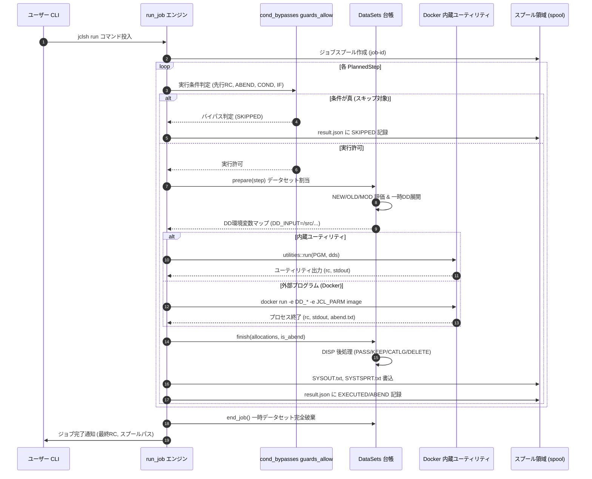

# JCL (Job Control Language) サポート実装詳細解説: パース・計画・実行シーケンス

本ドキュメントでは、本リポジトリにおける **JCL（Job Control Language）のサポート実装 (`extras/jclsh`)** について、構文解析（Lexing/Parsing）、プロシージャ展開・計画（Plan）、データセット管理（DISP）、および実行時エンジン（Dockerコンテナ起動 / 内蔵ユーティリティ連携 / スプール記録）の内部シーケンスを含めて詳細に解説します。

---

## 1. JCL対応のアーキテクチャ概要

### 1.1 目的と「原本無変更」原則
メインフレーム（IBM z/OS）で稼働する基幹バッチシステム（例: Bank of Z の `BNKSTMT.jcl` や CICS GenApp の JCL群）は、JCLによってジョブステップ、データセット割り当て、条件分岐、プログラム起動が定義されています。
本リポジトリの JCL 実装 **`jclsh`** は、**「JCL 原本を1行も書き換えることなく、オープン環境（Linux/Docker/Windows）で解析・計画・実行する」** ことを最優先原則として Rust で実装されています。

サイト依存のプレースホルダー（例: `<DB2SSID>` 等）や環境差異は、JCL 本文ではなく**外部プロファイル設定（`.conf`）**によって解決されます。

### 1.2 全体アーキテクチャ構成図

```
+--------------------------------------------------------------------------+
|                          JCL ソース原本 (.jcl)                           |
|  //JOBNAME  JOB  ...                                                     |
|  //STEP01   EXEC PGM=IKJEFT01 (または PROC名 / ユーティリティ)               |
|  //DDNAME   DD   DSN=...,DISP=(NEW,CATLG),...                            |
|  //SYSIN    DD   * (インストリームデータ)                                 |
+--------------------------------------------------------------------------+
                                     |
                                     v
+--------------------------------------------------------------------------+
|                      Rust JCL インタプリタ (jclsh)                       |
|  [1. パース層: jcl.rs]                                                   |
|      - 字句解析・カード化 (//, //*, /*, 継続行, DD *, DD DATA,DLM=)       |
|      - JCLLIB ORDER / INCLUDE MEMBER 解決                                |
|      - インストリーム / カタログド PROC 展開 & パラメータ置換             |
|      - IF / THEN / ELSE / ENDIF ガード & COND 条件解析                   |
|      - step.ddname による DD オーバーライドマージ                         |
|                                                                          |
|  [2. 計画・検証層: main.rs, datasets.rs]                                 |
|      - プロファイル照合 (program.<PGM>=パス, dataset.<DSN>=ファイル)     |
|      - IKJEFT01 (SYSTSIN: DSN SYSTEM/RUN) / DFSRRC00 (IMS PARM) 解析     |
|      - データセット存在性検証 & 未知プログラムの検出                     |
|                                                                          |
|  [3. 実行・ランタイム層: main.rs, datasets.rs, utilities.rs]             |
|      - ステップ実行条件評価 (COND / IF: 真ならスキップ, ABENDハンドリング) |
|      - DISP 状態遷移 (NEW/OLD/SHR/MOD -> PASS/KEEP/CATLG/DELETE)         |
|      - 環境変数注入 (DD_<NAME>=/src/..., JCL_PARM=..., JCL_ABEND_FILE)   |
|      - 実行委託: Docker (COBOL/PL1) または Rust内蔵ユーティリティ         |
|      - SYSOUT スプール保存 & result.json 監査記録生成                    |
+--------------------------------------------------------------------------+
          |                                              |
          v                                              v
+-----------------------------+        +-----------------------------------+
| Docker コンテナ実行          |        | Rust 内蔵ユーティリティ           |
| (COBOL / PL/I / Db2 / IMS)  |        | - IEFBR14 (DD DISP 後処理)        |
|  - GnuCOBOL バイナリ        |        | - IEBGENER (レコードコピー)       |
|  - PL/I (pl1c 生成バイナリ) |        | - IDCAMS (VSAM 定義/削除/REPRO)   |
|  - IBM Db2 CLI 接続         |        | - SORT (ソート・マージ)           |
|  - IMS CBLTDLI 連携         |        | - DFHCSDUP (CSD 定義ダミー)       |
+-----------------------------+        +-----------------------------------+
```

---

## 2. パース（構文解析）フェーズの実装詳細

構文解析器は `extras/jclsh/src/jcl.rs` に実装されています。

### 2.1 字句解析とカード（Card）化 (`cards` 関数)
JCLの80桁パンチカード形式および継続規則を忠実に再現してトークン化します。

1. **制御行とコメント**:
   - `//*`: コメント行として無視。
   - `/*`: デリミタ行。
   - `//`: JCL文。先頭2文字が空白の場合は継続行（オペランドのカンマ `,` 終端検証）。
2. **インストリームデータ (`DD *` / `DD DATA`)**:
   - `DD *`: 直後の行から `/*` または新たな `//` 文が現れるまでをデータ行としてキャプチャ。
   - `DD DATA,DLM=xx`: 内部に `//` を含むデータセットに対応するため、指定された2文字デリミタ（`DLM=`）が出現するまでを厳密にデータ行として保持。
3. **Card 構造体**:
   各文は `{ line, name, operation, operands, data }` に分解されます。

### 2.2 プロシージャとインクルードの解決

1. **`JCLLIB ORDER=(...)` と `INCLUDE MEMBER=...`**:
   - `JCLLIB` で指定されたライブラリ検索順序に従い、プロファイルで指定されたディレクトリからメンバー（ファイル）を探索。
   - 再帰的に `INCLUDE` を展開し、循環インクルードを検出・防止。
2. **インストリーム `PROC` / `PEND` およびカタログド `PROC`**:
   - `PROC` 定義内のステップを `Procedure` 構造体に保持。
   - `EXEC procname` 呼び出し時、最大15段までのネスト呼び出しに対応し、再帰呼び出しを検出。
   - プロシージャのデフォルト引数に対し、呼び出し側 `EXEC` のキーワード引数を上書きマージ。
3. **DD オーバーライド (`step.ddname`)**:
   - `//STEP01.SYSIN DD ...` のように指定された場合、プロシージャ内の該当ステップの該当DDカードとオペランド単位でマージ（`merge_dd` 関数）。

### 2.3 シンボル置換（`&symbol`）と一時データセット（`&&temp`）

- **`&NAME`**: `SET` 文または `PROC` パラメータで定義された値を再帰的に置換（循環参照検出付き）。末尾のピリオド `.` は区切り文字として消費（例: `&MEM.1` -> `PROG1`）。
- **`&&NAME`**: JCL 標準の一時データセット識別子としてそのまま保持され、シンボル置換の対象から除外。
- **サイトプレースホルダー `<NAME>`**: IBM 標準JCLではないサンプル固有の記述（例: `<DB2SSID>`）は、外部プロファイルの `site.NAME=値` または CLI の `--set NAME=値` でのみ安全に置換。

### 2.4 条件分岐構文の解析

1. **`COND` パラメータ**:
   - ステップ単位およびジョブ単位の `COND`。
   - `COND=(code, operator[, step])`、`EVEN`（先行ステップABEND時も実行）、`ONLY`（先行ステップABEND時のみ実行）。
   - 比較演算子: `EQ`, `NE`, `LT`, `LE`, `GT`, `GE`。
2. **`IF` / `THEN` / `ELSE` / `ENDIF` ガード構文**:
   - `IF (RC = 0 & STEP01.RUN) THEN` などの論理式をパース。
   - `AND`, `OR`, `NOT`, `¬` および括弧ネストに対応。
   - ステップごとに `IfGuard { expression, then_branch }` のスタックとして保持。

---

## 3. 計画・検証（Plan）フェーズの実装詳細

構文木（`Job`）から実行計画（`Vec<PlannedStep>`）を組み立てる処理は `extras/jclsh/src/main.rs` の `plan_job` 関数で行われます。

### 3.1 外部プロファイル (`Profile`) との照合

JCL本文は変更せず、`bank.conf` などのプロファイルによってホスト環境とのバインディングを検証します:

- `program.<NAME>=<path>`: 実行可能バイナリへのマッピング。
- `dataset.<DSN>=<path>`: 永続データセットのホストファイルパス。
- `proclib.<DSN>=<dir>`: `JCLLIB` カタログドプロシージャの格納ディレクトリ。
- `dataset_root=<dir>`: ジョブによる新規作成・変更が許可されたセキュアな作業領域。

### 3.2 特殊プログラムの内部計画

1. **TSO バッチコントローラ (`IKJEFT01`)**:
   - `SYSTSIN DD *` の内容を解析。
   - `DSN SYSTEM(xxxx)` -> `RUN PROGRAM(prog) PLAN(plan) LIB(lib)` -> `END` を構文抽出。
   - 指定された `SYSTEM`, `PLAN`, `LIB` がプロファイルの期待値と一致することを検証し、真の起動対象プログラム `prog` を解決。
2. **IMS バッチコントローラ (`DFSRRC00`)**:
   - `PARM='BMP|DLI|DBB,program,psb'` を解析。
   - プロファイル内の `ims_psb.<psb>`, `ims_dbd_dir`, `ims_wal`, `ims_cbltdli` の存在を検証。
3. **内蔵ユーティリティ (`utilities::is_builtin`)**:
   - `IEFBR14`, `IEBGENER`, `IDCAMS`, `SORT`, `DFHCSDUP` の場合は外部バイナリ不要としてマーク。

---

## 4. 実行（Execution & Runtime）フェーズの実装詳細

実行エンジンは `extras/jclsh/src/main.rs` の `run_job`、`datasets.rs`、および `utilities.rs` に実装されています。

### 4.1 条件評価ロジック（JCLの「真ならスキップ」原則）

メインフレームJCLの最も特徴的な仕様である **「COND条件が真（成立）ならステップをバイパス（スキップ）する」** という論理を厳密に評価します。

```rust
// extras/jclsh/src/jcl.rs より
// spec.tests のいずれかが真であればバイパス (true を返す)
for (_, rc) in candidates {
    let matched = match test.operator.as_str() {
        "EQ" => test.code == *rc,
        "NE" => test.code != *rc,
        "LT" => test.code < *rc,  // 例: COND=(4,LT) は 先行RCが4より大きければ (4 < RC) スキップ
        "LE" => test.code <= *rc,
        "GT" => test.code > *rc,
        "GE" => test.code >= *rc,
        _ => ...
    };
    if matched { return Ok(true); } // 条件成立 -> スキップ!
}
```

- **ABEND時の振る舞い**:
  - 先行ステップがABEND（異常終了）した場合、通常のステップはすべてスキップされます。
  - `COND=EVEN` または `COND=ONLY` が指定されているステップ、および `IF ABEND` 条件に合致するステップのみが実行を許可されます。

### 4.2 データセットライフサイクルと `DISP` 状態遷移 (`datasets.rs`)

各ステップの実行前後で、データセット台帳（`DataSets`）が `DISP` 属性に従って状態遷移を制御します。

| DISP 指定 | 開始時アクション | 正常終了時 (`normal`) | 異常終了時 (`abnormal`) |
| :--- | :--- | :--- | :--- |
| `NEW` | 作業領域に新規ファイル作成 | `CATLG` (台帳登録) / `KEEP` / `PASS` (次ステップへ引渡) | `DELETE` (即時削除) |
| `OLD` / `SHR` | 既存ファイルの存在確認と共有オープン | `KEEP` / `CATLG` | `KEEP` / `CATLG` |
| `MOD` | 既存ファイルがあれば末尾追記、なければ新規作成 | `CATLG` / `KEEP` | 状況に応じて保持または削除 |

- **一時データセット (`&&temp`)**: ジョブ専用ディレクトリ配下に作成され、ステップ間で `PASS` され、ジョブ終了時（`end_job`）に確実に全消去されます。
- **安全境界（サンドボックス）**: 永続ファイルの変更・削除はプロファイルの `dataset_root` 配下に厳格に制限され、ホスト上の意図しないファイル破壊を防ぎます。

### 4.3 プログラム実行とコンテナ連携

1. **Docker コンテナ起動**:
   COBOLやPL/Iのビジネスプログラムは、Docker コンテナ（`gnucobol-db2-build` 等）内で隔離実行されます。
   - `DD` パスは環境変数 `DD_<NAME>=/src/...` としてコンテナに注入。
   - `PARM` は環境変数 `JCL_PARM` として注入。
   - ABEND通知用ファイルパス `JCL_ABEND_FILE=/src/.../abend.txt` を設定。
   - IMS実行時は `COB_IMS_PSB`, `COB_IMS_DBD_DIR`, `COB_IMS_WAL`, `COB_IMS_REGION` を注入。
2. **内蔵ユーティリティの実行 (`utilities.rs`)**:
   - `IEFBR14`: 何も処理を行わず RC=0 を返却（データセットの割り当て・削除のトリガー）。
   - `IEBGENER`: `SYSUT1` から `SYSUT2` へ固定長/可変長レコードを正確に転送。
   - `IDCAMS`: `DEFINE CLUSTER`（VSAMメタデータ登録）、`DELETE`、`REPRO`（データロード / PostgreSQL・Db2 SQLテーブルとの相互転送）。
   - `SORT`: `SORT FIELDS=(...)` に基づくレコードソート・フィルタ。

### 4.4 ABEND検出とスプール出力

- **ABENDの検出**:
  - プログラムアダプタが `JCL_ABEND_FILE` に `U1234`（ユーザABEND）や `S0C4`（システムABEND）を書き込んだ場合。
  - プロセスがシグナル（SIGSEGV等: 129〜192）で強制終了した場合（`Sxxx` に変換）。
  - ABEND発生時、ジョブ全体のローカルRC表現として 16 をセット。
- **スプールディレクトリ管理**:
  `build/jclsh/spool/<job-id>/` 配下にステップごとの `SYSOUT.txt`, `SYSTSPRT.txt`, `abend.txt` が保存されます。
- **監査ログ (`result.json`)**:
  各ステップの実行結果（`EXECUTED`, `SKIPPED`, `ABEND`）および各RCが JSON 形式で永続化されます。

---

## 5. 詳細シーケンス図

### 5.1 パースおよびプロシージャ展開シーケンス



### 5.2 計画（Plan）および検証シーケンス



### 5.3 実行時詳細シーケンス（条件判定・データセット割当・Docker実行・後処理）



---

## 6. まとめと技術的特徴

1. **JCL 原本無変更の徹底**:
   メインフレームの資産運用において最もリスクとなる「移行時のソース改変」を完全に排除。原本 JCL をそのままバージョン管理下に置きながら、外部プロファイルによって環境差異のみを吸収します。
2. **完全な z/OS セマンティクス再現**:
   - `COND=(code, OP)` の「真ならスキップ」という逆転論理。
   - `EVEN` / `ONLY` および ABEND 発生時の通常ステップ自動バイパス。
   - `IF` / `ELSE` / `ENDIF` による高度な条件式評価。
   - `step.ddname` によるプロシージャ内 DD のきめ細やかなオーバーライドマージ。
3. **データセット安全性の担保**:
   `DISP=(NEW,CATLG,DELETE)` などのメインフレームライフサイクルを再現しつつ、ファイル操作を `dataset_root` 内に隔離。誤った JCL の実行によるホスト環境破壊を防止します。
4. **統合テスト・検証環境**:
   Bank of Z の `BNKSTMT.jcl`（PL/I + Db2）や CICS GenApp の大規模 JCL（93ステップ展開）を対象とした自動リグレッション試験が組み込まれており、高い互換性と信頼性を維持しています。
