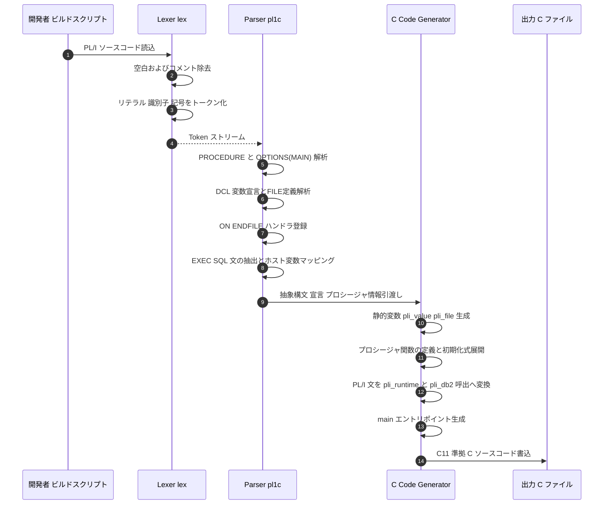
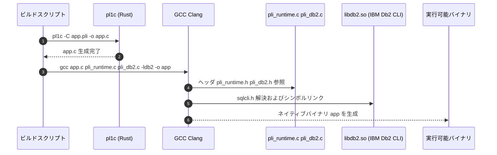
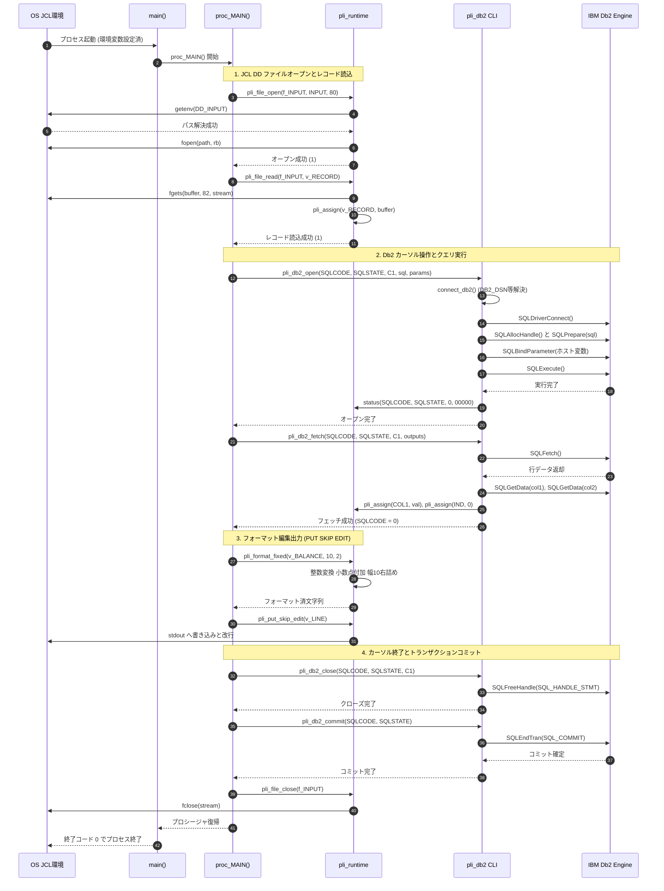

# PL/I (PL/1) サポート実装詳細解説: パース・コンパイル・実行シーケンス

本ドキュメントでは、本リポジトリにおける **PL/I（Programming Language One）のサポート実装** について、フロントエンドの構文解析（Lexing/Parsing）、中間Cコード生成（Transpilation）、ネイティブコンパイル、および実行時ランタイム（Runtime / Db2 CLI連携）の内部シーケンスを含めて詳細に解説します。

---

## 1. PL/I対応のアーキテクチャ概要

### 1.1 目的と設計方針
メインフレーム環境（IBM z/OS等）で稼働する基幹業務バッチシステム（例: Bank-of-Zの `BNKSTMT.pli` 等）は、COBOLだけでなくPL/Iで実装されているケースが多数存在します。
本リポジトリでは、PL/IコードをLinux/UNIXなどのオープン環境で透過的にコンパイル・実行するため、**Rustで記述された自己完結型トランスパイラ `pl1c`** と、**C言語で実装された軽量高信頼ランタイム（`pli_runtime` および `pli_db2`）** による多層アーキテクチャを採用しています。

### 1.2 全体構成図

```
+-----------------------------------------------------------------------+
|                           PL/I ソースコード (.pli)                     |
|  - DCL 変数 (CHAR, FIXED BIN, FIXED DEC)                              |
|  - ファイル定義 (FILE RECORD INPUT ENV(F RECSIZE(n)))                 |
|  - 構造化制御文 (DO, IF, CALL), I/O (READ, PUT EDIT), EXEC SQL         |
+-----------------------------------------------------------------------+
                                   |
                                   v  [pl1c: Rust Compiler]
+-----------------------------------------------------------------------+
|  1. 字句解析 (Lexer)     : トークン列生成 (Kind, Text, Line)            |
|  2. 構文解析 (Parser)    : プロシージャ, DCL, ON ENDFILE, EXEC SQL解析   |
|  3. コード生成 (Codegen) : C11 ソースコード (.c) 出力                  |
+-----------------------------------------------------------------------+
                                   |
                                   v
+-----------------------------------------------------------------------+
|                           生成された C ソースコード                     |
|  #include "pli_runtime.h" / #include "pli_db2.h"                      |
|  static pli_value v_VAR; static pli_file f_FILE;                      |
|  proc_PROC(); int main() { proc_MAIN(); }                             |
+-----------------------------------------------------------------------+
                                   |
                                   v  [GCC / Clang Linker]
+-----------------------------------------------------------------------+
|  C ランタイム (libpli)                                                 |
|  - pli_runtime.c : 固定長レコードDD I/O, 固定小数点演算, PUT EDIT     |
|  - pli_db2.c     : IBM Db2 CLI (ODBC) ラッパー, カーソル制御, SQLCA   |
|  - libdb2.so     : IBM Db2 クライアントドライバ                        |
+-----------------------------------------------------------------------+
                                   |
                                   v
+-----------------------------------------------------------------------+
|                         ネイティブ実行バイナリ                         |
+-----------------------------------------------------------------------+
```

---

## 2. パース（構文解析）フェーズの実装詳細

構文解析器は `extras/pl1c/src/main.rs` に外部クレート依存なし（標準ライブラリのみ）で実装されています。

### 2.1 字句解析（Lexer: `lex` 関数）
ソースコード文字列を `Token { kind, text, line }` のストリームに変換します。

- **スキップ処理**: 空白、改行、および PL/I 標準形式のブロックコメント `/* ... */` をスキップ。
- **文字列リテラル**: シングルクォート `'...'` を認識。連続する `''` を単一の `'` としてエスケープ処理。
- **ビット列リテラル**: `'0'B` または `'1'B` の後続 `B` 指定を認識（`BIT(1)` のみサポート）。
- **数値リテラル**: 整数部および小数部（`.`）を抽出。
- **複合演算子**: `<=`, `>=`, `^=`（否定等価）, `||`（文字列結合）を2文字トークンとして切り出し。
- **識別子・予約語**: 大文字・小文字を保持しながらトークン化（PL/Iの予約語判定はパーサー側で実施）。

### 2.2 構文解析器のデータ構造（`Parser` 構造体）

パーサーは再帰下降型（Recursive Descent）で構成されています。

```rust
struct Parser {
    tokens: Vec<Token>,
    pos: usize,
    decls: Vec<Decl>,                         // 変数宣言一覧
    procedures: Vec<Procedure>,               // プロシージャ一覧
    files: HashMap<String, usize>,            // ファイル名 -> レコード長
    file_handlers: HashMap<(String, String), String>, // (proc, file) -> ON ENDFILE処理
    cursors: HashMap<String, Cursor>,         // SQLカーソル定義
    names: HashSet<String>,                   // 宣言済み識別子
    sql_used: bool,                           // EXEC SQLが使用されたか
}
```

### 2.3 主要構文のパース手順

#### (1) プロシージャ（Procedure）の解析
- `NAME: PROC OPTIONS(MAIN);` または `NAME: PROCEDURE;` を解析。
- `OPTIONS(MAIN)` が指定されたプロシージャをエントリポイントとして記録（重複時は構文エラー）。
- 内部プロシージャ（サブルーチン）のネストに対応し、プロシージャ終端の `END NAME;` でラベル一致を検証。

#### (2) 変数宣言（`DCL` / `DECLARE`）の解析
カンマ区切りの複数宣言に対応し、各属性をパースしてCランタイム初期化式を生成します:
- `CHAR(n)` / `CHARACTER(n)`: `pli_storage_char(n)`（最大512文字）
- `BIT(1)`: `pli_storage_num(PLI_BIT, 1, 0)`
- `FIXED BIN(p, s)`: `pli_storage_num(PLI_BIN, p, s)`（最大62ビット）
- `FIXED DEC(p, s)`: `pli_storage_num(PLI_DEC, p, s)`（最大17桁）
- `INIT(expr)` / `INITIAL(expr)`: 初期値式を評価して保持。
- `FILE RECORD INPUT ENV(F RECSIZE(n))`: JCL DD名と固定レコード長 `n` を `files` テーブルに登録。

#### (3) 例外・条件処理（`ON ENDFILE`）の解析
- `ON ENDFILE(filename) BEGIN; ... END;`
- PL/I特有の非同期例外構文ですが、本トランスパイラでは該当プロシージャとファイル名のペア `(proc, file)` をキーとしてハンドラブロックを保持します。
- 後続の `OPEN FILE(...)` や `READ FILE(...) INTO(...)` が失敗、またはEOFに達した際、C言語の `if (!pli_file_read(...)) { <handler> }` 内にインライン展開されます。

#### (4) 埋め込みSQL（`EXEC SQL`）の解析
SQLプリコンパイラの役割を `pl1c` 自身が内蔵しています。
- **`EXEC SQL INCLUDE SQLCA;`**:
  Cヘッダ `#include "pli_db2.h"` のインクルードフラグを立て、`SQLCODE`（`FIXED BIN(31)`）と `SQLSTATE`（`CHAR(5)`）を静的変数として自動宣言。
- **ホスト変数の置換**:
  SQL文中の `:VAR` や `:VAR :IND`（インジケータ変数）を走査し、ODBCパラメータプレースホルダ `?` に置換。入力パラメータ配列および出力パラメータ配列を構築。
- **SQL文ごとの低水準化**:
  - `DECLARE CURSOR FOR <select>`: カーソル辞書にSQL文と入力変数を保存。
  - `OPEN <cursor>`: `pli_db2_open(...)` を呼び出すCコードへ変換。
  - `FETCH <cursor> INTO :v1, :v2`: `pli_db2_fetch(...)` を呼び出すCコードへ変換。
  - `CLOSE <cursor>`: `pli_db2_close(...)` を呼び出すCコードへ変換。
  - `SELECT ... INTO ... FROM ...`: シングルトンSELECTを `pli_db2_select(...)` へ変換。
  - `COMMIT WORK`: `pli_db2_commit(...)` へ変換。

#### (5) 式の評価と演算子優先順位（`expr` 関数）
Prattパーサー／優先順位クライミング法を用いて、優先順位に従ってC関数呼び出しツリーへ変換します:
- 単項演算子: `^` (`pli_not`), `-` (`pli_neg`), `+`
- レベル1: `|` (`pli_or`)
- レベル2: `&` (`pli_and`)
- レベル3: `=`, `^=`, `<`, `<=`, `>`, `>=` (`pli_eq`, `pli_ne`, `pli_lt`, `pli_le`, `pli_gt`, `pli_ge`)
- レベル4: `||` (`pli_concat`)
- レベル5: `+`, `-` (`pli_add`, `pli_sub`)
- レベル6: `*`, `/` (`pli_mul`, `pli_div`)

---

## 3. コンパイル（コード生成 & ネイティブ生成）フェーズの実装詳細

### 3.1 C言語へのトランスパイル規則 (`compile` 関数)

`pl1c` は解析結果から以下の構成を持つ単一のCソースコードを生成します。

```c
#include "pli_runtime.h"
#include "pli_db2.h" /* SQL使用時のみ */

/* 1. 静的変数の配置 */
static pli_value v_SQLCODE;
static pli_value v_SQLSTATE;
static pli_value v_ACCOUNT_ID;
static pli_file f_SORTCODE;

/* 2. プロシージャ前方宣言 */
static void proc_BNKSTMT(void);

/* 3. プロシージャ関数本体 */
static void proc_BNKSTMT(void)
{
    /* 初期化コード */
    v_ACCOUNT_ID = pli_storage_char(10);
    pli_assign(&v_ACCOUNT_ID, pli_literal("0000000000"));

    /* PL/I 文の変換 */
    if (!pli_file_open(&f_SORTCODE, "SORTCODE", 80)) {
        goto label_EOF_HANDLER;
    }
    
    /* SQL カーソルオープン */
    pli_db2_open(&v_SQLCODE, &v_SQLSTATE, "C1", "SELECT ... WHERE ID = ?", 1, (pli_sql_param[]){{&v_ACCOUNT_ID, NULL}});
    ...
}

/* 4. エントリポイント */
int main(void)
{
    proc_BNKSTMT();
    return 0;
}
```

### 3.2 ネイティブコンパイル・ビルドの流れ

トランスパイル後のCコードは、ホストの標準Cコンパイラ（GCCまたはClang）でコンパイル・リンクされます。

```bash
# ステップ 1: PL/I から C へのトランスパイル
pl1c -C BNKSTMT.pli -o BNKSTMT.c

# ステップ 2: C ソースと PL/I ランタイム / Db2 CLI のコンパイル・リンク
gcc -O2 -I extras/pl1c/runtime \
    BNKSTMT.c \
    extras/pl1c/runtime/pli_runtime.c \
    extras/pl1c/runtime/pli_db2.c \
    -ldb2 \
    -o BNKSTMT
```

---

## 4. 実行（ランタイム & 外部連携）フェーズの実装詳細

### 4.1 メモリ表現モデル: `pli_value` 構造体 (`pli_runtime.h`)

PL/Iの変数はすべて共通の構造体 `pli_value` で管理され、型安全な相互変換と演算を提供します。

```c
typedef enum { PLI_CHAR, PLI_BIN, PLI_DEC, PLI_BIT } pli_kind;

typedef struct {
    pli_kind kind;               /* データ型種別 */
    int precision;               /* 精度（総桁数またはビット幅） */
    int scale;                   /* 小数点以下桁数（スケール） */
    size_t length;               /* CHAR型の現在文字列長 */
    int64_t number;              /* FIXED BIN / DEC / BIT の内部数値（10^scale 倍で保持） */
    char chars[PLI_MAX_CHAR];    /* CHAR型の文字データバッファ（最大512バイト） */
} pli_value;
```

#### 固定小数点数の高精度内部演算
- `scale` を持つ固定小数点数は、小数点を排した整数（`number`）として `int64_t` に格納されます。
- 加減算・乗除算時には `scaled(pli_value v, int target_scale)` 関数により10の冪乗（`power10`）を掛けてスケールを揃え、オーバーフローチェック付き関数（`checked_add`, `checked_mul`）で正確に演算されます。

### 4.2 JCL DDファイルI/O機構 (`pli_runtime.c`)

PL/Iプログラム中のファイル参照は、メインフレームJCLのDD（Data Definition）名規約に従ってOS環境変数から解決されます。

```c
int pli_file_open(pli_file *file, const char *dd_name, size_t record_size)
{
    char key[128];
    const char *path;
    snprintf(key, sizeof key, "DD_%s", dd_name);
    path = getenv(key);
    if (!path || !*path) return 0;
    file->stream = fopen(path, "rb");
    file->record_size = record_size;
    return file->stream != NULL;
}
```
- **実行例**: `export DD_SORTCODE=/data/input/sortcode.dat` と設定することで、PL/Iコード内の `OPEN FILE(SORTCODE)` が透過的に `/data/input/sortcode.dat` をオープンします。
- `pli_file_read` は末尾の改行コード（`\r`, `\n`）を除去し、`RECSIZE` を超えないことを検証した上で `pli_value` にコピーします。EOF検出時は 0 を返し、生成コード側の `ON ENDFILE` ハンドラが発火します。

### 4.3 画面・レポート出力機構 (`PUT EDIT` / `PUT LIST`)

- **`PUT SKIP LIST(...)`**: 指定された項目を空白区切りで標準出力に出力し、改行します。
- **`PUT SKIP EDIT(...) (...)`**:
  - `A`: 文字列としてそのまま出力。
  - `F(width, decimals)`: `pli_format_fixed` により、指定された総幅 `width` および小数桁 `decimals` で右詰めフォーマット。桁あふれ時はメインフレーム仕様に準拠し、全幅を `*`（アスタリスク）で埋めます。
- **`PUT PAGE`**: 改ページ制御文字 `\f`（Form Feed: 0x0C）を標準出力に出力します。

### 4.4 IBM Db2 CLI (ODBC) データベース連携機構 (`pli_db2.c`)

PL/Iプログラムから埋め込みSQLが実行されると、動的にIBM Db2 CLI APIと対話します。

#### (1) 接続の遅延確立 (`connect_db2`)
初回SQL実行時に環境変数から接続パラメータを取得し、接続ハンドルを作成します:
- `DB2_DSN`, `DB2_USER`, `DB2_PASSWORD`（DSN接続）
- `DB2_DATABASE`, `DB2_HOST`, `DB2_PORT`, `DB2_USER`, `DB2_PASSWORD`（TCP/IP直接接続）
- 自動コミットをオフ（`SQL_AUTOCOMMIT_OFF`）に設定。
- `DB2_SCHEMA` が指定されている場合、`SET CURRENT SCHEMA <schema>` を自動実行。

#### (2) カーソルライフサイクルとパラメータバインド
- **`pli_db2_open`**:
  `SQLAllocHandle(SQL_HANDLE_STMT)` -> `SQLPrepare` -> `SQLBindParameter`（ホスト変数を `SQL_C_CHAR` としてバインド） -> `SQLExecute`。
- **`pli_db2_fetch`**:
  `SQLFetch` を実行。データが存在する場合は各カラムについて `SQLGetData` を呼び出し。
  - カラム値がNULLの場合: インジケータ変数に `-1` を設定。インジケータ変数が省略されていた場合はエラー `-305`（SQLSTATE `"22002"`）をセット。
  - カラム値が有効な場合: インジケータ変数に `0` を設定し、ターゲット変数に文字または数値として格納。
  - レコード末尾に達した場合: `SQL_NO_DATA` を検知し、`SQLCODE = 100`（SQLSTATE `"02000"`）を設定。
- **`pli_db2_close`**:
  ステートメントハンドルを `SQLFreeHandle` し、バインド用メモリを解放。
- **`pli_db2_commit`**:
  全アクティブカーソルを解放し、`SQLEndTran(SQL_HANDLE_DBC, connection, SQL_COMMIT)` を実行。

---

## 5. 詳細シーケンス図

### 5.1 パースおよびCコード生成シーケンス



### 5.2 ネイティブコンパイルおよびリンクシーケンス



### 5.3 実行時詳細シーケンス（初期化・ファイルI/O・Db2 SQL・出力）



---

## 6. まとめと技術的特徴

1. **自己完結型トランスパイラ (`pl1c`)**:
   Rustの強固な型システムとパターンマッチングを活用し、外部依存クレートなしで字句解析、構文解析、Cコード生成、埋め込みSQLプリコンパイルを単一バイナリで完結させています。
2. **C11 中間コード出力アプローチ**:
   LLVM IR等の低水準バイナリを直接出力するのではなく、可読性の高いC11コードを経由することで、既存のGCC/Clangの最適化パイプライン、デバッガ（GDB）、およびOS固有のABI（Application Binary Interface）と完全な互換性を確保しています。
3. **メインフレーム互換データモデル**:
   `pli_value` による固定小数点演算（`FIXED DEC`, `FIXED BIN`）、文字データ（`CHAR`）、固定長レコードDDファイルI/O（`ON ENDFILE`）、およびDb2 CLI（`SQLCODE`, `SQLSTATE`）のエミュレーションにより、メインフレーム上のPL/Iバッチ資産をオープンシステムへそのままリホストすることが可能となっています。
