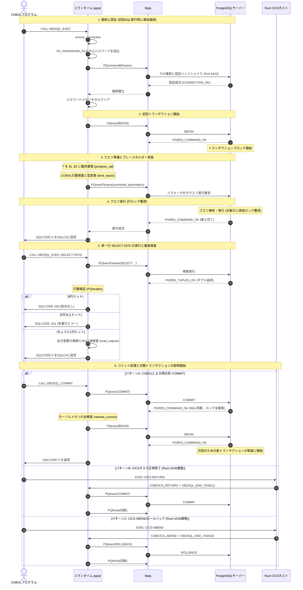

# GnuCOBOLにおけるPostgreSQL埋め込みSQL対応のアーキテクチャと処理シーケンス詳細報告書

## 1. 概要とアーキテクチャ

GnuCOBOL環境において、メインフレーム向けの埋め込みSQL（`EXEC SQL ... END-EXEC`）をPostgreSQLに対して透過的に実行可能とするため、`extras/pgsql/pgsql.c` にlibpq（PostgreSQL Cクライアントライブラリ）を用いたブリッジが実装されています。

### 1.1 設計思想と共通ABI
本実装の最大の特徴は、**Db2埋め込みSQLと同一の内部ABI（`DB2SQL_*` 呼び出し規約）を共有している点**です。
- コンパイラオプション `cobc --postgres-sql` を指定すると、既存のプリプロセッサ `bin/db2sql-preprocess.py` が呼び出され、`CALL "DB2SQL_EXEC"` や `CALL "DB2SQL_COMMIT"` などのコードが生成されます。
- 実行時に、`libdb2sql.so` の代わりに `extras/pgsql/pgsql.c` からビルドされた `libpgsqlsql.so` をロード（`COB_PRE_LOAD`）することで、COBOLプログラムに手を加えることなく接続先をPostgreSQLに切り替えることができます。

```text
+-------------------------------------------------------------------+
| 1. COBOLコード層                                                   |
|    EXEC SQL SELECT ... INTO :HV-NAME FROM CUSTOMER END-EXEC       |
+---------------------------------+---------------------------------+
                                  │ cobc --postgres-sql
                                  ▼
+-------------------------------------------------------------------+
| 2. プリプロセッサ層 (bin/db2sql-preprocess.py)                    |
|    共通SQL変換・? プレースホルダー生成・CALL "DB2SQL_EXEC" 生成    |
+---------------------------------+---------------------------------+
                                  │ GnuCOBOL コンパイル & リンク
                                  ▼
+-------------------------------------------------------------------+
| 3. C言語ランタイム層 (extras/pgsql/pgsql.c / libpgsqlsql.so)      |
|    ? を $1, $2 に動的変換・libpq (PQexecParams, PQgetvalue 等)    |
|    常にアクティブなトランザクション (BEGIN/COMMIT連鎖) 制御       |
+-----------------+-------------------------------+-----------------+
                  │                               │
                  │ SQLCODE / SQLSTATE            │ UOW / VSAM連携
                  ▼                               ▼
+--------------------------------+ +--------------------------------+
| 4. PostgreSQL (サーバー)       | | 5. Rust実装連携層              |
|    公式イメージ: postgres:17-alpine| |  - cobcics: CICS VSAM/UOW連携|
|    ポート 5433 (TCP/IP)        | |    (SAVEPOINTによる保護)       |
|    トランザクション分離 (ReadCommitted)| |  - jclsh: VSAM-PostgreSQL連携 |
+--------------------------------+ +--------------------------------+
```

---

## 2. 各層の実装詳細と役割分担

### 2.1 COBOLコード層 (`demo.cbl`, `ebcdic-demo.cbl`)
- **SQL構文**: `INCLUDE SQLCA`, `SELECT ... INTO`, `INSERT`, `UPDATE`, `DELETE`, `DECLARE/OPEN/FETCH/CLOSE CURSOR`, `COMMIT WORK`, `ROLLBACK WORK`。
- **データ型**: 英数字（`PIC X`）、二進数（`COMP / COMP-5`）、パック10進数（`COMP-3`）、可変長文字列（`49` レベルの長さ付きグループ項目）、NULL指示変数（`INDICATOR` 句）。
- **EBCDIC対応**: `-fdata-codeset=IBM-1399` 等でコンパイルされた場合でも、日本語漢字を含むデータがPostgreSQLのUTF-8と安全に往復します。

### 2.2 プリプロセッサ層 (`bin/db2sql-preprocess.py`)
`cobc --postgres-sql` 指定時に稼働します。
- 入力ホスト変数を `?` パラメータに置換。
- 出力ホスト変数を分離し、メタデータ文字列 `DB2-SQL-META` を生成。
- 固定形式72桁の規則を満たす `CALL "DB2SQL_EXEC"` 等のGnuCOBOLソースを生成。

### 2.3 C言語ランタイム層 (`extras/pgsql/pgsql.c`)
PostgreSQL公式の **libpq (`libpq-fe.h`)** を用いて実装されています。

1. **認証と秘密情報の分離**:
   - `PGHOST`, `PGPORT`, `PGDATABASE`, `PGUSER` の標準環境変数に加え、専用の `PG_PASSWORD_FILE` 環境変数をサポート。
   - ローカルの秘密ファイル（`extras/pgsql/secrets/password.txt`）からパスワードを読み取り、接続完了後に直ちにメモリを `memset` でゼロクリア。
2. **プレースホルダーの動的置換 (`postgres_sql`)**:
   - プリプロセッサが生成した `?` パラメータを、libpqが要求する `$1`, `$2`, `$3`, ... 形式へ文字列リテラル内外を判定しながら動的に置換。
3. **トランザクションの連続性維持**:
   - 初回接続時に `PQexec(connection, "BEGIN")` を発行。
   - `COMMIT` または `ROLLBACK` 発行直後に、**即座に次の `BEGIN` を自動発行**することで、メインフレームDb2と同様の「常にアクティブなトランザクションが存在する」挙動を再現。
4. **SQLCA互換マッピング (`sqlcode_for_state`)**:
   - PostgreSQLのSQLSTATEをDb2互換のSQLCODEにマッピング：
     - `23505` (一意性制約違反 / Duplicate Key) → `SQLCODE = -803`
     - `23503` (外部キー制約違反) → `SQLCODE = -530`
     - `23502` (非NULL制約違反) → `SQLCODE = -407`
     - `22003` (数値範囲超過) → `SQLCODE = -302`
     - 該当なし → `SQLCODE = +100` (`SQLSTATE = "02000"`)
     - 単一行SELECTで多重ヒット → `SQLCODE = -811` (`SQLSTATE = "21000"`)
     - NULL値受取時に指示子なし → `SQLCODE = -305` (`SQLSTATE = "22002"`)

### 2.4 Rust実装連携層 (`extras/cobcics`, `extras/jclsh`)
1. **CICS VSAM-SQL連携 (`extras/cobcics/pg_vsam.c` & `src/main.rs`)**:
   - CICSの `--vsam-backend postgres` オプションにより、VSAM KSDSレコードをPostgreSQLのテーブル（`K BYTEA PRIMARY KEY, V BYTEA NOT NULL`）にマッピング。
   - **SAVEPOINTによる保護**: PostgreSQLではエラーが発生するとトランザクション全体がアボート状態になります。重複キー（`23505`）発生時でもCICSタスクが継続できるよう、各更新操作を `SAVEPOINT` で囲み、エラー時はセーブポイントまでロールバックする高度な制御を実装。
   - CICSタスク終了時に `DB2SQL_END_TASK(1)` でコミット、ABEND時に `DB2SQL_END_TASK(0)` でロールバック。
2. **JCLバッチ連携 (`extras/jclsh/src/vsam_sql.rs`)**:
   - JCLジョブ実行ツール `jclsh`（Rust）において、`vsam_backend = "postgres"` 指定時、VSAMデータセット定義（`DEFINE CLUSTER`）やデータ投入（`REPRO`）をPostgreSQL上で自動実行。

---

## 3. 詳細シーケンス解説

以下に、接続・認証、トランザクション開始、クエリ実行、コミットに至る完全な詳細シーケンスを示します。



---

## 4. 細部仕様と技術的ポイント

### 4.1 常にアクティブなトランザクション（Continuous Transaction Chain）
PostgreSQLの通常モードはオートコミット（各文完結）ですが、メインフレームDb2は「常に作業単位（UOW）が存在する」セマンティクスです。
`pgsql.c` では、初回接続時および各 `COMMIT` / `ROLLBACK` の完了直後に `BEGIN` を即座に発行することで、この動作を模倣しています。COBOLプログラム側から見ると、何もしなくても常に一貫したトランザクション内で処理が行われます。

### 4.2 プレースホルダーの動的置換技術
プリプロセッサ `bin/db2sql-preprocess.py` はDb2と共用のため、出力されるSQLには `?` が埋め込まれています。
`pgsql.c` 内の `postgres_sql` 関数は、シングルクォートやダブルクォート内のリテラル文字列（例: `'What?'`）をスキップし、SQLパラメータとしての `?` のみを `$1, $2, ...` に置き換えます。これにより、プリプロセッサ側を変更することなくPostgreSQLエンジンに適合させています。

### 4.3 CICS VSAMにおける `SAVEPOINT` によるエラー保護
PostgreSQLのトランザクションは、一度エラー（例: 重複キー違反 `23505`）が発生すると、明示的にロールバックするまで後続のあらゆるSQL文を拒否します（`current transaction is aborted, commands ignored until end of transaction block`）。
CICSアプリケーションでは、重複キーを前提として `WRITE` し、エラーコードを受け取ってから別の処理を継続するパターンが頻繁にあります。
`extras/cobcics/pg_vsam.c` では、各書き込み操作の直前に `SAVEPOINT vsam_op` を発行し、エラー発生時は即座に `ROLLBACK TO SAVEPOINT vsam_op` を発行することで、**外側のCICS UOWトランザクション全体を破壊せずにエラーコードのみをCOBOLへ返却する**という極めて高度な防御機構が組み込まれています。
