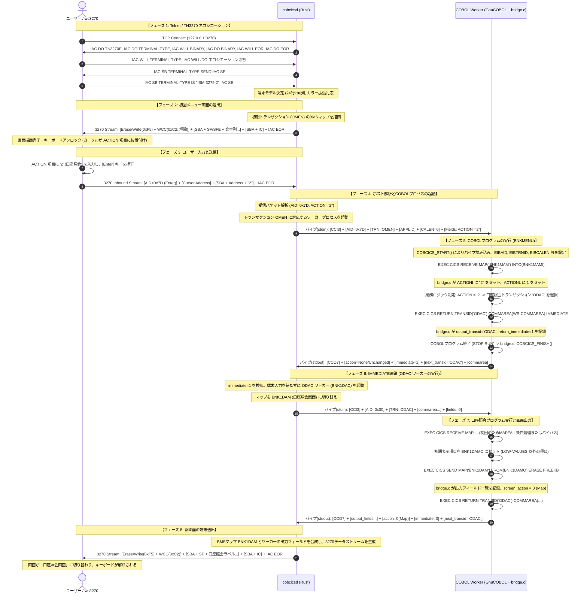

# GnuCOBOL / cobcics: 3270エミュレータ通信機能の実装と処理シーケンス詳細解説

## 1. 概要とアーキテクチャ

メインフレーム（IBM z/OS等）のオンライントランザクション処理（CICS）では、端末として**3270表示装置**（または `wc3270`, `c3270`, `x3270` などのTN3270エミュレータ）が使用されます。
GnuCOBOL環境においてこの端末会話を実現するため、`gnucobol/extras/cobcics/` にRust製CICS/TN3270サーバーエンジン（`cobcicsd`）およびGnuCOBOL連携ブリッジ（`bridge.c`）が実装されています。

### 1.1 全体構成図

```text
+-----------------------+
|  3270 エミュレータ    | (wc3270 / c3270 など)
| (IBM-3279-2 / CP037)  |
+-----------+-----------+
            │ TCP (ポート 3270)
            │ [Telnet + 3270 Data Stream (EBCDIC)]
            ▼
+---------------------------------------------------------------+
| cobcicsd (Rust製 CICS / TN3270 ホストサーバー)                |
|                                                               |
|  ├─ tn3270.rs: Telnetネゴシエーション / 3270ストリーム生成・解析|
|  ├─ bms.rs: BMSマップパーサー / 物理マップ定義・座標管理      |
|  ├─ server.rs: 接続ループ / セッション・トランザクション管理   |
|  └─ worker.rs: COBOLワーカー呼び出し / パイププロトコル制御    |
+-------------------------------+-------------------------------+
                                │ stdin / stdout パイプ
                                │ [バイナリプロトコル: CCI3/4 ⇄ CCO5/6/7]
                                ▼
+---------------------------------------------------------------+
| COBOL ワーカープロセス (GnuCOBOL 実行可能バイナリ)            |
|                                                               |
|  ├─ bridge.c: C言語ABI (COBCICS_START, RECEIVE_MAP, RETURN等) |
|  ├─ CICSプリプロセッサ生成コード (cics-preprocess.py)         |
|  ├─ BMSシンボリックマップ構造体 (...I / ...O コピーブック)    |
|  └─ COBOL 業務ロジック (EXEC CICS ..., SQL, ファイル入出力)   |
+---------------------------------------------------------------+
```

---

## 2. 3つの通信プロトコル層

エミュレータからCOBOLプログラムまでの間には、3つの異なる抽象度・プロトコル層が存在します。

```text
[エミュレータ] <==== ① Telnet/TN3270層 ====> [cobcicsd] <==== ③ パイプABI層 ====> [COBOL Worker]
               <==== ② 3270データストリーム ====>
```

### ① Telnet / TN3270 / TN3270E 層 (`src/tn3270.rs`)
- TCPトランスポート上でRFC 854 (Telnet)、RFC 1576 (TN3270)、RFC 2355 (TN3270E) に準拠したバイナリネゴシエーションを行います。
- **レコード境界**: 3270データストリームの末尾は必ず Telnetコマンド `IAC EOR`（`0xFF 0xEF`）で区切られます。
- **TN3270Eヘッダ**: TN3270Eネゴシエーション完了時は、データ先頭に5バイトのヘッダ（通常データ時は `[0x00, 0x00, 0x00, 0x00, 0x00]`）が付与されます。

### ② 3270 データストリーム層 (`src/tn3270.rs`)
- メインフレーム端末とやり取りされる伝統的な画面制御バイト列（EBCDICエンコード）。
- **Outbound（画面描画）**:
  - コマンド: `0xF5` (Erase/Write) または `0x7E` (Erase/Write Alternate) または `0xF1` (Write / Data-Only)
  - WCC（Write Control Character）: キーボードロック解除（`0xC2`）、アラーム鳴動（`0xC6`）等
  - オーダー（Orders）:
    - `0x11` (SBA: Set Buffer Address): 画面バッファアドレス（12bit/14bit）を指定
    - `0x1D` (SF: Start Field): フィールド属性（保護/非保護、文字/数値、輝度、MDTフラグ）
    - `0x29` (SFE: Start Field Extended): カラー（Color）、強調（Highlight）、日本語SO/SI制御等の拡張属性
    - `0x13` (IC: Insert Cursor): カーソル位置の設定
- **Inbound（端末入力）**:
  - AID（Action Indicator）: 押下されたキー種別（Enter: `0x7D`, PF1〜PF24, Clear: `0x6D`, PA1〜PA3 等）
  - カーソルアドレス: キー押下時のカーソル位置（2バイト）
  - 変更データ（MDTがセットされたフィールドのみ）: `SBA + アドレス + 入力文字列` の繰り返し

### ③ ホスト - COBOLワーカー間 パイププロトコル層 (`src/worker.rs` / `bridge.c`)
`cobcicsd` とCOBOLプロセスは別プロセスとして起動され、標準入出力（stdin / stdout）パイプを介して独自のバイナリプロトコルで通信します。COBOL内の `DISPLAY` 出力が混ざって壊れないよう、`bridge.c` 側で `dup2` により通常の標準出力を stderr に逃がし、専用のファイル記述子でプロトコルを保護します。

#### リクエスト形式: `CCI3` / `CCI4` (Host → COBOL)
| オフセット | 長さ | 内容 |
| :---: | :---: | :--- |
| 0 | 4 | マジックコード `b"CCI3"` (コンテナなし) または `b"CCI4"` |
| 4 | 1 | 押下されたAIDキーコード (`input.aid`) |
| 5 | 4 | 実行トランザクションID (`input_transid`) |
| 9 | 8 | CICSリージョン名 (`input_applid`, 例: `"BANKAPP "`) |
| 17 | 2 | COMMAREA長 (ビッグエンディアン `u16`) |
| 19 | $L_c$ | 直前タスクから引き継がれたCOMMAREAデータ |
| $19+L_c$ | 2 | 変更フィールド数 $N$ (ビッグエンディアン `u16`) |
| 可変 | - | 各フィールド情報: `名前 (8B)` + `長さ (u16)` + `UTF-8文字列本文` |

#### レスポンス形式: `CCO7` (COBOL → Host)
| オフセット | 長さ | 内容 |
| :---: | :---: | :--- |
| 0 | 4 | マジックコード `b"CCO7"` (拡張属性対応) |
| 4 | 2 | 出力フィールド数 $M$ (`u16`) |
| 可変 | - | 各出力フィールド: `名前 (8B)` + `長さ (u16)` + `UTF-8文字列本文` |
| 可変 | 2 | 属性変更数 (`u16`) + 各属性: `名前 (8B)` + `値 (1B)` |
| 可変 | 2 | 拡張属性変更数 (`u16`) + 各属性: `名前 (8B)` + `種別 ('C'/'H')` + `値 (1B)` |
| 可変 | 1 | 画面アクション (`screen_action`: 0=Map, 1=Erase, 2=DataOnly, 3=DataOnly+Alarm, 4=None, 5=Text) |
| 可変 | 1 | 即時実行フラグ (`return_immediate`: 0 または 1) |
| 可変 | 4 | 次回トランザクションID (`output_transid`) |
| 可変 | 2 | 返却COMMAREA長 (`u16`) + 返却COMMAREA本文 |
| 可変 | 2 | テキスト長 (`u16`) + テキスト本文 (SEND TEXT用) |

---

## 3. BMS（Basic Mapping Support）とシンボリックマップの連携構造

画面のレイアウトは、アセンブラマクロ（`.bms`）で静的に定義されます。

```text
BNK1MAI  DFHMSD TYPE=&SYSPARM,MODE=INOUT,TERM=3270-2,LANG=COBOL,TIOAPFX=YES
BNK1MAM  DFHMDI SIZE=(24,80),LINE=1,COLUMN=1
TITLE    DFHMDF POS=(1,25),ATTRB=(ASKIP,BRT),LENGTH=30,INITIAL='BANK OF Z - MAIN MENU'
ACTION   DFHMDF POS=(19,30),ATTRB=(UNPROT,NUM,IC),LENGTH=1
MESSAGE  DFHMDF POS=(23,2),ATTRB=(ASKIP,BRT),LENGTH=70
         DFHMSD TYPE=FINAL
```

### `cobcics-mapgen` によるCOBOLコピーブック生成
このBMSから、COBOLコンパイル時に取り込むシンボリックマップ構造体が生成されます。

```cobol
       01  BNK1MAMI.
           02  FILLER PIC X(12).            *> TIOAPFX
           02  TITLEL    PIC S9(4) COMP.    *> フィールド長
           02  TITLEF    PIC X.             *> フラグ (変更有無・消去フラグ)
           02  FILLER REDEFINES TITLEF.
               03  TITLEA PIC X.            *> 属性バイト
           02  TITLEI    PIC X(30).         *> 入力データ領域
           02  ACTIONL   PIC S9(4) COMP.
           02  ACTIONF   PIC X.
           02  FILLER REDEFINES ACTIONF.
               03  ACTIONA PIC X.
           02  ACTIONI   PIC X(1).
           ...
       01  BNK1MAMO REDEFINES BNK1MAMI.
           02  FILLER PIC X(12).
           02  FILLER PIC X(3).
           02  TITLEC PIC X.                *> 拡張カラー
           02  TITLEH PIC X.                *> 拡張ハイライト
           02  TITLEO PIC X(30).            *> 出力データ領域
           ...
```

- **Low-Values（`0x00`）ルール**:
  COBOLプログラムが出力領域 `...O` を `LOW-VALUES` のままにしたフィールドは、`bridge.c` が送信対象から除外します。これにより、BMSマクロで定義された `INITIAL`（タイトル等の固定ラベル）がそのまま端末画面に表示されます。

---

## 4. エミュレータとCOBOL処理の完全な詳細シーケンス

以下に、端末接続からログインメニュー表示、ユーザー入力、COBOL業務プログラム実行、次画面遷移までの詳細シーケンスを示します。



---

## 5. 細部シーケンス・実装の技術的ポイント

### 5.1 12/14ビット バッファアドレスの相互変換 (`src/tn3270.rs`)
3270表示装置では、画面上の行・列（例: 24行80列＝最大1920文字）の位置指定に12ビットまたは14ビットのアドレスコードが使用されます。
- `tn3270.rs` では、`ADDRESS_CODE` テーブル（64要素）に基づき、上位6ビットと下位6ビットをそれぞれEBCDIC文字風のコードにエンコードして送受信します。
  ```rust
  // アドレス 0 の場合: 0x40 0x40 (空白2文字)
  // 12-bit アドレスの上位・下位 6bit への分解
  [ADDRESS_CODE[address >> 6], ADDRESS_CODE[address & 0x3f]]
  ```
- エミュレータからのInboundストリームを受信した際は、`parse_address(&record[1..3])` により即座に画面上の0始まりインデックス（$Row \times Columns + Col$）へ逆変換されます。

### 5.2 擬似会話型トランザクション（Pseudo-Conversational Mode）
CICSアプリケーションは、ユーザーのキー入力を待つ間プロセスを常駐させず、一度 `EXEC CICS RETURN TRANSID('次ID') COMMAREA(...)` でプロセスを終了させます。
1. `bridge.c` が `COBCICS_RETURN` で次回の `TRANSID` と `COMMAREA` を `CCO7` レスポンスに乗せて返します。
2. `cobcicsd` 側は、接続中のエミュレータセッション構造体（`crate::worker::Session`）にこの `transid` と `commarea` を記憶してプロセスを解放します。
3. 次回、ユーザーが端末でキー（EnterやPFキー）を押した際、`cobcicsd` が記憶しておいた `transid` に紐づくCOBOLプログラムを再起動し、保存されていた `commarea` を渡します。
4. これにより、数百〜数千の端末が接続されてもリソースを浪費しないメインフレーム固有のアーキテクチャが忠実に再現されています。

### 5.3 `DATAONLY` と差分更新によるトラフィック削減
- COBOL側で `EXEC CICS SEND MAP(...) DATAONLY` を発行すると、画面全体の再描画（Erase/Write）を行わず、Writeコマンド（`0xF1`）と変更されたフィールドの `SBA + データ` のみが送出されます。
- `tn3270::render_dataonly_for_terminal` がこの差分ストリームを構築し、端末側の既存ラベルや属性を保持したままデータセルのみを高速に上書き更新します。

### 5.4 日本語EBCDIC（DBCS / 漢字）とSO/SI制御
- 日本語環境（IBM-930, IBM-939, IBM-1399等）では、1バイト文字と2バイト漢字の切り替えにシフトコード `SO`（Shift Out: `0x0E`）と `SI`（Shift In: `0x0F`）が用いられます。
- 3270端末のSFE（Start Field Extended）にて入力制御属性 `[0xFE, 0x01]` を付与することで、エミュレータ側での日本語自動入力モードを有効化し、ワーカーパイプ上ではUTF-8文字列として安全にデコードしてCOBOLプログラムに受け渡す設計となっています。
