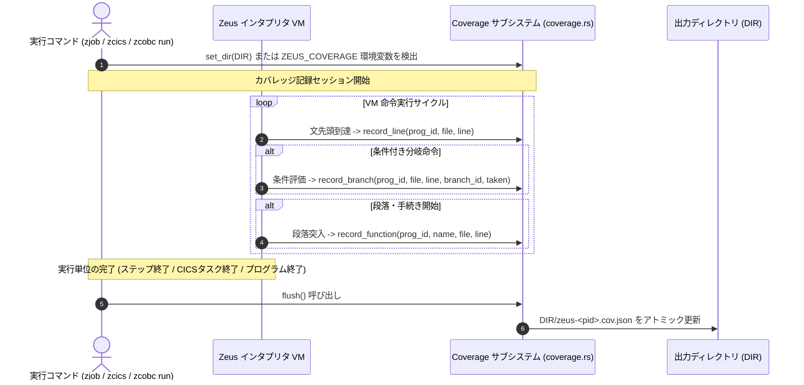

# Zeus における COBOL / PL/I カバレッジ機能 実装詳細解説

本ドキュメントでは、**Zeus（Rust による z/OS アプリケーションランタイム）** における **COBOL および PL/I のコードカバレッジ計測サブシステム（`zcov` / `ZEUS_COVERAGE`）** について、インタプリタ実行時のインメモリ計測、プロセス単位の JSON 中間記録、集計・レポート生成（LCOV / HTML）、および GnuCOBOL 等のトランスパイル型処理系とのアーキテクチャ上の差異を含めて詳細に解説します。

---

## 1. Zeus カバレッジのアーキテクチャ概要

### 1.1 目的と設計方針
Zeus は Enterprise COBOL 4.2 および Enterprise PL/I 5.3 のソースコードを独自コンパイラ（`zcobc` / `zpli`）により中間表現（ZIR / PL/I IR）へ変換し、Rust 製インタプリタ上で実行します。

従来のトランスパイル型処理系（COBOL → C言語 → GCC `gcov`）では、生成された中間言語レベルの膨大な内部分岐が混入し、業務ロジック本来の網羅率測定が困難でした。Zeus では以下の設計方針により、言語仕様に忠実なカバレッジ計測を実現しています:

1. **言語ネイティブな論理計測**:
   - COBOL: 実行文（Line）、条件付きジャンプ（Branch: `IF`, `EVALUATE WHEN`, `PERFORM UNTIL/VARYING`, `AT END`, `INVALID KEY`, `ON SIZE ERROR` 等）、段落・節（Paragraph / Section）。
   - PL/I: 実行文（Line: `DECLARE`・手続き定義を除く）、分岐（Branch: `IF` の THEN / ELSE）、手続き（Procedure: 入室回数）。
2. **実行エンジン（インタプリタ）への完全統合**:
   ソースコードの計装による副作用（バイナリ肥大化や実行時オーバーヘッド）を避け、インタプリタの仮想マシン（VM）実行ループ内で直接カウンタをインクリメントします。
3. **複数実行・長時間稼働プロセスの合算**:
   ジョブステップ単位（`zjob`）、トランザクション単位（`zcics`）、あるいは単体実行（`zcobc run`）の終了時に、プロセス合算カウンタを JSON 形式で出力。常駐サーバーでもタスク完了ごとに最新状態をディスクに書き出します。

### 1.2 全体アーキテクチャ構成図

```text
+--------------------------------------------------------------------------+
|                   COBOL (.cbl) / PL/I (.pli) ソースコード                 |
+--------------------------------------------------------------------------+
                                     |
                                     v  [zcobc / zpli コンパイル]
+--------------------------------------------------------------------------+
| 1. コンパイラ層 (zeus-cobol / zeus-pli)                                   |
|   - 構文解析時に Stmt::Line でソース位置 (ファイルパス・行・列) を保持      |
|   - ZIR 中間表現: stmt_pos, instr_stmt, 段落 pos                         |
|   - COPY メンバー / %INCLUDE メンバーの元ファイル位置を厳密に追跡         |
+--------------------------------------------------------------------------+
                                     |
                                     v  [ZEUS_COVERAGE=DIR / --coverage DIR]
+--------------------------------------------------------------------------+
| 2. 実行・計測層 (zeus-cobol VM / zeus-pli VM: coverage.rs)               |
|   - インタプリタ実行ループで PC に対応する位置・分岐方向を直接記録         |
|     * 行実行: 文の先頭命令の実行時に加算                                 |
|     * 分岐判定: taken (飛越し) / not_taken (直進) を個別に 64bit 加算    |
|     * 段落/手続き: 入室時に加算                                          |
|   - 実行単位終了フック (プログラム終了 / ジョブステップ終了 / CICS タスク終了) |
|   - プロセス合算カウンタをアトミック出力: DIR/zeus-<pid>.cov.json          |
+--------------------------------------------------------------------------+
                                     |
                                     v
+--------------------------------------------------------------------------+
| 3. 集計・レポーティング層: zcov (crates/zeus-cobol/src/bin/zcov.rs)       |
|   - 複数プロセスの zeus-*.cov.json をマージ                              |
|   - テキストサマリ (--detail: 未実行行、片側分岐、未入室段落の抽出)       |
|   - LCOV 形式出力 (--lcov coverage.info) -> genhtml / IDE 連携           |
|   - HTML レポート生成 (--html report_dir) -> 行別実行回数・カラー表示    |
+--------------------------------------------------------------------------+
```

---

## 2. カバレッジ計測の対象と内部データモデル

計測データは `crates/zeus-cobol/src/coverage.rs` 内で定義された Rust データ構造体によって表現されます。

### 2.1 データ構造の定義

```rust
/// 単一プログラム (COBOL プログラムまたは PL/I モジュール) のカバレッジ
#[derive(Debug, Clone, Default, PartialEq, Eq, Serialize, Deserialize)]
pub struct ProgramCov {
    pub language: String,            // "COBOL" または "PL/I"
    pub name: String,                // プログラム名 / モジュール名
    pub sources: Vec<String>,        // ソースファイルの絶対パス一覧
    pub lines: Vec<LineCount>,       // 文単位の実行回数
    pub branches: Vec<BranchCount>,  // 分岐単位の判定回数
    pub functions: Vec<FnCount>,     // 段落 / 節 / 手続きの入室回数
}

#[derive(Debug, Clone, Copy, PartialEq, Eq, Serialize, Deserialize)]
pub struct LineCount {
    pub file: u32,  // sources 配列のインデックス
    pub line: u32,  // 1-based 行番号
    pub count: u64, // 実行回数
}

#[derive(Debug, Clone, Copy, PartialEq, Eq, Serialize, Deserialize)]
pub struct BranchCount {
    pub file: u32,
    pub line: u32,
    pub id: u32,         // 同一行内の複数分岐を区別する ID
    pub taken: u64,      // 分岐成立 (ジャンプ) 回数
    pub not_taken: u64,  // 分岐不成立 (フォールスルー) 回数
}

#[derive(Debug, Clone, PartialEq, Eq, Serialize, Deserialize)]
pub struct FnCount {
    pub name: String,
    pub file: u32,
    pub line: u32,
    pub count: u64,
}
```

### 2.2 COBOL と PL/I の計測対象詳細

| 項目 | COBOL の計測対象 | PL/I の計測対象 |
| :--- | :--- | :--- |
| **行 (Lines)** | 実行可能文が存在する行。文の最初の命令が実行された回数（1行に複数文がある場合は最大値）。 | 実行可能文（`DECLARE` および手続き定義を除く）が存在する行の実行回数。 |
| **分岐 (Branches)** | 条件付き飛越し命令ごとに `taken`（分岐先へジャンプ）と `not_taken`（次行へフォールスルー）を独立カウント:<br>- `IF ... ELSE ... END-IF`<br>- `EVALUATE ... WHEN ...`<br>- `PERFORM ... UNTIL / VARYING`<br>- `READ ... AT END / INVALID KEY`<br>- `ADD/COMPUTE ... ON SIZE ERROR` | `IF` 文の `THEN` 節と `ELSE` 節（同一行に複数の `IF` がある場合は行単位で合算）。 |
| **段落・手続き (Functions)** | 段落（節ヘッダー含む）の先頭命令の実行回数。 | `PROCEDURE` に入った回数（先頭の実行文の実行回数）。 |

---

## 3. 実行時計測シーケンスとフラッシュ機構

### 3.1 実行時シーケンス図



### 3.2 アトミック書き込みと常駐プロセス対応
- 常駐型プロセス（`zcics` による CICS 端末サーバーや `zconn` z/OS Connect エミュレータ）では、プロセスが終了しないため、タスク（疑似会話トランザクション）が完了するたびに `DIR/zeus-<pid>.cov.json` へフラッシュされます。
- 書き込みは一時ファイル（`.tmp`）に書き出した後にリネームするアトミック更新を採用しており、外部の監視プロセスや CI スクリプトが不完全なファイルを読み取る競合を防ぎます。

---

## 4. 集計ツール `zcov` の実装

`zcov`（`crates/zeus-cobol/src/bin/zcov.rs`）は、指定されたディレクトリ内のすべての `zeus-*.cov.json` を探索・マージし、多彩な形式でレポートを出力します。

### 4.1 コマンドライン仕様

```bash
# 基本サマリレポートの表示
zcov report DIR...

# 詳細表示（未実行行、片側未通過分岐、未入室段落を特定）
zcov report --detail DIR...

# LCOV 形式出力（IDE や CI/CD パイプライン連携用）
zcov report --lcov DIR/coverage.info DIR...

# HTML ビジュアルレポート出力
zcov report --html DIR/html_report DIR...
```

### 4.2 レポート出力例（テキストサマリ）

```text
Program          Language   Lines           Branches        Functions
---------------------------------------------------------------------
CBACT01C         COBOL      142/180  (78%)   24/ 36  (66%)   12/ 14  (85%)
CBSTM03A         COBOL      320/350  (91%)   58/ 64  (90%)   28/ 28 (100%)
IBLOGIN          PL/I        45/ 50  (90%)    8/ 10  (80%)    3/  3 (100%)
---------------------------------------------------------------------
Total                       507/580  (87%)   90/110  (81%)   43/ 45  (95%)
```

`--detail` オプションを指定した場合、テスト漏れの箇所がピンポイントで表示されます:
- `CBACT01C.cbl:142: branch not taken (false branch never executed)`
- `CBACT01C.cbl:185: line never executed`
- `CBACT01C.cbl:210: paragraph '9999-ERROR-EXIT' never entered`

### 4.3 HTML ビジュアライザ
`--html` オプションにより生成される HTML レポートは、ソースコードの絶対パスをもとに元のソースファイルを読み込み、以下の色分けでレンダリングします:
- **緑色**: 実行された行（左端に実行回数を表示）
- **赤色**: 実行されなかった行（未カバー行）
- **黄色**: 分岐の片側ルートしか通過していない行（真のみ、または偽のみ実行）

---

## 5. 実機検証およびベンチマーク実績

Zeus のカバレッジ計測機構は、以下のテストスイートおよび実アプリケーションで検証されています（2026年10月時点）:

1. **CCVS85 適合性テスト**:
   - NIST CCVS85 スイート全 434 本のプログラムをカバレッジ計測有効状態で実行し、全件で実行結果（出力・終了コード）が完全一致することを確認。カバレッジ計測による論理副作用がないことを実証。
2. **AWS CardDemo バッチ & オンライン**:
   - `tools/carddemo.sh all`（バッチジョブ）および `tools/carddemo-online.sh test`（CICS オンライン）において、対象 29 本の COBOL プログラムのカバレッジを統合計測:
     - 行網羅率 (Line Coverage): **58%**
     - 分岐網羅率 (Branch Coverage): **44%**
     - 段落網羅率 (Paragraph Coverage): **87%**
3. **PL/I テスト**:
   - `crates/zeus-pli/tests/coverage.rs` において、再帰手続き、IF 分岐、ON ユニットを含む PL/I プログラムの網羅率計測を検証。

---

## 6. GnuCOBOL 方式との比較・制約事項

| 比較項目 | Zeus (`zcov`) | GnuCOBOL (`cobc --cobol-branch-coverage`) |
| :--- | :--- | :--- |
| **計測レベル** | インタプリタ VM 内での論理カウンタ加算 | 生成 C コードへの `cob_cov_hit()` 関数注入 |
| **計測対象** | 行、分岐（COBOL全般・PL/I IF）、段落/節/手続き | 分岐のOutcome（真・偽・各WHEN等）、決定（Decision） |
| **対応言語** | **COBOL および PL/I の双方** | COBOL のみ |
| **ネイティブコード時の挙動** | 機械語実行時はインタプリタへ自動切替 | ネイティブコンパイル時にもそのまま動作 |
| **中間ファイル** | 単一 JSON (`zeus-<pid>.cov.json`) | 静的マップ JSON + 複数 `.counts` バイナリ |
| **複合条件 (MC/DC)** | 未対応（条件式全体の結果を計測） | 未対応（単一条件ごとの Outcome を計測） |
