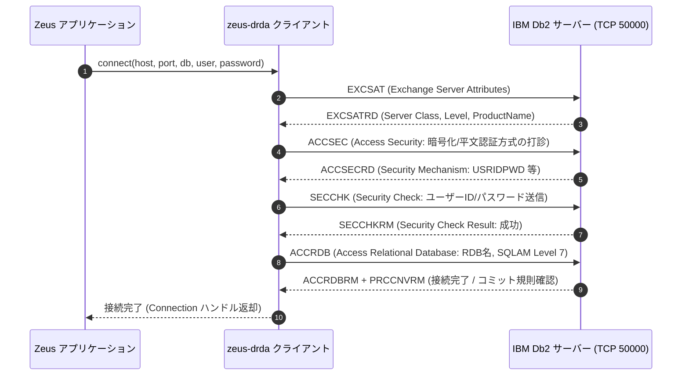
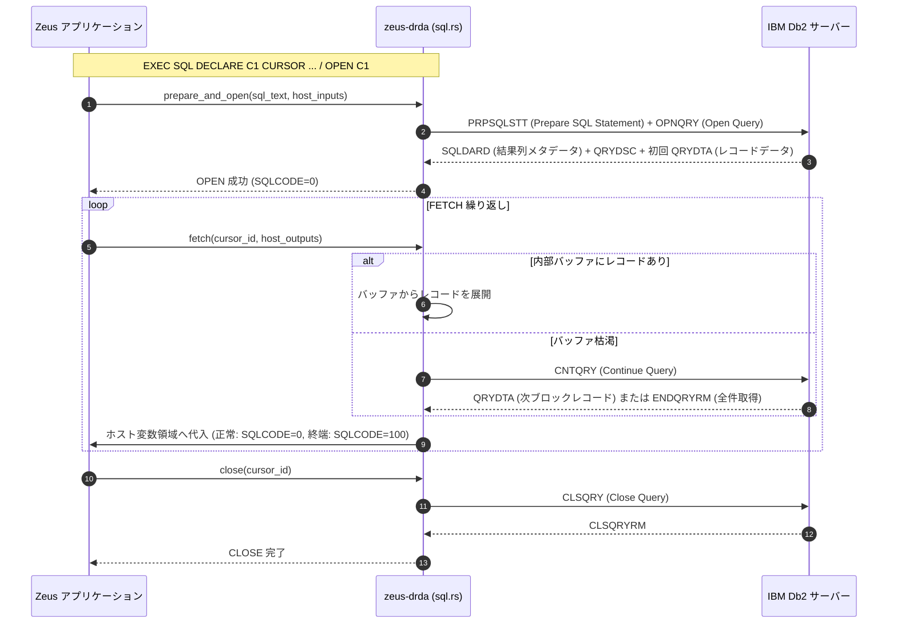

# Zeus における Db2 統合アーキテクチャと DRDA プロトコル処理詳細解説

本ドキュメントでは、**Zeus（Rust による z/OS アプリケーションランタイム）** における **IBM Db2 統合アーキテクチャ（`zeus-drda` / `zeus-db2`）** について、Pure Rust による DRDA（Distributed Relational Database Architecture）プロトコル実装、動的 SQL・SQLDA、ホスト変数と EBCDIC バインド、および CICS / JCL との作業単位（UOW）連携を含めて詳細に解説します。

---

## 1. Db2 統合のアーキテクチャ概要

### 1.1 目的と「Pure Rust DRDA 直接実装」という設計判断
メインフレーム（z/OS）上の基幹業務システム（CardDemo, GenApp, Bank of Z 等）では、大量のデータアクセスが `EXEC SQL ... END-EXEC` 文を通じて Db2 に対して行われます。

一般的なオープン系リホスト環境や GnuCOBOL では、IBM 公式の C 言語ドライバ（IBM Data Server Driver for ODBC and CLI）を動的リンクする方式を採用します。しかし、Zeus では以下の明確な設計判断のもと、**「Pure Rust による DRDA プロトコル直接実装（`crates/zeus-drda`）」** を採用しています:

1. **外部 C ライブラリ非依存（ゼロ依存性）**:
   - 独自の高価なライブラリや IBM CLI ドライバ（`libdb2.so` / `db2cli.dll`）のインストールが不要であり、Linux/Windows/コンテナ環境で即座にビルド・単一バイナリ実行が可能。
2. **EBCDIC ネイティブ通信**:
   - メモリ内部で EBCDIC 生バイトを保持する Zeus の実行モデルと直結。DRDA プロトコル自体が元来メインフレーム（SNA / TCP/IP）上で IBM により設計された EBCDIC ベースのプロトコルであるため、無駄な ASCII 変換オーバーヘッドを排斥。
3. **第1バックエンド（Db2 Community Edition）と第2バックエンド（PostgreSQL）の両立**:
   - 公式の Db2 LUW / z/OS への直接接続に加え、同じ DRDA / SQL レイヤで PostgreSQL との翻訳ブリッジ（`zeus-pg`）を接続可能。

### 1.2 全体アーキテクチャ構成図

```text
+--------------------------------------------------------------------------+
|                  COBOL / PL/I アプリケーション (.cbl / .pli)              |
|  EXEC SQL                                                                |
|      SELECT CUST_NAME, CUST_BAL INTO :HV-NAME, :HV-BAL                   |
|      FROM CUSTOMER WHERE CUST_ID = :HV-ID                                |
|  END-EXEC                                                                |
+--------------------------------------------------------------------------+
                                     |
                                     v  [zcobc / zpli コンパイル]
+--------------------------------------------------------------------------+
| 1. コンパイラ統合層 (zeus-cobol / zeus-pli)                              |
|   - 埋め込み SQL 構文解析 (静的 DML, カーソル, 動的 SQL, INCLUDE SQLCA)   |
|   - ホスト変数バインド情報の抽出 (型, 長さ, オフセット, NULL指示子)         |
|   - SQL 通信領域 SQLCA (SQLCODE, SQLSTATE) の自動メモリ配置               |
|   - ZIR 中間表現: OpSqlPrepare, OpSqlOpen, OpSqlFetch, OpSqlExec 等へ展開 |
+--------------------------------------------------------------------------+
                                     |
                                     v  [実行時: zeus-db2 互換層]
+--------------------------------------------------------------------------+
| 2. ランタイム実行層 (zeus-db2)                                           |
|   - セッション / コネクション管理 (単一接続 / CICS スレッド共有)          |
|   - ホスト変数バッファ ⇄ DRDA パラメータマッピング                         |
|   - SQLCODE / SQLSTATE へのエラーコード正規化変換                         |
+--------------------------------------------------------------------------+
                                     |
                                     v  [DRDA クライアント呼び出し]
+--------------------------------------------------------------------------+
| 3. DRDA プロトコル層 (zeus-drda: client.rs, ddm.rs, sql.rs)              |
|   - DDM (Distributed Data Management) パケット構築 & DDM コマンド送信     |
|     * EXCSAT (サーバー属性交換), ACCSEC / SECCHK (認証)                  |
|     * ACCRDB (RDB アクセス), PRPSQLSTT (SQL 準備), OPNQRY (クエリ開始)   |
|     * CNTQRY (フェッチ継続), CLSQRY (クエリ終了)                         |
|     * RDBCMM (コミット), RDBRLLBCK (ロールバック)                        |
|   - Dynamic SQL & SQLDA (記述子) 生成 / 解釈                             |
+--------------------------------------------------------------------------+
                                     |
                                     v  [TCP/IP ソケット通信: ポート 50000]
+------------------------------------+-------------------------------------+
| バックエンド A: IBM Db2               | バックエンド B: PostgreSQL (zeus-pg) |
| (Db2 for LUW / Community Edition)   | (zeus-drda アダプタ経由の変換接続)  |
+------------------------------------+-------------------------------------+
```

---

## 2. DRDA プロトコル通信シーケンス

DRDA（Distributed Relational Database Architecture）は、IBM が規定した階層型データ交換アーキテクチャ（DDM: Distributed Data Management）上で動作します。

### 2.1 セッション確立とハンドシェイク シーケンス



### 2.2 クエリ実行とカーソル操作シーケンス (`SELECT ... INTO` / カーソル)



---

## 3. DDM パケット構造と型バインド

### 3.1 DDM（Distributed Data Management）のメッセージ構造
`crates/zeus-drda/src/ddm.rs` において、DRDA のパケットは以下のバイナリヘッダーで厳密にエンコードされます:

```text
 0                   1                   2                   3
 0 1 2 3 4 5 6 7 8 9 0 1 2 3 4 5 6 7 8 9 0 1 2 3 4 5 6 7 8 9 0 1
+-+-+-+-+-+-+-+-+-+-+-+-+-+-+-+-+-+-+-+-+-+-+-+-+-+-+-+-+-+-+-+-+
|          Length (2B)          | Magic (0xD0)  |  Format (1B)  |
+-+-+-+-+-+-+-+-+-+-+-+-+-+-+-+-+-+-+-+-+-+-+-+-+-+-+-+-+-+-+-+-+
|       Correlator ID (2B)      |    Command Code Point (2B)    |
+-+-+-+-+-+-+-+-+-+-+-+-+-+-+-+-+-+-+-+-+-+-+-+-+-+-+-+-+-+-+-+-+
|              Parameter / Payload Data ...                     |
+---------------------------------------------------------------+
```

- **Code Point の例**:
  - `0x1041`: `EXCSAT` (Exchange Server Attribute)
  - `0x106D`: `ACCSEC` (Access Security)
  - `0x106E`: `SECCHK` (Security Check)
  - `0x2001`: `ACCRDB` (Access RDB)
  - `0x2414`: `PRPSQLSTT` (Prepare SQL Statement)
  - `0x2411`: `OPNQRY` (Open Query)
  - `0x200C`: `RDBCMM` (Commit)
  - `0x200E`: `RDBRLLBCK` (Rollback)

### 3.2 Dynamic SQL と SQLDA のサポート
2026年10月の機能拡張により、`zeus-drda` は静的 SQL のみならず、**動的 SQL（Dynamic SQL）および SQLDA（SQL Descriptor Area）** の完全な送受信をサポートしています:
- `PREPARE stmt FROM :string-var`
- `DESCRIBE stmt INTO sqlda`
- `EXECUTE stmt USING DESCRIPTOR sqlda`
- 実行時に動的に型（INTEGER, DECIMAL, VARCHAR, DATE, TIMESTAMP 等）が決定される場合でも、SQLDA 記述子の `SQLTYPE`, `SQLLEN`, `SQLDATA`, `SQLIND` を解析して適切な DRDA データ形式にエンコードします。

### 3.3 ホスト変数と EBCDIC / ネイティブ型変換
Zeus では内部メモリが EBCDIC 生バイト列であるため、型変換規則は以下のように最適化されています:

1. **文字列型 (`CHAR` / `VARCHAR`)**:
   - Db2 側が EBCDIC 照合順序（または UTF-8）で設定されている場合、DRDA パケット内の CCSID（例: CCSID 37 / CCSID 1208）属性に基づき、透過的にバイトストリームを転送。
2. **パック10進数 (`COMP-3` / `DECIMAL`)**:
   - `zeus-decimal` クレートを用いて、z/OS 規格のニブル表現（末尾ニブル `C`/`D`/`F`）をそのまま DRDA DECIMAL パケットと相互変換。
3. **2進整数 (`COMP` / `COMP-4` / `COMP-5`)**:
   - ビッグエンディアン 16bit / 32bit / 64bit 整数として直接バイト配置を整合。
4. **NULL 指示変数 (`INDICATOR`)**:
   - 負の値（`-1`）が渡された場合、DRDA の NULL インジケータビットをセットして送信。

---

## 4. トランザクション・作業単位（UOW）の連携

### 4.1 CICS 連携 (`zcics`)
- CICS トランザクション実行環境では、タスクの開始時に CICS リージョンのコネクションプールまたは専用接続が割り当てられます。
- `EXEC CICS SYNCPOINT`:
  - `zeus-drda` に対して `RDBCMM` コマンドを発行し、コミットを確定。同時に VSAM / TS キューの更新をコミット。
- `EXEC CICS SYNCPOINT ROLLBACK` または タスク異常終了 (ABEND):
  - `zeus-drda` に対して `RDBRLLBCK` コマンドを発行し、トランザクション開始時点までロールバック。

### 4.2 JCL バッチ連携 (`zjob`)
- バッチステップ（例: `IKJEFT01` や `DSNTEP2` 相当のユーティリティ実行）において、ステップ単位で接続・コミットが制御されます。
- `crates/zeus-jcl/src/utils/db2util.rs` に実装された組み込みユーティリティ群が、バッチ実行中の SQL スクリプト実行や DSN コマンド（`DSN SYSTEM(...) RUN PROGRAM(...)`）を処理します。

---

## 5. GnuCOBOL 方式との比較

| 比較項目 | Zeus (`zeus-drda`) | GnuCOBOL (`extras/db2sql`) |
| :--- | :--- | :--- |
| **アーキテクチャ** | **Pure Rust による DRDA プロトコル直接実装** | IBM 公式 CLI / ODBC ドライバの C 言語動的リンク |
| **外部依存性** | **ゼロ（標準ソケット通信のみで動作）** | `db2cli.h`, `libdb2.so` が実行環境に必須 |
| **通信プロトコル** | TCP/IP ポート 50000 への DRDA パケット直結 | IBM Data Server Driver 経由 |
| **EBCDIC 整合性** | EBCDIC ネイティブ保持。文字化け要因を排除 | C/ODBC 境界で ASCII/UTF-8 変換を介在 |
| **動的 SQL / SQLDA** | Pure Rust エンジン内で SQLDA を構築・解析 | ODBC の SQLDescribeCol / SQLBindCol に依存 |
| **PostgreSQL 連携** | DRDA レイヤおよび `zeus-pg` による直結アダプタ | `db2sql` 内で PostgreSQL 専用 API へ分岐 |
