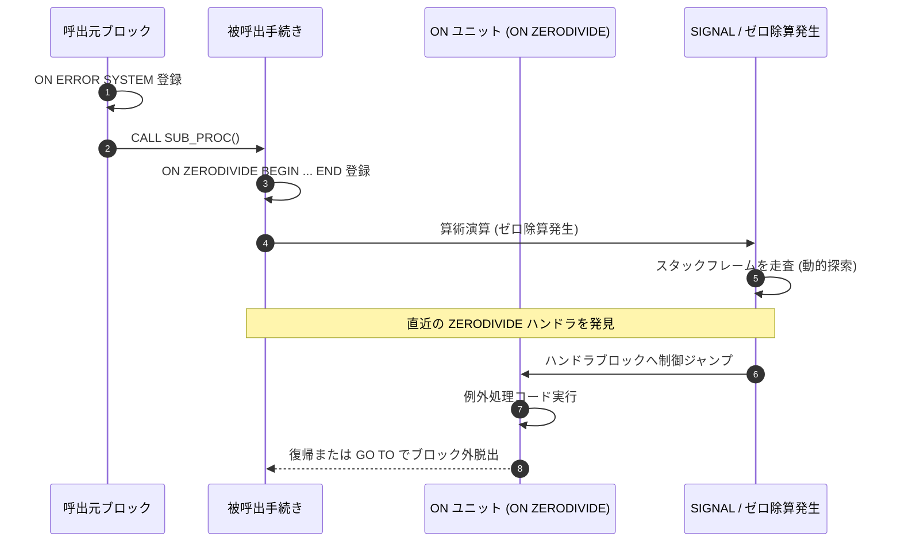

# Zeus における PL/I 統合アーキテクチャとコンパイラ・ランタイム詳細解説

本ドキュメントでは、**Zeus（Rust による z/OS アプリケーションランタイム）** における **Enterprise PL/I 処理系（`zeus-pli` / `zpli`）** について、独自コンパイラ・インタプリタの構造、z/OS 規格に準拠したデータ型・構造体写像、COBOL との実行単位（メモリ空間）統合アーキテクチャ、入出力システム、および例外処理（ON ユニット）の内部メカニズムを含めて詳細に解説します。

---

## 1. PL/I 処理系のアーキテクチャ概要

### 1.1 目的と独自処理系採用の理由
メインフレーム上の基幹システムでは、COBOL と並び IBM PL/I（Enterprise PL/I for z/OS）で記述されたバッチおよびオンライントランザクションが重要な業務ロジックを担っています。

GnuCOBOL プロジェクト（zosplus）では、PL/I ソースを C 言語へトランスパイルする `extras/pl1c` を採用していますが、Zeus では **「独立した Rust 製 PL/I コンパイラ・ランタイム（`crates/zeus-pli` / `zpli`）」** を独自開発しました。この理由は、PL/I が持つ以下の言語特性が、COBOL の静的実行モデルとは根本的に異なるためです:

1. **動的スタックフレームと再帰呼出し**:
   - `RECURSIVE` 手続き、ブロック単位の `AUTOMATIC` 記憶域、内部手続きから上位スコープへの静的チェーン参照。
2. **高度な記憶域クラス**:
   - `STATIC`, `AUTOMATIC`, `BASED`（ポインタ修飾 `P->VAR`）、`CONTROLLED`（`ALLOCATE` / `FREE` による世代スタック）。
3. **動的例外探索（ON ユニット）**:
   - 実行時のコールスタックを動的に遡り、最も近いスコープで登録された `ON <condition>` ハンドラを起動する仕組み。

### 1.2 全体アーキテクチャ構成図

```text
+--------------------------------------------------------------------------+
|                        PL/I ソースコード (.pli)                          |
|  *PROCESS MARGINS(2,72);                                                 |
|  MAIN: PROCEDURE OPTIONS(MAIN);                                          |
|      DECLARE 1 CUST_REC,                                                 |
|                2 ID FIXED BIN(31),                                       |
|                2 NAME CHAR(20),                                          |
|                2 BAL FIXED DEC(9,2);                                     |
|      PUT SKIP LIST('PROCESSED:', CUST_REC.NAME);                         |
|  END MAIN;                                                               |
+--------------------------------------------------------------------------+
                                     |
                                     v  [zpli compile / crates/zeus-pli]
+--------------------------------------------------------------------------+
| 1. コンパイル層 (zeus-pli: preproc.rs, sema/)                             |
|   - プリプロセッサ: MARGINS(2,72), %INCLUDE, マクロ文 (%DECLARE, %IF)    |
|   - 字句・構文解析: IBM Enterprise PL/I V5.3 文法 (クリーンルーム実装)     |
|   - 意味解析 & 型推論: 構造体ペアリング算法, RULES(IBM) 精度計算規則     |
|   - 型付き中間表現 (PL/I IR) の生成                                      |
+--------------------------------------------------------------------------+
                                     |
                                     v  [実行単位の記憶域共有: interlang::XRef]
+------------------------------------+-------------------------------------+
| 2. 実行時メモリ統合層 (Zeus VM アドレス空間)                                |
|   - STATIC 領域: モジュール初回ロード時に確保・INITIAL 初期化            |
|   - ヒープ領域: BASED / CONTROLLED 変数の ALLOCATE / FREE                |
|   - スタック領域: 256KB セグメント単位で AUTOMATIC 記憶域を割当て        |
|   - ゼロコピー引数渡し: COBOL LINKAGE ⇄ PL/I PARAMETER / BASED ポインタ   |
+------------------------------------+-------------------------------------+
                                     |
                                     v  [インタプリタ実行: vm/]
+--------------------------------------------------------------------------+
| 3. ランタイム実行エンジン (zeus-pli: vm/)                                 |
|   - 命令ディスパッチ: 算術演算, 比較, 暗黙型変換 (算術 ⇄ 文字 ⇄ ビット)   |
|   - レコード入出力: READ, WRITE, REWRITE, DELETE, LOCATE (順次, VSAM)     |
|   - ストリーム入出力: PUT / GET (LIST, EDIT, DATA), PRINT 書式制御       |
|   - 条件処理: ON, REVERT, SIGNAL, ONCODE / ONFILE 等の動的例外ハンドリング |
+--------------------------------------------------------------------------+
```

---

## 2. データ型表現とメモリ配置

Zeus の PL/I 処理系は、z/OS の内部データ配置（EBCDIC・ビッグエンディアン）とバイト単位で完全互換を保ちます。

### 2.1 主要データ型の内部表現

| PL/I データ型 | z/OS 内部配置 | Zeus での内部表現 |
| :--- | :--- | :--- |
| **`CHARACTER(n)`** | EBCDIC 生バイト列（固定長） | `Vec<u8>` (EBCDIC 037) |
| **`CHAR(n) VARYING`** | 2バイト長接頭部（ビッグエンディアン） + EBCDIC | `[len_hi, len_lo, data...]` |
| **`FIXED DECIMAL(p, q)`** | パック10進数（COMP-3 相当） | `zeus-decimal` クレートによるニブル管理 |
| **`FIXED BINARY(p)`** | 2の補数（`p<=15`: 2B, `p<=31`: 4B, `p<=63`: 8B） | ビッグエンディアン 16/32/64bit 整数 |
| **`FLOAT DECIMAL/BIN`** | IBM 16進浮動小数点（HFP: 単精度 4B, 倍精度 8B） | IBM HFP 形式のエミュレーション |
| **`BIT(n) ALIGNED`** | バイト境界に整列したビット列 | バイト単位配置 |
| **`BIT(n) UNALIGNED`**| ビット単位で連続して詰め込まれたビット列 | ビットオフセット管理 |
| **`POINTER`** | 31bit アドレス（4バイト）。NULL は `X'FF000000'` | 4バイトビッグエンディアン整数 |

### 2.2 構造体写像（ペアリング算法）
IBM の言語仕様書（*Enterprise PL/I for z/OS V5.3 Language Reference*）に定められた**ペアリング算法（Structure Mapping）**をビット単位で厳密に実装しています:
- 構造体メンバーは、自身の型の整列境界（ハーフワード、フルワード、ダブルワード境界）に従ってパディングが挿入されます。
- `ALIGNED` と `UNALIGNED` の混在、多層ネスト構造体、および `REFER` オプション（末尾可変長配列）を正しく計算します。

---

## 3. COBOL とのメモリ空間・相互呼出の統合

### 3.1 実行単位（Run-Unit）の記憶域共有
Zeus では、COBOL プログラムと PL/I プログラムが同一のジョブステップまたは CICS タスク内で相互に呼び出し合う際、**単一の共通アドレス空間（`zeus_cobol::vm::Machine` の記憶域）を共有**します。

1. **記憶域の貸し借り (`attach` / `detach`)**:
   PL/I モジュールが実行される際、COBOL VM のリニアメモリ空間を借用し、その中に `GETMAIN` 方式でモジュール領域を確保します:
   - **STATIC 領域**: モジュールごとに初回ロード時に永続確保。
   - **ヒープ領域**: `ALLOCATE` 文で確保される領域。
   - **スタック領域**: 256 KB のセグメントを必要に応じて伸張し、ブロック活性化ごとに `AUTOMATIC` 記憶域を配置。
2. **ゼロコピー引数渡し (`interlang::XRef`)**:
   - 言語間の引数渡しは、データのコピー＆書き戻し（Copy-in / Copy-back）を行わず、**メモリ上の絶対アドレス・長さ・境界情報を保持する `XRef` 構造体**を通じてポインタ渡しされます。
   - これにより、COBOL の `LINKAGE SECTION` と PL/I の `BASED` 変数が同一の物理バイト列を指し、一方の更新が他方へ即座に反映されます。

---

## 4. 入出力システム（ストリーム I/O & レコード I/O）

### 4.1 ストリーム入出力
- **`PUT / GET LIST(...)`**:
  空白区切りの簡易リスト入出力。PRINT ファイル時は IBM 既定のタブ位置（25, 49, 73, 97 桁目）へ自動整列。
- **`PUT / GET EDIT(...) (FORMAT)`**:
  高度な書式指定入出力（`A`, `F(w,d)`, `E(w,d)`, `P'picture'`, `X(n)`, `SKIP(n)`, `PAGE`, `COLUMN(n)`）。
- **`PUT / GET DATA(...)`**:
  変数名付き入出力（例: `VAR1=123 VAR2='ABC';`）。
- **`GET / PUT STRING(str)`**:
  インメモリ文字列に対するストリーム読み書き。

### 4.2 レコード入出力
順次データセット（FB/VB）および VSAM（KSDS / RRDS）に対する低レベル I/O をサポート:
- `READ FILE(...) INTO(...) KEY(...)`: キー指定読み込み。
- `WRITE FILE(...) FROM(...) KEYFROM(...)`: レコード挿入。
- `LOCATE based_var FILE(...)`:
  出力バッファに BASED 変数を直接マッピングし、後続の `LOCATE` またはファイルクローズ時にバッファ内容を書き出す高速 I/O。

---

## 5. 条件処理機構（ON ユニットと例外ディスパッチ）

PL/I の強力な例外処理（Condition Handling）を、Rust のスタック巻き戻しおよび動的探索エンジンによって再現しています:



- **組み込み条件**: `CONVERSION`, `FIXEDOVERFLOW`, `ZERODIVIDE`, `SIZE`, `ENDFILE`, `KEY`, `UNDEFINEDFILE`, `ERROR`, `FINISH`。
- **組み込み関数**: `ONCODE`, `ONFILE`, `ONKEY`, `ONLOC`, `ONSOURCE`, `ONCHAR` により、エラー発生位置と詳細コードを取得可能。

---

## 6. GnuCOBOL 方式（pl1c）との比較

| 比較項目 | Zeus (`zpli`) | GnuCOBOL (`extras/pl1c`) |
| :--- | :--- | :--- |
| **処理方式** | **Rust 製独自コンパイラ ＋ インタプリタ実行** | PL/I → C 言語トランスパイル ＋ GCC コンパイル |
| **記憶域モデル** | 実行単位メモリ統合（COBOL と同一アドレス空間） | C 言語ヒープ / スタック（ポインタ互換のみ） |
| **引数渡し** | `interlang::XRef` によるゼロコピー参照 | C 言語ポインタ渡し |
| **再帰・スタック** | 256KB セグメント型動的スタックフレーム | C 言語ネイティブのスタックフレーム |
| **例外処理** | インタプリタ内での動的 ON ユニット探索 | C 言語の `setjmp` / `longjmp` またはシグナル |
| **外部依存性** | ゼロ（Zeus 単一バイナリ内で完結） | GCC / Clang および C ランタイム |
