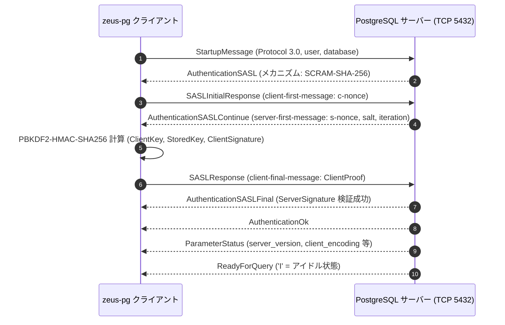

# Zeus における PostgreSQL 統合アーキテクチャとプロトコル変換詳細解説

本ドキュメントでは、**Zeus（Rust による z/OS アプリケーションランタイム）** における **PostgreSQL 統合アーキテクチャ（`zeus-pg` / `zeus-drda`）** について、Pure Rust による PostgreSQL フロントエンド/バックエンドプロトコル実装、DRDA-PostgreSQL 透過変換ブリッジ、EBCDIC 037 照合順序（Collation）ルール、および Db2 カタログ互換ビューの実装詳細を解説します。

---

## 1. PostgreSQL 統合のアーキテクチャ概要

### 1.1 目的と第2バックエンドの位置づけ
Zeus におけるリレーショナルデータベース連携は、IBM 公式の **Db2 Community Edition を第1バックエンド（標準オラクル）** としつつ、商用利用やクラウドでの運用コスト低減・ライセンスフリー化を目的として **オープンソースの PostgreSQL を第2バックエンド** としてサポートしています。

COBOL や PL/I のアプリケーションコード側には一切の変更（`EXEC SQL` 構文の変更など）を要求せず、Zeus ランタイム内部で **「Db2 向けの SQL および DRDA 通信を、PostgreSQL ネイティブのクエリおよびプロトコルへ透過的にブリッジする」** アーキテクチャを採用しています。

### 1.2 全体アーキテクチャ構成図

```text
+--------------------------------------------------------------------------+
|                  COBOL / PL/I アプリケーション (.cbl / .pli)              |
|  EXEC SQL SELECT ... FROM SYSIBM.SYSTABLES WHERE ... END-EXEC            |
+--------------------------------------------------------------------------+
                                     |
                                     v  [zcobc / zpli 実行時]
+--------------------------------------------------------------------------+
| 1. DRDA クライアント層 (zeus-drda)                                        |
|   - アプリケーションからは「Db2 (DRDA) サーバー」として認識              |
|   - SQLDA (SQL 記述子) およびホスト変数バインド処理                      |
+--------------------------------------------------------------------------+
                                     |
                                     v  [内部アダプタ切り替え: ZEUS_DB2_BACKEND=pg]
+--------------------------------------------------------------------------+
| 2. DRDA-to-PostgreSQL ブリッジ層 (zeus-drda / zeus-pg)                    |
|   - SQL 方言変換:                                                        |
|     * FETCH FIRST n ROWS ONLY ⇄ LIMIT n                                  |
|     * SYSIBM.* システムカタログ ⇄ pg_catalog ビューマッピング            |
|     * CURRENT TIMESTAMP, CURRENT DATE 関数名の互換正規化                 |
|   - プレースホルダー置換: Db2 型位置パラメータ ⇄ PostgreSQL $1, $2      |
+--------------------------------------------------------------------------+
                                     |
                                     v  [Pure Rust PostgreSQL プロトコル]
+--------------------------------------------------------------------------+
| 3. PostgreSQL クライアント層 (zeus-pg: lib.rs, scram.rs)                 |
|   - PostgreSQL Frontend/Backend Protocol 3.0 実装                        |
|   - 認証ハンドシェイク: SCRAM-SHA-256 / MD5 / クリアテキストパスワード    |
|   - 簡易クエリ ('Q') および 拡張クエリプロトコル ('P', 'B', 'E', 'S')    |
|   - コピーモード ('H', 'd', 'c') による高速バルクロード対応              |
+--------------------------------------------------------------------------+
                                     |
                                     v  [TCP/IP ソケット: ポート 5432]
+--------------------------------------------------------------------------+
| 4. PostgreSQL データベースサーバー                                        |
|   - EBCDIC 照合順序ルール適用 (tools/pg-ebcdic037.rules)                  |
|   - トランザクション制御 (BEGIN / COMMIT / ROLLBACK)                     |
+--------------------------------------------------------------------------+
```

---

## 2. Pure Rust PostgreSQL クライアントの実装 (`zeus-pg`)

Zeus は外部の C 言語ライブラリ（`libpq`）に依存せず、Rust でゼロから書かれた軽量な PostgreSQL クライアント（`crates/zeus-pg`）を内蔵しています。

### 2.1 接続・認証シーケンス (SCRAM-SHA-256)
`crates/zeus-pg/src/scram.rs` において、モダンな PostgreSQL の標準認証方式である **SCRAM-SHA-256**（RFC 7677 / RFC 5802）をネイティブ実装しています:



### 2.2 拡張クエリプロトコル（Prepared Statements）
SQL 実行では、PostgreSQL の **拡張クエリプロトコル（Extended Query Protocol）** を利用してパラメータ化クエリを実行します:
1. **Parse ('P')**: SQL テキストをパースし、ステートメント名を登録。
2. **Bind ('B')**: ホスト変数から抽出したパラメータ値をバイナリまたはテキスト形式でバインド。
3. **Describe ('D')**: 結果行のメタデータ（列数、型 OID、長さ）を取得。
4. **Execute ('E')**: クエリを実行し、行データ（DataRow 'D'）を受信。
5. **Sync ('S')**: パイプラインを同期し、トランザクション状態を確認。

---

## 3. EBCDIC 037 照合順序（Collation）の保証

### 3.1 文字コード順序の課題
メインフレームの基幹システムでは、文字列のソート順序や不等号比較（`WHERE CUST_CODE > 'A'` 等）が **IBM EBCDIC 037 のバイト順** に依存しています。
- **ASCII / UTF-8**: 数字（'0'〜'9': `0x30`〜`0x39`）＜ 英大文字（'A'〜'Z': `0x41`〜`0x5A`）
- **EBCDIC 037**: 英大文字（'A'〜'Z': `0xC1`〜`0xE9`）＜ 数字（'0'〜'9': `0xF0`〜`0xF9`）

PostgreSQL の既定の照合順序（`C` や `en_US.UTF-8`）でソートを行うと、数字と英字の前後関係が逆転し、業務ロジックやバッチ照合が破綻します。

### 3.2 `pg-ebcdic037.rules` による解決
Zeus では、リポジトリ内の `tools/pg-ebcdic037.rules` を利用して PostgreSQL にカスタム照合順序を登録・適用します:

```sql
-- EBCDIC 037 バイト値に基づくカスタム ICU 照合順序の定義
CREATE COLLATION ebcdic037 (
    provider = icu,
    rules = '& \u0000 < \u0001 ... < a < b ... < A < B ... < 0 < 1 < ...'
);
```

テーブル作成スクリプト（`tools/pg.sh`）において、検索・ソート対象の `VARCHAR` / `CHAR` 列に `COLLATE ebcdic037` を付与することで、PostgreSQL 上でもメインフレームと完全に同一のソート結果および範囲検索条件を再現します。

---

## 4. システムカタログ互換ビューの提供

CardDemo や Bank of Z では、データベースの存在確認や動的メタデータ取得のために `SYSIBM.SYSTABLES` や `SYSIBM.SYSCOLUMNS` に対する `SELECT` が行われます。

Zeus の PostgreSQL アダプタは、`tools/pg.sh` を通じて以下の Db2 互換ビュー群を自動生成します:

```sql
CREATE SCHEMA IF NOT EXISTS SYSIBM;

-- SYSIBM.SYSTABLES 互換ビュー
CREATE OR REPLACE VIEW SYSIBM.SYSTABLES AS
SELECT 
    schemaname AS CREATOR,
    tablename  AS NAME,
    'T'        AS TYPE
FROM pg_catalog.pg_tables;

-- SYSIBM.SYSCOLUMNS 互換ビュー
CREATE OR REPLACE VIEW SYSIBM.SYSCOLUMNS AS
SELECT 
    column_name AS NAME,
    table_name  AS TBNAME,
    table_schema AS TBCREATOR,
    data_type   AS COLTYPE,
    character_maximum_length AS LENGTH
FROM information_schema.columns;
```

これにより、COBOL ソース中の `EXEC SQL SELECT ... FROM SYSIBM.SYSTABLES` が修正なしでそのまま PostgreSQL に対して実行可能となります。

---

## 5. GnuCOBOL 方式との比較

| 比較項目 | Zeus (`zeus-pg` / `zeus-drda`) | GnuCOBOL (`extras/db2sql`) |
| :--- | :--- | :--- |
| **接続実装** | **Pure Rust による PostgreSQL 3.0 プロトコル実装** | `libpq` の C 言語動的リンク |
| **外部依存性** | **ゼロ（標準 TCP ソケットのみで完結）** | ホスト環境に `libpq-dev` / `libpq.so` が必要 |
| **認証方式** | SCRAM-SHA-256, MD5, パスワード | `libpq` の設定に依存 |
| **アーキテクチャ位置** | DRDA プロトコル層での透過ブリッジ | SQL プリプロセッサ / C ランタイム層での分岐 |
| **照合順序** | `pg-ebcdic037.rules` による EBCDIC バイト順再現 | PostgreSQL の設定またはアプリケーション層での対応 |
