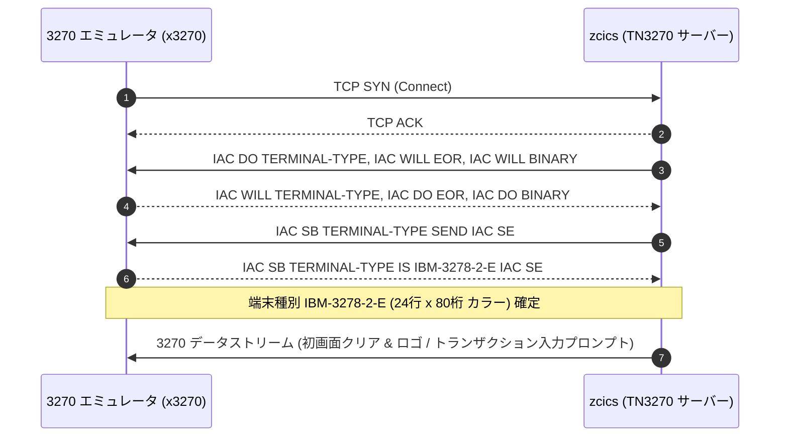
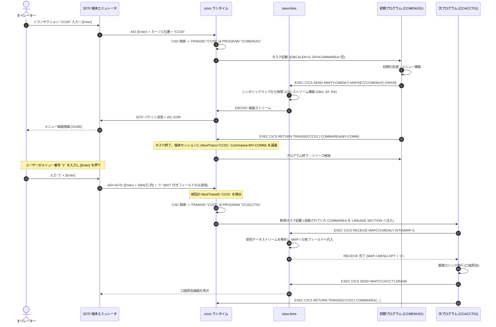

# Zeus における TN3270 / CICS オンライン処理シーケンス詳細ガイド

本ドキュメントでは、**Zeus（Rust による z/OS アプリケーションランタイム）** における **CICS オンライン処理エンジン（`zeus-cics` / `zcics`）** および **BMS マップ処理（`zeus-bms` / `zbms`）** について、内蔵 TN3270(E) サーバー、BMS データストリーム構築、TCB（Task Control Block）コルーチン実行モデル、疑似会話型（Pseudo-Conversational）トランザクション遷移、および実機エミュレータ端末との完全な通信シーケンスを詳細に解説します。

---

## 1. CICS / 3270 サブシステムのアーキテクチャ概要

### 1.1 目的と内蔵サーバー方式
メインフレームのオンライントランザクション業務（CardDemo, GenApp, Bank of Z 等）は、CICS（Customer Information Control System）上で稼働し、IBM 3270 表示端末（および TN3270 エミュレータ）を通じてユーザーと対話します。

Zeus の CICS 実装 **`zcics`** は、外部のゲートウェイやプロキシに頼ることなく、**「単一の Rust プロセス内に TN3270 / TN3270E サーバー、CICS リージョン、CSD リソース定義、BMS マッププロセッサを完全内蔵する」** アーキテクチャを採用しています。これにより、既存の x3270、c3270、IBM Personal Communications などの端末エミュレータから直接接続し、z/OS 実機と全く同じキータッチ・画面レスポンスで業務プログラムを実行できます。

### 1.2 全体アーキテクチャ構成図

```text
+--------------------------------------------------------------------------+
|                  IBM 3270 端末エミュレータ (x3270, c3270 等)              |
+--------------------------------------------------------------------------+
                                     │ TCP/IP 接続 (ポート 23 / 3270)
                                     ▼
+--------------------------------------------------------------------------+
| 1. 内蔵 TN3270(E) サーバー (zeus-cics / RFC 1576, RFC 2355)              |
|   - Telnet ネゴシエーション (IAC DO/DONT/WILL/WONT TERMINAL-TYPE, EOR)     |
|   - 3270E 拡張機能 (DEVICE-TYPE: IBM-3278-2-E, BIND, RESPONSES)           |
|   - EBCDIC ⇄ ASCII 画面文字・制御コード変換境界                           |
+--------------------------------------------------------------------------+
                                     │ 3270 データストリーム (SBA, SF, AID)
                                     ▼
+--------------------------------------------------------------------------+
| 2. BMS 画面処理サブシステム (zeus-bms: zbms)                              |
|   - BMS マクロ定義 (DFHMSD, DFHMDI, DFHMDF) の解析                        |
|   - 物理マップ (画面バッファへの命令列展開: SBA, SF, SFE, RA, IC, EUA)     |
|   - シンボリックマップ (COBOL COPY メンバ: 01 MAP-I, 01 MAP-O) 生成とマッピング|
|   - 入力デコード: 改変データタグ (MDT) 付きフィールドの抽出                |
+--------------------------------------------------------------------------+
                                     │ 入出力マップ構造体 / DFHEIBLK
                                     ▼
+--------------------------------------------------------------------------+
| 3. CICS タスク管理・実行エンジン (zeus-cics: zcics)                      |
|   - CSD (CICS System Definition) リソース管理: PROGRAM, TRANSACTION, FILE |
|   - TCB (Task Control Block) & コルーチンによる軽量タスクディスパッチ     |
|   - 疑似会話管理: NEXTTRANSID と COMMAREA / チャネルの端末セッション保持  |
|   - CICS API 実装:                                                       |
|     * EXEC CICS SEND MAP / RECEIVE MAP / SEND CONTROL                    |
|     * EXEC CICS LINK / XCTL / RETURN TRANSID                             |
|     * EXEC CICS READ / WRITE / STARTBR / READNEXT (VSAM 連携)            |
|     * EXEC CICS SYNCPOINT [ROLLBACK] (Db2 / IMS トランザクション連携)     |
+--------------------------------------------------------------------------+
                                     │ ZIR 命令実行
                                     ▼
+--------------------------------------------------------------------------+
| 4. COBOL / PL/I アプリケーション (例: CardDemo CCMENU01C 等)             |
+--------------------------------------------------------------------------+
```

---

## 2. TN3270(E) プロトコルネゴシエーション シーケンス

端末エミュレータが Zeus のポート 23（または指定ポート）に接続した際、以下の Telnet オプションネゴシエーションが行われます:



---

## 3. 疑似会話型（Pseudo-Conversational）トランザクション処理シーケンス

CICS の中核設計思想である**「疑似会話（Pseudo-Conversational）」**は、ユーザーが画面キーを入力している間はタスクを解放し、入力完了時（Enter やファンクションキー押下）にのみ新しいタスクを起動して直前の状態（COMMAREA）を引き継ぐモデルです。

### 3.1 詳細処理シーケンス図



---

## 4. BMS（Basic Mapping Support）と 3270 データストリーム

### 4.1 BMS マクロから物理・シンボリックマップへの展開
`crates/zeus-bms`（`zbms`）は、アセンブラで書かれた BMS マップ定義ソースを解析します:

```assembly
CCMENUS  DFHMSD TYPE=&SYSPARM,MODE=INOUT,LANG=COBOL,STORAGE=AUTO,      X
               CTRL=(FREEKB,FRSET),TERM=3270-2
CCMENU   DFHMDI SIZE=(24,80)
TITLE    DFHMDF POS=(1,25),ATTRB=(ASKIP,BRT),LENGTH=30,               X
               INITIAL='CREDIT CARD MANAGEMENT SYSTEM'
OPT      DFHMDF POS=(12,40),ATTRB=(UNPROT,NUM),LENGTH=1
         DFHMSD TYPE=FINAL
```

1. **シンボリックマップ（COBOL 登録集）の生成**:
   - 各フィールドに対して、入力構造体（`OPTL` [長さ], `OPTF` [フラグ], `OPTI` [データ]）および出力構造体（`OPTA` [属性], `OPTO` [データ]）を持つ COPY メンバを自動生成。
2. **物理マップ（3270 オーダー列）の生成**:
   - `SBA` (Set Buffer Address: `0x11` + 2バイトアドレス)
   - `SF` (Start Field: `0x1D` + 属性バイト)
   - `SFE` (Start Field Extended: `0x29` + カラー・強調属性)
   - `RA` (Repeat to Address: `0x3C` + アドレス + 繰り返し文字)
   - `IC` (Insert Cursor: `0x13`)

### 4.2 MDT（Modified Data Tag）による最小データ転送
3270 プロトコルの優れた特性である **MDT（改変データタグ）** を完全エミュレート:
- 画面全体を再送するのではなく、ユーザーがキーボードで値を変更したフィールド（MDT ビットが立ったフィールド）のアドレスとデータのみが端末から送信されます。
- `zeus-bms` は受信ストリーム内の `SBA` アドレスから該当フィールドを同定し、COBOL の入力シンボリックマップ構造体へ正確に値をセットします。

---

## 5. TCB コルーチンモデルとタスク制御

Zeus では、CICS のタスク並行実行を OS ネイティブスレッドではなく、**軽量なコルーチン（協調的マルチタスク / TCB）** で制御しています:
- `EXEC CICS LINK PROGRAM('SUBPROG') COMMAREA(...)`:
  現在のタスクコンテキストをスタックに退避し、同一アドレス空間内でサブルーチンプログラムを実行（復帰時に更新された COMMAREA を反映）。
- `EXEC CICS XCTL PROGRAM('NEXTPROG')`:
  カレントプログラムを終了し、同一タスクレベルで制御を新しいプログラムへ恒久移行（スタックを破棄）。
- `EXEC CICS SYNCPOINT`:
  Db2（DRDA）コミット、VSAM ダーティバッファ書き出し、TS キューのコミットを一括実行。

---

## 6. GnuCOBOL 方式（cobcics）との比較

| 比較項目 | Zeus (`zcics`) | GnuCOBOL (`cobcics`) |
| :--- | :--- | :--- |
| **TN3270 サーバー** | **Rust 製サーバー完全内蔵（直接接続可能）** | 外部エミュレータまたは簡易ソケットブリッジ |
| **3270E 拡張機能** | RFC 2355（BIND, DEVICE-TYPE）対応 | 基本 RFC 1576 サブセット |
| **タスク並行実行** | TCB コルーチンモデルによる軽量タスク管理 | OS プロセス / 単一スレッド実行 |
| **BMS マップ処理** | `zeus-bms` によるバイナリマップ展開 | Python 変換スクリプト + C ランタイム |
| **COMMAREA 保持** | インメモリ端末セッション管理 | プロセス引数または一時ファイル |
| **多言語対応** | **COBOL および PL/I の CICS 相互呼出** | COBOL のみ |
